<p align="right"><a href="README.md">🇪🇸 Español</a></p>

<p align="center">
  
</p>

<p align="center">
  
  
  
</p>

<h3 align="center">The repos reels make you "comment X" to get.<br>Here, free, verified and ready to install.</h3>

<p align="center">
  <a href="#new">🆕 New</a> ·
  <a href="#top">🔥 Top 5</a> ·
  <a href="#index">🧭 Index</a> ·
  <a href="#claude-picks">🤖 Let Claude pick</a> ·
  <a href="#add">🤝 Add a repo</a>
</p>

Every week, reels and videos show off dozens of "the repo that changes everything". Almost none share the link, and many ask you to "comment X and I'll DM it". **AllForOne** collects the ones that actually exist: every repo was looked up on GitHub, its README was read, and we wrote down **what it does, how to install it and where it was shown**.

> **Legend:** no mark = recommended · 🆕 = added in the last 7 days · ⚠️ = niche or heavy requirements · ⭐ refreshed on every update. Full cards (requirements, license, sources) and tips are in the [Spanish README](README.md).

<a id="new"></a>

## 🆕 New this week

| Repo | Area | What it does |
|---|---|---|
| **[debpalash/VoiceStudio](https://github.com/debpalash/VoiceStudio)** | 🆓 Free alternatives | VoiceStudio is the open-source, fully-local ElevenLabs alternative — voice cloning, voice design, video dubbing, dictation, transcription & audiobook creation in 646 languages. |
| **[AppFlowy-IO/AppFlowy](https://github.com/AppFlowy-IO/AppFlowy)** | 🆓 Free alternatives | Bring projects, wikis, and teams together with AI. AppFlowy is the AI collaborative workspace where you achieve more without losing control of your data. The leading open source Notion alternative. |
| **[aaif-goose/goose](https://github.com/aaif-goose/goose)** | 🤖 Agents & setup | an open source, extensible AI agent that goes beyond code suggestions - install, execute, edit, and test with any LLM |
| **[calcom/cal.diy](https://github.com/calcom/cal.diy)** | 🆓 Free alternatives | Scheduling infrastructure for absolutely everyone. |
| **[Donchitos/Claude-Code-Game-Studios](https://github.com/Donchitos/Claude-Code-Game-Studios)** | 🎮 Games | Turn Claude Code into a full game dev studio — 49 AI agents, 75 workflow skills, and a complete coordination system mirroring real studio hierarchy. |
| **[chatwoot/chatwoot](https://github.com/chatwoot/chatwoot)** | 🆓 Free alternatives | Open-source live-chat, email support, omni-channel desk. An alternative to Intercom, Zendesk, Salesforce Service Cloud etc. 🔥💬 |
| **[Anil-matcha/Open-Generative-AI](https://github.com/Anil-matcha/Open-Generative-AI)** | 🆓 Free alternatives | Uncensored AI Image & Video Generator — Free AI image & video generation studio with 800+ models (Flux, Midjourney, Kling, Sora, Veo). No content filters. Self-hosted, MIT licensed. |
| **[every-app/open-seo](https://github.com/every-app/open-seo)** | 🆓 Free alternatives | Open source alternative to Semrush and Ahrefs |

<a id="top"></a>

## 🔥 Top 5 by stars

| | Repo | ⭐ | What it does |
|:-:|---|:-:|---|
| 🥇 | **[stablyai/orca](https://github.com/stablyai/orca)** | 134.4k | Orca lets you run a fleet of bots with your own subscription (e.g. Claude Code, Grok, Agy, Codex). Available on desktop, mobile and remote runtime. |
| 🥈 | **[debpalash/VoiceStudio](https://github.com/debpalash/VoiceStudio)** | 117.1k | VoiceStudio is the open-source, fully-local ElevenLabs alternative — voice cloning, voice design, video dubbing, dictation, transcription & audiobook creation in 646 languages. |
| 🥉 | **[AppFlowy-IO/AppFlowy](https://github.com/AppFlowy-IO/AppFlowy)** | 79.4k | Bring projects, wikis, and teams together with AI. AppFlowy is the AI collaborative workspace where you achieve more without losing control of your data. The leading open source Notion alternative. |
| 4️⃣ | **[ghostty-org/ghostty](https://github.com/ghostty-org/ghostty)** | 64.4k | 👻 Ghostty is a fast, feature-rich, and cross-platform terminal emulator that uses platform-native UI and GPU acceleration. |
| 5️⃣ | **[ChromeDevTools/chrome-devtools-mcp](https://github.com/ChromeDevTools/chrome-devtools-mcp)** | 59k | Chrome DevTools for coding agents |

<a id="index"></a>

## 🧭 Index

| What do you want to do? | Jump to |
|---|---|
| 🎬 **[Create content](#contenido)**<br><sub>You edit video, audio, design or branding.</sub> | [🎬 Video & audio](#video) (5) · [🎨 Design & branding](#diseno) (1) |
| 💻 **[Code](#programar)**<br><sub>You build websites, apps or tools with agents.</sub> | [🌐 Web & frontend](#web) (2) · [📱 Mobile](#mobile) (2) · [🧪 Browser & QA](#navegador) (2) · [🤖 Agents & setup](#agentes) (10) |
| 🧠 **[Think & decide](#pensar)**<br><sub>You want to plan better or make a decision.</sub> | [🧠 Plan & decide](#planificar) (3) |
| 🆓 **[Save money](#ahorrar)**<br><sub>You want to stop paying for apps and go open source.</sub> | [🆓 Free alternatives](#alternativas) (9) |
| 🎮 **[Make games](#hacer-juegos)**<br><sub>You want to prototype a game from one sentence.</sub> | [🎮 Games](#juegos) (1) |

<p align="center"></p>

<a id="contenido"></a>

## 🎬 Create content

<sub>You edit video, audio, design or branding.</sub>

<a id="video"></a>

### 🎬 Video & audio

> Edit, score and record video with agents.

| Repo | ⭐ | Type | What it does | Install |
|---|:-:|---|---|---|
| **[browser-use/video-use](https://github.com/browser-use/video-use)** 🆕 | 31.5k | 🧩 skill | Edit videos with coding agents | `git clone` + link to `~/.claude/skills/video-use`; ffmpeg and API key from ElevenLabs |
| **[Leonxlnx/earshot](https://github.com/Leonxlnx/earshot)** 🆕 | 5.6k | 🔌 MCP | Sound effects for coding agents: ask in plain words and earshot renders the sound in code. CPU-only, no audio model, open source. | `uv tool install "earshot[mcp] @ git+https://github.com/Leonxlnx/earshot"`; uv and ffmpeg |
| **[Clipwing/skills](https://github.com/Clipwing/skills)** 🆕 | 187 | 🧩 skill | Claude Skills for video editing | copy `skills/real-sfx` to `~/.claude/skills/real-sfx/` |
| **[webadderallorg/Recordly](https://github.com/webadderallorg/Recordly)** 🆕 | 37.3k | 🛠️ app | Create polished demo videos without editing skills. Mac/Windows/Linux | installer from Releases |
| **[mojomast/open-higgsfield-skills](https://github.com/mojomast/open-higgsfield-skills)** ⚠️ 🆕 | 61 | 🗂️ collection | Agent-agnostic skills that turn one prompt into a video with open-weights ComfyUI workflows (LTX, FLUX Klein, Qwen, Wan) - video-director orchestrator + 35 skills. #OpenSourceHiggsfield | copy the skills; ComfyUI with to GPU of 16 GB or Colab |

<p align="center"></p>

<a id="diseno"></a>

### 🎨 Design & branding

> Logos, identity and icons with a designer's eye.

| Repo | ⭐ | Type | What it does | Install |
|---|:-:|---|---|---|
| **[kaankiziltug/logo-design-skill](https://github.com/kaankiziltug/logo-design-skill)** 🆕 | 7.6k | 🧩 skill | A comprehensive logo-design skill for Claude, Gemini CLI, Codex and other AI agents: principles, process, SVG craft, testing tools and a 1,400+ logo reference library. | `/plugin marketplace add kaankiziltug/logo-design-skill` + `/plugin install logo-design@logo-design-skill` |

<p align="center"></p>

<a id="programar"></a>

## 💻 Code

<sub>You build websites, apps or tools with agents.</sub>

<a id="web"></a>

### 🌐 Web & frontend

> Modern frontend and component systems, without the agent making things up.

| Repo | ⭐ | Type | What it does | Install |
|---|:-:|---|---|---|
| **[GoogleChrome/modern-web-guidance](https://github.com/GoogleChrome/modern-web-guidance)** 🆕 | 25.5k | 🧩 skill | Keep your coding agent up to date with the latest web best practices | `npx modern-web-guidance@latest install` |
| **[meta/astryx](https://github.com/meta/astryx)** 🆕 | 32.6k | 📚 library | An open source design system that's fully customizable and agent ready | `npm install @astryxdesign/core @astryxdesign/theme-neutral @stylexjs/stylex` |

<p align="center"></p>

<a id="mobile"></a>

### 📱 Mobile

> iOS and Android from Claude Code, with or without a Mac.

| Repo | ⭐ | Type | What it does | Install |
|---|:-:|---|---|---|
| **[anthropics/claude-plugins-official](https://github.com/anthropics/claude-plugins-official)** 🆕 | 48.1k | 🧷 plugin | Official, Anthropic-managed directory of high quality Claude Code Plugins. | `/plugin install xcode@claude-plugins-official`; Mac with Xcode |
| **[MobAI-App/ios-builder](https://github.com/MobAI-App/ios-builder)** 🆕 | 1.2k | ⌨️ CLI | Build and develop iOS apps without a Mac using GitHub Actions, Codemagic, or Bitrise, with simulator access and hot reload via MobAI. | binary from the README + `builder auth github` + `builder init` |

<p align="center"></p>

<a id="navegador"></a>

### 🧪 Browser & QA

> Let the agent drive the browser, debug and test like a person.

| Repo | ⭐ | Type | What it does | Install |
|---|:-:|---|---|---|
| **[microsoft/playwright-mcp](https://github.com/microsoft/playwright-mcp)** 🆕 | 40.1k | 🔌 MCP | Playwright MCP server | see README |
| **[ChromeDevTools/chrome-devtools-mcp](https://github.com/ChromeDevTools/chrome-devtools-mcp)** 🆕 | 59k | 🔌 MCP | Chrome DevTools for coding agents | see README |

<p align="center"></p>

<a id="agentes"></a>

### 🤖 Agents & setup

> Run several agents, install skills and set up your terminal.

| Repo | ⭐ | Type | What it does | Install |
|---|:-:|---|---|---|
| **[stablyai/orca](https://github.com/stablyai/orca)** 🆕 | 134.4k | 🛠️ app | Orca lets you run a fleet of bots with your own subscription (e.g. Claude Code, Grok, Agy, Codex). Available on desktop, mobile and remote runtime. | installer from onorca.dev; skill: `npx skills add https://github.com/stablyai/orca --skill orca-cli` |
| **[vercel-labs/skills](https://github.com/vercel-labs/skills)** 🆕 | 40.6k | ⌨️ CLI | The open agent skills tool - npx skills | `npx skills add <repo> --skill <nombre>` |
| **[ghostty-org/ghostty](https://github.com/ghostty-org/ghostty)** 🆕 | 64.4k | 🛠️ app | 👻 Ghostty is a fast, feature-rich, and cross-platform terminal emulator that uses platform-native UI and GPU acceleration. | see README |
| **[herdrdev/herdr](https://github.com/herdrdev/herdr)** ⚠️ 🆕 | 52.5k | 🛠️ app | the runtime your coding agents live on | see README |
| **[paperclipai/paperclip](https://github.com/paperclipai/paperclip)** ⚠️ 🆕 | 116.3k | 🛠️ app | The open-source app everyone uses to manage agents at work | see README |
| **[alacritty/alacritty](https://github.com/alacritty/alacritty)** ⚠️ 🆕 | 66.3k | 🛠️ app | A cross-platform, OpenGL terminal emulator. | see README |
| **[NousResearch/hermes-agent](https://github.com/NousResearch/hermes-agent)** ⚠️ 🆕 | 265.7k | 🤖 agent | The agent that grows with you | see README |
| **[cloudflare/agents](https://github.com/cloudflare/agents)** 🆕 | 6k | 📚 library | Build and deploy AI Agents on Cloudflare | `npm install @cloudflare/codemode` |
| **[aaif-goose/goose](https://github.com/aaif-goose/goose)** 🆕 | 56.9k | 🤖 agent | an open source, extensible AI agent that goes beyond code suggestions - install, execute, edit, and test with any LLM | see README |
| **[midudev/better-claude](https://github.com/midudev/better-claude)** 🆕 | 291 | 🧷 plugin | Small plugins and mods that make your life (and Claude Code) better | `/plugin marketplace add midudev/better-claude` + install each plugin |

<p align="center"></p>

<a id="pensar"></a>

## 🧠 Think & decide

<sub>You want to plan better or make a decision.</sub>

<a id="planificar"></a>

### 🧠 Plan & decide

> Think before you build: advisor councils, context-free reviewers, plans that defend themselves.

| Repo | ⭐ | Type | What it does | Install |
|---|:-:|---|---|---|
| **[google/elephant-goldfish-model](https://github.com/google/elephant-goldfish-model)** 🆕 | 22.4k | 🧷 plugin | Open-source plugin for designing and reviewing software with agents | `claude plugin marketplace add google/elephant-goldfish-model` + `claude plugin install egm@egm` |
| **[aiwithremy/claude-skills-llm-council](https://github.com/aiwithremy/claude-skills-llm-council)** 🆕 | 3.3k | 🧩 skill | LLM Council — a Claude Code skill that runs your decisions through 5 AI advisors with peer review | copy SKILL.md to `~/.claude/skills/llm-council/` |
| **[tenfoldmarc/llm-council-skill](https://github.com/tenfoldmarc/llm-council-skill)** 🆕 | 1.1k | 🧩 skill | The 5-advisor LLM Council adapted to Claude Code subagents: parallel advisors, anonymous peer review and a chairman verdict with one next step. | `git clone https://github.com/tenfoldmarc/llm-council-skill ~/.claude/skills/llm-council` |

<p align="center"></p>

<a id="ahorrar"></a>

## 🆓 Save money

<sub>You want to stop paying for apps and go open source.</sub>

<a id="alternativas"></a>

### 🆓 Free alternatives

> Open-source apps to stop paying subscriptions: voice, SEO, notes, scheduling, support and more.

| Repo | ⭐ | Type | What it does | Install |
|---|:-:|---|---|---|
| **[Anil-matcha/Open-Generative-AI](https://github.com/Anil-matcha/Open-Generative-AI)** 🆕 | 36k | 🛠️ app | Uncensored AI Image & Video Generator — Free AI image & video generation studio with 800+ models (Flux, Midjourney, Kling, Sora, Veo). No content filters. Self-hosted, MIT licensed. | see README |
| **[debpalash/VoiceStudio](https://github.com/debpalash/VoiceStudio)** 🆕 | 117.1k | 🛠️ app | VoiceStudio is the open-source, fully-local ElevenLabs alternative — voice cloning, voice design, video dubbing, dictation, transcription & audiobook creation in 646 languages. | see README |
| **[every-app/open-seo](https://github.com/every-app/open-seo)** 🆕 | 28.7k | 🛠️ app | Open source alternative to Semrush and Ahrefs | see README |
| **[AppFlowy-IO/AppFlowy](https://github.com/AppFlowy-IO/AppFlowy)** 🆕 | 79.4k | 🛠️ app | Bring projects, wikis, and teams together with AI. AppFlowy is the AI collaborative workspace where you achieve more without losing control of your data. The leading open source Notion alternative. | installers at appflowy.com |
| **[OpenWhispr/openwhispr](https://github.com/OpenWhispr/openwhispr)** 🆕 | 12.1k | 🛠️ app | Voice-to-text dictation app with local (Nvidia Parakeet/Whisper) and cloud models (BYOK). Privacy-first and available cross-platform. | installers at openwhispr.com |
| **[opf/openproject](https://github.com/opf/openproject)** 🆕 | 17.7k | 🛠️ app | OpenProject is the leading open source project management software for product, project and portfolio management. A powerful Jira alternative with agile planning, issue tracking, roadmaps, Gantt charts, time tracking, collaboration features, and more. Available on premises or in the cloud. ⭐ Star us on GitHub | see README |
| **[calcom/cal.diy](https://github.com/calcom/cal.diy)** 🆕 | 50.3k | 🛠️ app | Scheduling infrastructure for absolutely everyone. | see README |
| **[chatwoot/chatwoot](https://github.com/chatwoot/chatwoot)** 🆕 | 40.4k | 🛠️ app | Open-source live-chat, email support, omni-channel desk. An alternative to Intercom, Zendesk, Salesforce Service Cloud etc. 🔥💬 | see README |
| **[CapSoftware/Cap](https://github.com/CapSoftware/Cap)** 🆕 | 25.5k | 🛠️ app | Open source Loom alternative. Beautiful, shareable screen recordings. | installers at cap.so |

<p align="center"></p>

<a id="hacer-juegos"></a>

## 🎮 Make games

<sub>You want to prototype a game from one sentence.</sub>

<a id="juegos"></a>

### 🎮 Games

> From one sentence to a playable game.

| Repo | ⭐ | Type | What it does | Install |
|---|:-:|---|---|---|
| **[Donchitos/Claude-Code-Game-Studios](https://github.com/Donchitos/Claude-Code-Game-Studios)** 🆕 | 40.7k | 🗂️ collection | Turn Claude Code into a full game dev studio — 49 AI agents, 75 workflow skills, and a complete coordination system mirroring real studio hierarchy. | `git clone https://github.com/Donchitos/Claude-Code-Game-Studios.git <juego>` + `/prototype <idea>` |

<p align="center"></p>

<a id="claude-picks"></a>

## 🤖 Let Claude pick for you

The [`allforone`](skills/allforone/SKILL.md) skill reads this catalog, picks what fits your project, checks every repo is still alive and proposes what to install. **It installs nothing you didn't choose.**

```bash
npx skills add Hutchy147/AllForOne --skill allforone
```

Then, in Claude Code:

```text
/allforone I want to build a Next.js landing page and record a demo video
```

<a id="add"></a>

## 🤝 Add a repo

Found something missing? Open an [issue with the "Sumar un repo" template](../../issues/new?template=sumar-repo.yml) with the link and where you saw it. Every suggestion is checked on GitHub before it's added.

## 🎥 Sources

Thanks to the creators who showed them first: [@_mati.alvez](https://www.instagram.com/reel/DgESYOCNWwV/) · [@agustin.ruppel](https://www.instagram.com/reel/DeUP-4pl-9f/) · [@aldopaucaria](https://www.instagram.com/reel/Df41R_HpUxD/) · [@aldopaucaria](https://www.instagram.com/reel/Dfzrv8tDyCQ/) · [@antonspain_ia](https://www.instagram.com/reel/Df_pUWqHI1r/) · [@cromeda.studio](https://www.instagram.com/reel/DgE5qQSgOzx/) · [@francisco__miranda](https://www.instagram.com/reel/Df0kGBPMuUD/) · [@gitrepo.es](https://www.instagram.com/reel/Df67F0rAplI/) · [@gitrepo.es](https://www.instagram.com/reel/DfcBko1k1ND/) · [@jamessotovalle](https://www.instagram.com/reel/DgEa2GIxoyb/) · [@javiniguezoficial](https://www.instagram.com/reel/DfuTCPWKo21/) · [@javiniguezoficial](https://www.instagram.com/reel/DZmxlSkKmbP/) · [@lynxstudiosbcn](https://www.instagram.com/reel/DfvXi6KERBK/) · [@midu.dev](https://www.instagram.com/reel/DfzxGd3AilI/) · [@midu.dev](https://www.instagram.com/reel/DeroLlfiFNh/) · [@noticiasde.ia](https://www.instagram.com/reel/Df1iZaSOzvS/) · [@nzstudio__._](https://www.instagram.com/reel/Dft2BG2DQhE/) · [@relyviews](https://www.instagram.com/reel/DffWecwjyDx/) · [@ux.jonathan](https://www.instagram.com/reel/Dfp8ogTTqmi/) · [▶ Claude Code Edits Your Videos Now — video-use (17.5K⭐ Git…](https://www.youtube.com/watch?v=TkjEZEA84Go) · [▶ Orca: la app open source que une TODOS tus agentes de IA …](https://www.youtube.com/watch?v=ze7AgvWfRwM) · [▶ Probando Orca ADE: Cómo programar con MÚLTIPLES Agentes d…](https://www.youtube.com/watch?v=KbOKUlUd9mA)

<p align="center"></p>

<p align="center"><b>All for one, one for all.</b><br>Every ⭐ helps this reach someone who's commenting "REPO" under a reel right now.<br>If it saved you time, <a href="https://github.com/Hutchy147/AllForOne">star it</a> and turn on <i>Watch → Custom → Releases</i> to hear about new additions.</p>
