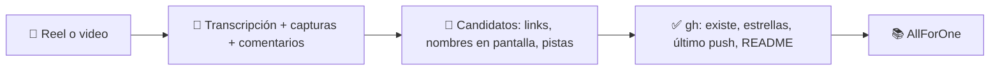

<p align="center">
  
</p>

<p align="center">
  
  
  
  
</p>

<h3 align="center">Uno para todos: las skills, plugins, MCPs y herramientas para Claude Code<br>que vale la pena conocer, verificados y listos para instalar.</h3>

<p align="center">
  <a href="#rapido">⚡ En 30 segundos</a> ·
  <a href="#indice">🧭 Índice</a> ·
  <a href="#claude-elige">🤖 Que Claude elija</a> ·
  <a href="#metodo">🔍 Cómo se verifica</a> ·
  <a href="#sumar">🤝 Sumar un repo</a>
</p>

<p align="center"></p>

Cada semana aparecen en reels y videos decenas de «el repo que cambia todo». Casi ninguno da el link, y muchos piden «comentá X y te lo mando». **AllForOne** junta los que existen de verdad: cada repo se buscó en GitHub, se leyó su README y se anotó **para qué sirve, cómo se instala y dónde se vio**.

<a id="rapido"></a>

## ⚡ En 30 segundos

1. **Elegí qué querés hacer** en el [índice](#indice): crear contenido, programar, pensar y decidir o hacer juegos.
2. **Abrí la ficha** de cada repo: qué hace, cómo se instala, requisitos, licencia y dónde se vio.
3. **¿Arrancás un proyecto?** Instalá la skill [`allforone`](#claude-elige) y Claude te arma la lista según lo que vayas a hacer.

> **Leyenda:** sin marca = recomendado · ⚠️ = sirve en casos puntuales o tiene requisitos pesados · las ⭐ se actualizan en cada publicación.

<a id="indice"></a>

## 🧭 Índice

### Por lo que querés hacer

| ¿Qué querés hacer? | Andá directo a |
|---|---|
| 🎬 **[Crear contenido](#contenido)**<br><sub>Editás video, audio, diseño o marca.</sub> | [🎬 Video y audio](#video) (5) · [🎨 Diseño y marca](#diseno) (1) |
| 💻 **[Programar](#programar)**<br><sub>Hacés webs, apps o herramientas con agentes.</sub> | [🌐 Web y frontend](#web) (2) · [📱 Mobile](#mobile) (2) · [🧪 Navegador y QA](#navegador) (2) · [🤖 Agentes y entorno](#agentes) (10) |
| 🧠 **[Pensar y decidir](#pensar)**<br><sub>Querés planificar mejor o tomar una decisión.</sub> | [🧠 Planificar y decidir](#planificar) (3) |
| 🆓 **[Ahorrar](#ahorrar)**<br><sub>Querés dejar de pagar apps y usar open source.</sub> | [🆓 Alternativas gratis](#alternativas) (9) |
| 🎮 **[Hacer juegos](#hacer-juegos)**<br><sub>Querés prototipar un juego desde una frase.</sub> | [🎮 Juegos](#juegos) (1) |

<details>
<summary><b>Ver todas las áreas</b></summary>

| | Área | Repos | Tips |
|---|---|:-:|:-:|
| 🎬 | [**Video y audio**](#video) — Editar, sonorizar y grabar video con agentes. | 5 | 4 |
| 🎨 | [**Diseño y marca**](#diseno) — Logos, identidad e íconos con criterio de diseñador. | 1 | 1 |
| 🌐 | [**Web y frontend**](#web) — Frontend moderno y sistemas de componentes, sin que el agente invente. | 2 | 3 |
| 📱 | [**Mobile**](#mobile) — iOS y Android desde Claude Code, con o sin Mac. | 2 | 3 |
| 🧪 | [**Navegador y QA**](#navegador) — Que el agente maneje el navegador, depure y pruebe como una persona. | 2 | 0 |
| 🤖 | [**Agentes y entorno**](#agentes) — Correr varios agentes, instalar skills y armar tu terminal. | 10 | 8 |
| 🧠 | [**Planificar y decidir**](#planificar) — Pensar antes de construir: consejos de asesores, revisores sin contexto, planes que se defienden solos. | 3 | 4 |
| 🆓 | [**Alternativas gratis**](#alternativas) — Apps open source para dejar de pagar suscripciones: voz, SEO, notas, agenda, soporte y más. | 9 | 0 |
| 🎮 | [**Juegos**](#juegos) — De una frase a un juego jugable. | 1 | 2 |

</details>

<p align="center"></p>

<a id="contenido"></a>

## 🎬 Crear contenido

<sub>Editás video, audio, diseño o marca.</sub>

<a id="video"></a>

### 🎬 Video y audio

> Editar, sonorizar y grabar video con agentes.

| Repo | ⭐ | Tipo | Para qué sirve |
|---|:-:|---|---|
| **[browser-use/video-use](https://github.com/browser-use/video-use)** | 31.5k | 🧩 skill | Editar video con Claude Code a partir del material en bruto (cortes, color, subtítulos, autoevaluación) |
| **[Leonxlnx/earshot](https://github.com/Leonxlnx/earshot)** | 5.6k | 🔌 MCP | Que el agente escuche, mida y genere sonido (SFX desde código, crítica de mezcla); trae la skill real-sound |
| **[Clipwing/skills](https://github.com/Clipwing/skills)** | 187 | 🧩 skill | Real SFX: pone grabaciones reales en el cuadro exacto de un video (más otras skills de edición) |
| **[webadderallorg/Recordly](https://github.com/webadderallorg/Recordly)** | 37.3k | 🛠️ otro | App para grabar demos de pantalla pulidas (zoom en los clics, marco, línea de tiempo) |
| **[mojomast/open-higgsfield-skills](https://github.com/mojomast/open-higgsfield-skills)** ⚠️ | 61 | 🗂️ colección | 37 skills para que el agente dirija un video entero con ComfyUI (FLUX, LTX, voz); pide GPU de 16 GB o Colab |

<details>
<summary>📖 <b>browser-use/video-use</b> — ficha completa</summary>

**Qué hace:** Edita video desde Claude Code a partir del material en bruto: corta muletillas y silencios, hace color grading, quema subtítulos, agrega fades y revisa su propio render con un «critic loop» antes de entregar el video final.

**Cómo se instala:** `git clone` + link a `~/.claude/skills/video-use`; ffmpeg y API key de ElevenLabs

**Requisitos:** ffmpeg y una API key de ElevenLabs para transcribir (paga aparte).

⭐ 31.5k · 🧩 skill · 📄 MIT · 🌐 [web](https://video-use.com) · 🐙 [GitHub](https://github.com/browser-use/video-use)

🎥 Visto en: [▶ Claude Code Edits Your Videos Now — video-use (17.5K⭐ Git…](https://www.youtube.com/watch?v=TkjEZEA84Go)

</details>
<details>
<summary>📖 <b>Leonxlnx/earshot</b> — ficha completa</summary>

**Qué hace:** Le da «oídos» al agente: describe, mide y critica audio, y genera efectos de sonido desde código con `earshot forge` y kits de sonido. Corre en CPU, sin modelo de audio. Trae la skill `real-sound` para armar una banda sonora con grabaciones reales con licencia.

**Cómo se instala:** `uv tool install "earshot[mcp] @ git+https://github.com/Leonxlnx/earshot"`; uv y ffmpeg

**Requisitos:** uv y ffmpeg.

⭐ 5.6k · 🔌 MCP · 📄 MIT · 🌐 [web](https://leonxlnx.github.io/earshot-site/) · 🐙 [GitHub](https://github.com/Leonxlnx/earshot)

🎥 Visto en: [@francisco__miranda](https://www.instagram.com/reel/Df0kGBPMuUD/), [@nzstudio__._](https://www.instagram.com/reel/Dft2BG2DQhE/)

</details>
<details>
<summary>📖 <b>Clipwing/skills</b> — ficha completa</summary>

**Qué hace:** Skills de edición de video. La estrella es «Real SFX»: busca los momentos del video que necesitan sonido y pone grabaciones reales en el cuadro exacto.

**Cómo se instala:** copiar `skills/real-sfx` a `~/.claude/skills/real-sfx/`

**Requisitos:** Claude Code; ffmpeg.

⭐ 187 · 🧩 skill · 📄 sin declarar · 🐙 [GitHub](https://github.com/Clipwing/skills)

🎥 Visto en: [@francisco__miranda](https://www.instagram.com/reel/Df0kGBPMuUD/), [@nzstudio__._](https://www.instagram.com/reel/Dft2BG2DQhE/)

</details>
<details>
<summary>📖 <b>webadderallorg/Recordly</b> — ficha completa</summary>

**Qué hace:** App de escritorio para grabar demos de pantalla que quedan pulidas sin editar: zoom automático en cada clic, mouse suavizado, marco con fondo y sombra, línea de tiempo para recortar y acelerar, y burbuja con la cámara.

**Cómo se instala:** instalador de Releases

**Requisitos:** Mac, Windows o Linux.

⭐ 37.3k · 🛠️ otro · 📄 AGPL-3.0 · 🌐 [web](https://recordly.dev) · 🐙 [GitHub](https://github.com/webadderallorg/Recordly)

🎥 Visto en: [@agustin.ruppel](https://www.instagram.com/reel/DeUP-4pl-9f/)

</details>
<details>
<summary>📖 <b>mojomast/open-higgsfield-skills</b> — ficha completa</summary>

**Qué hace:** 37 skills para que el agente dirija un video entero con modelos abiertos: `video-director` planifica, genera imágenes con FLUX, anima con LTX o Wan, suma voz y subtítulos, y lo arma con workflows de ComfyUI.

**Cómo se instala:** copiar las skills; ComfyUI con GPU de 16 GB o Colab

**Requisitos:** Servidor ComfyUI con GPU de 16 GB o más (o Google Colab) y los pesos de los modelos.

⭐ 61 · 🗂️ colección · 📄 propia (revisar antes de usar) · 🐙 [GitHub](https://github.com/mojomast/open-higgsfield-skills)

🎥 Visto en: [@lynxstudiosbcn](https://www.instagram.com/reel/DfvXi6KERBK/)

</details>

<details>
<summary><b>💡 4 tips de video y audio</b></summary>

- «Critic loop»: que el agente mire su propio resultado, le ponga un puntaje y lo rehaga antes de mostrarlo. Se puede reusar en cualquier skill. <sub>[fuente](https://www.youtube.com/watch?v=TkjEZEA84Go)</sub>
- Claude no oye: con un MCP de audio puede medir y criticar la mezcla de un video que arma. <sub>[fuente](https://www.instagram.com/reel/Df0kGBPMuUD/)</sub>
- La API de [Openverse](https://openverse.org) es pública y sin clave: cualquier agente con shell puede buscar y bajar audio CC0. <sub>[fuente](https://www.instagram.com/reel/Dft2BG2DQhE/)</sub>
- Para grabar demos sin editar a mano: una app que hace zoom en los clics y arma la línea de tiempo sola. <sub>[fuente](https://www.instagram.com/reel/DeUP-4pl-9f/)</sub>

</details>

<p align="center"></p>

<a id="diseno"></a>

### 🎨 Diseño y marca

> Logos, identidad e íconos con criterio de diseñador.

| Repo | ⭐ | Tipo | Para qué sirve |
|---|:-:|---|---|
| **[kaankiziltug/logo-design-skill](https://github.com/kaankiziltug/logo-design-skill)** | 7.6k | 🧩 skill | Diseño de logos con brief, 3 conceptos, pruebas a 16 px y export de favicon e íconos |

<details>
<summary>📖 <b>kaankiziltug/logo-design-skill</b> — ficha completa</summary>

**Qué hace:** Convierte al agente en diseñador de logos: arma un brief, propone 3 conceptos y frena para que elijas. Trae una biblioteca de más de 1.400 logos SVG de referencia para no copiar, prueba cada logo a 16 px, en un color y junto a la competencia, y exporta favicon e íconos de app.

**Cómo se instala:** `/plugin marketplace add kaankiziltug/logo-design-skill` + `/plugin install logo-design@logo-design-skill`

**Requisitos:** Claude Code, Gemini CLI, Codex u otro agente con skills.

⭐ 7.6k · 🧩 skill · 📄 MIT · 🐙 [GitHub](https://github.com/kaankiziltug/logo-design-skill)

🎥 Visto en: [@gitrepo.es](https://www.instagram.com/reel/DfcBko1k1ND/)

</details>

<details>
<summary><b>💡 1 tips de diseño y marca</b></summary>

- El patrón «propone 3 conceptos y se detiene a que elijas» sirve para cualquier skill de diseño. <sub>[fuente](https://www.instagram.com/reel/DfcBko1k1ND/)</sub>

</details>

<p align="center"></p>

<a id="programar"></a>

## 💻 Programar

<sub>Hacés webs, apps o herramientas con agentes.</sub>

<a id="web"></a>

### 🌐 Web y frontend

> Frontend moderno y sistemas de componentes, sin que el agente invente.

| Repo | ⭐ | Tipo | Para qué sirve |
|---|:-:|---|---|
| **[GoogleChrome/modern-web-guidance](https://github.com/GoogleChrome/modern-web-guidance)** | 25.5k | 🧩 skill | Que el agente escriba frontend moderno y no patrones viejos; `legacy-scan` audita un repo |
| **[meta/astryx](https://github.com/meta/astryx)** | 32.6k | 📚 librería | Sistema de diseño React de Meta (más de 150 componentes) pensado para agentes |

<details>
<summary>📖 <b>GoogleChrome/modern-web-guidance</b> — ficha completa</summary>

**Qué hace:** Le da al agente guías actualizadas de la plataforma web para que no escriba código viejo: `dialog.showModal()` en vez de modales con jQuery, `grid` en vez de `float`, `popover` en vez de tooltips en JS. Incluye `legacy-scan`, que encuentra patrones viejos en un repo.

**Cómo se instala:** `npx modern-web-guidance@latest install`

**Requisitos:** Node. Manda telemetría; se apaga con `DISABLE_TELEMETRY=1`.

⭐ 25.5k · 🧩 skill · 📄 Apache-2.0 · 🌐 [web](https://goo.gle/modern-web-guidance) · 🐙 [GitHub](https://github.com/GoogleChrome/modern-web-guidance)

🎥 Visto en: [@midu.dev](https://www.instagram.com/reel/DfzxGd3AilI/)

</details>
<details>
<summary>📖 <b>meta/astryx</b> — ficha completa</summary>

**Qué hace:** Sistema de diseño de Meta en React y StyleX: más de 150 componentes, plantillas, modo oscuro y temas. La API, la documentación y una CLI están pensadas para que las use un agente sin inventar componentes.

**Cómo se instala:** `npm install @astryxdesign/core @astryxdesign/theme-neutral @stylexjs/stylex`

**Requisitos:** Proyecto React; StyleX.

⭐ 32.6k · 📚 librería · 📄 MIT · 🌐 [web](http://astryx.atmeta.com) · 🐙 [GitHub](https://github.com/meta/astryx)

🎥 Visto en: [@javiniguezoficial](https://www.instagram.com/reel/DfuTCPWKo21/)

</details>

<details>
<summary><b>💡 3 tips de web y frontend</b></summary>

- `npx modern-web-guidance@latest legacy-scan .` encuentra APIs y patrones viejos en un repo sin instalar nada. Manda telemetría: se apaga con `DISABLE_TELEMETRY=1`. <sub>[fuente](https://www.instagram.com/reel/DfzxGd3AilI/)</sub>
- Una CLI de componentes (como la de Astryx) le da al agente la referencia real, para que no invente props. <sub>[fuente](https://www.instagram.com/reel/DfuTCPWKo21/)</sub>
- Para que una web aparezca en Google: Google Analytics, ficha de Google Business Profile, pedir la indexación en Search Console, sitemap y un dominio propio. <sub>[fuente](https://www.instagram.com/reel/DffWecwjyDx/)</sub>

</details>

<p align="center"></p>

<a id="mobile"></a>

### 📱 Mobile

> iOS y Android desde Claude Code, con o sin Mac.

| Repo | ⭐ | Tipo | Para qué sirve |
|---|:-:|---|---|
| **[anthropics/claude-plugins-official](https://github.com/anthropics/claude-plugins-official)** (`xcode`) | 48.1k | 🧷 plugin | Plugin oficial de Apple: Claude compila, testea y lee errores de Xcode (solo con Mac) |
| **[MobAI-App/ios-builder](https://github.com/MobAI-App/ios-builder)** | 1.2k | ⌨️ CLI | Compilar apps iOS (nativo, RN, Expo, Flutter) desde Windows o Linux con una Mac en la nube |

<details>
<summary>📖 <b>anthropics/claude-plugins-official</b> — ficha completa</summary>

**Qué hace:** El directorio oficial de plugins de Anthropic. El plugin `xcode` deja que Claude compile, corra y testee esquemas, renderice previews de SwiftUI, maneje simuladores y dispositivos, lea los logs de build y busque en la documentación de Apple.

**Cómo se instala:** `/plugin install xcode@claude-plugins-official`; Mac con Xcode

**Requisitos:** Mac con Xcode actualizado, el proyecto abierto y «permitir agentes externos» activado en Xcode.

⭐ 48.1k · 🧷 plugin · 📄 Apache-2.0 · 🌐 [web](https://code.claude.com/docs/en/plugins) · 🐙 [GitHub](https://github.com/anthropics/claude-plugins-official)

🎥 Visto en: [@noticiasde.ia](https://www.instagram.com/reel/Df1iZaSOzvS/)

</details>
<details>
<summary>📖 <b>MobAI-App/ios-builder</b> — ficha completa</summary>

**Qué hace:** Compila apps iOS desde Windows o Linux usando una Mac en la nube (GitHub Actions, Codemagic o Bitrise) y devuelve el `.ipa`. Soporta Swift, React Native, Expo, Flutter y Cordova/Ionic, con firma opcional, instalación por QR sin TestFlight y hot reload.

**Cómo se instala:** binario del README + `builder auth github` + `builder init`

**Requisitos:** Cuenta de GitHub (o Codemagic/Bitrise); cuenta de Apple Developer para firmar.

⭐ 1.2k · ⌨️ CLI · 📄 MIT · 🐙 [GitHub](https://github.com/MobAI-App/ios-builder)

🎥 Visto en: [@javiniguezoficial](https://www.instagram.com/reel/DZmxlSkKmbP/)

</details>

<details>
<summary><b>💡 3 tips de mobile</b></summary>

- Nombrá los componentes en el prompt y el resultado mejora: **tab bar**, **bottom sheet**, **FAB**, **snackbar**. Ejemplo: «una app con tab bar, un bottom sheet para filtrar, un FAB para crear y un snackbar para deshacer». <sub>[fuente](https://www.instagram.com/reel/Dfp8ogTTqmi/)</sub>
- Con el plugin de Xcode, Claude lee solo los errores de compilación: se acaba el copiar y pegar. <sub>[fuente](https://www.instagram.com/reel/Df1iZaSOzvS/)</sub>
- Se puede compilar para iOS sin Mac física usando una Mac en la nube. <sub>[fuente](https://www.instagram.com/reel/DZmxlSkKmbP/)</sub>

</details>

<p align="center"></p>

<a id="navegador"></a>

### 🧪 Navegador y QA

> Que el agente maneje el navegador, depure y pruebe como una persona.

| Repo | ⭐ | Tipo | Para qué sirve |
|---|:-:|---|---|
| **[microsoft/playwright-mcp](https://github.com/microsoft/playwright-mcp)** | 40.1k | 🔌 MCP | Manejar el navegador desde el agente |
| **[ChromeDevTools/chrome-devtools-mcp](https://github.com/ChromeDevTools/chrome-devtools-mcp)** | 59k | 🔌 MCP | Chrome DevTools para agentes: depurar y automatizar el navegador |

<details>
<summary>📖 <b>microsoft/playwright-mcp</b> — ficha completa</summary>

**Qué hace:** Servidor MCP oficial de Playwright: el agente abre páginas, hace clic, completa formularios y lee la página por su árbol de accesibilidad, sin capturas. Sirve para probar webs y automatizar tareas en el navegador.

**Cómo se instala:** ver README

**Requisitos:** Node 18 o más.

⭐ 40.1k · 🔌 MCP · 📄 Apache-2.0 · 🌐 [web](https://www.npmjs.com/package/@playwright/mcp) · 🐙 [GitHub](https://github.com/microsoft/playwright-mcp)

🎥 Visto en: [▶ Orca: la app open source que une TODOS tus agentes de IA …](https://www.youtube.com/watch?v=ze7AgvWfRwM)

</details>
<details>
<summary>📖 <b>ChromeDevTools/chrome-devtools-mcp</b> — ficha completa</summary>

**Qué hace:** Las DevTools de Chrome para agentes: inspeccionar el DOM, leer la consola y la red, medir rendimiento y automatizar un Chrome real. Ideal para depurar frontend desde el agente.

**Cómo se instala:** ver README

**Requisitos:** Node y Chrome.

⭐ 59k · 🔌 MCP · 📄 Apache-2.0 · 🌐 [web](https://developer.chrome.com/docs/devtools/agents) · 🐙 [GitHub](https://github.com/ChromeDevTools/chrome-devtools-mcp)

🎥 Visto en: [▶ Orca: la app open source que une TODOS tus agentes de IA …](https://www.youtube.com/watch?v=ze7AgvWfRwM)

</details>

<p align="center"></p>

<a id="agentes"></a>

### 🤖 Agentes y entorno

> Correr varios agentes, instalar skills y armar tu terminal.

| Repo | ⭐ | Tipo | Para qué sirve |
|---|:-:|---|---|
| **[stablyai/orca](https://github.com/stablyai/orca)** | 134.4k | 🛠️ otro | App de escritorio, móvil y remota para correr varios agentes CLI en paralelo con worktrees, editor y un CLI de orquestación |
| **[vercel-labs/skills](https://github.com/vercel-labs/skills)** | 40.6k | ⌨️ CLI | `npx skills`, el instalador de skills de skills.sh |
| **[ghostty-org/ghostty](https://github.com/ghostty-org/ghostty)** | 64.4k | 🛠️ otro | Terminal rápida con aceleración por GPU, base de la terminal de Orca |
| **[herdrdev/herdr](https://github.com/herdrdev/herdr)** ⚠️ | 52.5k | 🛠️ otro | Runtime y terminal multiagente en Rust, liviano y con SSH; alternativa a Orca |
| **[paperclipai/paperclip](https://github.com/paperclipai/paperclip)** ⚠️ | 116.3k | 🛠️ otro | Gestor open source de agentes para el trabajo; solo se menciona en un comentario |
| **[alacritty/alacritty](https://github.com/alacritty/alacritty)** ⚠️ | 66.3k | 🛠️ otro | Terminal OpenGL multiplataforma |
| **[NousResearch/hermes-agent](https://github.com/NousResearch/hermes-agent)** ⚠️ | 265.7k | 🤖 agente | Agente CLI de Nous Research, compatible con Orca |
| **[cloudflare/agents](https://github.com/cloudflare/agents)** (`packages/codemode`) | 6k | 📚 librería | Code Mode: el modelo escribe un script que encadena tus herramientas y corre en sandbox, en vez de una llamada por herramienta |
| **[aaif-goose/goose](https://github.com/aaif-goose/goose)** | 56.9k | 🤖 agente | Agente open source de código, extensible y con cualquier LLM |
| **[midudev/better-claude](https://github.com/midudev/better-claude)** | 291 | 🧷 plugin | Plugins chicos para Claude Code: consumo, contexto, commits con Haiku, voz, snapshots y más |

<details>
<summary>📖 <b>stablyai/orca</b> — ficha completa</summary>

**Qué hace:** App de escritorio, móvil y remota para correr una flota de agentes CLI (Claude Code, Codex, Kimi, OpenCode y más) en paralelo, cada uno en su worktree, con navegador interno, editor, automatizaciones y un CLI de orquestación.

**Cómo se instala:** instalador de onorca.dev; skill: `npx skills add https://github.com/stablyai/orca --skill orca-cli`

**Requisitos:** Tus propias suscripciones de los agentes.

⭐ 134.4k · 🛠️ otro · 📄 MIT · 🌐 [web](https://orca.dev) · 🐙 [GitHub](https://github.com/stablyai/orca)

🎥 Visto en: [▶ Orca: la app open source que une TODOS tus agentes de IA …](https://www.youtube.com/watch?v=ze7AgvWfRwM), [▶ Probando Orca ADE: Cómo programar con MÚLTIPLES Agentes d…](https://www.youtube.com/watch?v=KbOKUlUd9mA)

</details>
<details>
<summary>📖 <b>vercel-labs/skills</b> — ficha completa</summary>

**Qué hace:** `npx skills`, el instalador abierto de skills de skills.sh: instala skills de cualquier repo en `.agents/skills`, por proyecto o global, y otras apps de agentes las leen sin configurar nada.

**Cómo se instala:** `npx skills add <repo> --skill <nombre>`

**Requisitos:** Node.

⭐ 40.6k · ⌨️ CLI · 📄 MIT · 🌐 [web](https://skills.sh) · 🐙 [GitHub](https://github.com/vercel-labs/skills)

🎥 Visto en: [▶ Orca: la app open source que une TODOS tus agentes de IA …](https://www.youtube.com/watch?v=ze7AgvWfRwM)

</details>
<details>
<summary>📖 <b>ghostty-org/ghostty</b> — ficha completa</summary>

**Qué hace:** Terminal rápida y multiplataforma, con interfaz nativa y aceleración por GPU. Es la base de la terminal de Orca.

**Cómo se instala:** ver README

**Requisitos:** Mac o Linux.

⭐ 64.4k · 🛠️ otro · 📄 MIT · 🌐 [web](https://ghostty.org) · 🐙 [GitHub](https://github.com/ghostty-org/ghostty)

🎥 Visto en: [▶ Probando Orca ADE: Cómo programar con MÚLTIPLES Agentes d…](https://www.youtube.com/watch?v=KbOKUlUd9mA)

</details>
<details>
<summary>📖 <b>herdrdev/herdr</b> — ficha completa</summary>

**Qué hace:** Runtime y terminal para agentes de código hecho en Rust: liviano, con varios agentes a la vez y trabajo remoto por SSH. Alternativa más simple a Orca.

**Cómo se instala:** ver README

**Requisitos:** ver README.

⭐ 52.5k · 🛠️ otro · 📄 Apache-2.0 · 🌐 [web](https://herdr.dev) · 🐙 [GitHub](https://github.com/herdrdev/herdr)

🎥 Visto en: [▶ Orca: la app open source que une TODOS tus agentes de IA …](https://www.youtube.com/watch?v=ze7AgvWfRwM)

</details>
<details>
<summary>📖 <b>paperclipai/paperclip</b> — ficha completa</summary>

**Qué hace:** App open source para gestionar agentes en el trabajo.

**Cómo se instala:** ver README

**Requisitos:** ver README.

⭐ 116.3k · 🛠️ otro · 📄 MIT · 🌐 [web](https://paperclip.ing) · 🐙 [GitHub](https://github.com/paperclipai/paperclip)

🎥 Visto en: [▶ Orca: la app open source que une TODOS tus agentes de IA …](https://www.youtube.com/watch?v=ze7AgvWfRwM)

</details>
<details>
<summary>📖 <b>alacritty/alacritty</b> — ficha completa</summary>

**Qué hace:** Terminal multiplataforma acelerada por OpenGL, minimalista y muy rápida.

**Cómo se instala:** ver README

**Requisitos:** ninguno especial.

⭐ 66.3k · 🛠️ otro · 📄 Apache-2.0 · 🌐 [web](https://alacritty.org) · 🐙 [GitHub](https://github.com/alacritty/alacritty)

🎥 Visto en: [▶ Probando Orca ADE: Cómo programar con MÚLTIPLES Agentes d…](https://www.youtube.com/watch?v=KbOKUlUd9mA)

</details>
<details>
<summary>📖 <b>NousResearch/hermes-agent</b> — ficha completa</summary>

**Qué hace:** Agente CLI de Nous Research que aprende de tu uso; se puede correr junto a otros agentes desde Orca.

**Cómo se instala:** ver README

**Requisitos:** ver README.

⭐ 265.7k · 🤖 agente · 📄 MIT · 🌐 [web](https://hermes-agent.nousresearch.com) · 🐙 [GitHub](https://github.com/NousResearch/hermes-agent)

🎥 Visto en: [▶ Probando Orca ADE: Cómo programar con MÚLTIPLES Agentes d…](https://www.youtube.com/watch?v=KbOKUlUd9mA)

</details>
<details>
<summary>📖 <b>cloudflare/agents</b> — ficha completa</summary>

**Qué hace:** El SDK de agentes de Cloudflare. Su paquete `@cloudflare/codemode` implementa Code Mode: convierte tus herramientas en tipos TypeScript, el modelo escribe un script que las encadena y se ejecuta en sandboxes aislados que arrancan en milisegundos. Al modelo vuelve solo el resultado, no cada paso. En el caso de Cloudflare, un flujo pasó de 1,17 millones de tokens a unos 1.000.

**Cómo se instala:** `npm install @cloudflare/codemode`

**Requisitos:** Node; se integra con Vercel AI SDK o TanStack AI. Experimental.

⭐ 6k · 📚 librería · 📄 MIT · 🌐 [web](https://developers.cloudflare.com/agents/) · 🐙 [GitHub](https://github.com/cloudflare/agents)

🎥 Visto en: [@antonspain_ia](https://www.instagram.com/reel/Df_pUWqHI1r/)

</details>
<details>
<summary>📖 <b>aaif-goose/goose</b> — ficha completa</summary>

**Qué hace:** Agente open source que instala, ejecuta, edita y prueba código con cualquier LLM. Nació en Block y, como Cloudflare, va hacia ejecutar código en vez de encadenar llamadas a herramientas.

**Cómo se instala:** ver README

**Requisitos:** ver README.

⭐ 56.9k · 🤖 agente · 📄 Apache-2.0 · 🌐 [web](https://goose-docs.ai/) · 🐙 [GitHub](https://github.com/aaif-goose/goose)

🎥 Visto en: [@antonspain_ia](https://www.instagram.com/reel/Df_pUWqHI1r/)

</details>
<details>
<summary>📖 <b>midudev/better-claude</b> — ficha completa</summary>

**Qué hace:** Plugins chicos de midudev para Claude Code: Image Preview (ver imágenes pegadas al pasar el mouse), Sub Meter (consumo de las ventanas de 5 h y semanal), Context Meter, Commit (Conventional Commits con Haiku), Narrator (te cuenta en voz alta qué hizo), Time Machine (volver archivos a cualquier turno), After (cola de tareas), Use Haiku, Think Hard, Token Meter y Quick Peek.

**Cómo se instala:** `/plugin marketplace add midudev/better-claude` + instalar cada plugin

**Requisitos:** Claude Code con plugins.

⭐ 291 · 🧷 plugin · 📄 MIT · 🐙 [GitHub](https://github.com/midudev/better-claude)

🎥 Visto en: [@midu.dev](https://www.instagram.com/reel/DeroLlfiFNh/)

</details>

<details>
<summary><b>💡 8 tips de agentes y entorno</b></summary>

- Claude Desktop acepta conectores MCP personalizados: el de Meta Ads es `mcp.facebook.com/ads`. Para subir anuncios sin errores, pasale el ID de uno armado a mano y que clone su configuración. <sub>[fuente](https://www.instagram.com/reel/DgE5qQSgOzx/)</sub>
- Para que el agente pruebe tu app sin improvisar scripts: un CLI propio con órdenes fijas (`abrir`, `clic`, `captura`) y un «feature map» del código. Así reproduce, arregla y te entrega evidencia. <sub>[fuente](https://www.instagram.com/reel/DgEa2GIxoyb/)</sub>
- Con MCP clásico, la lista de herramientas ocupa contexto antes de empezar. «Code Mode» las expone como API y el modelo escribe un script que las encadena en un sandbox: mismo trabajo con muchos menos tokens. En la API de Claude, lo parecido es *programmatic tool calling* y *tool search*. <sub>[fuente](https://www.instagram.com/reel/Df_pUWqHI1r/)</sub>
- Con 2 o 3 agentes en paralelo alcanza: más satura la máquina. <sub>[fuente](https://www.youtube.com/watch?v=KbOKUlUd9mA)</sub>
- Los worktrees conviene tenerlos en el disco interno, no en uno externo ni en un USB. <sub>[fuente](https://www.youtube.com/watch?v=KbOKUlUd9mA)</sub>
- Ojo con los atajos que lanzan agentes con `--dangerously-skip-permissions`: conviene saberlo antes de usarlos. <sub>[fuente](https://www.youtube.com/watch?v=KbOKUlUd9mA)</sub>
- En GitHub, Watch → Custom → Releases te avisa solo de las versiones nuevas de un repo. <sub>[fuente](https://www.youtube.com/watch?v=KbOKUlUd9mA)</sub>
- Las skills instaladas con `npx skills` quedan en `.agents/skills` y otras apps de agentes las leen sin configurar nada. Después de instalar, reiniciá la sesión. <sub>[fuente](https://www.youtube.com/watch?v=ze7AgvWfRwM)</sub>

</details>

<p align="center"></p>

<a id="pensar"></a>

## 🧠 Pensar y decidir

<sub>Querés planificar mejor o tomar una decisión.</sub>

<a id="planificar"></a>

### 🧠 Planificar y decidir

> Pensar antes de construir: consejos de asesores, revisores sin contexto, planes que se defienden solos.

| Repo | ⭐ | Tipo | Para qué sirve |
|---|:-:|---|---|
| **[google/elephant-goldfish-model](https://github.com/google/elephant-goldfish-model)** | 22.4k | 🧷 plugin | Un agente con contexto planifica y revisores sin contexto le buscan los huecos antes de construir |
| **[aiwithremy/claude-skills-llm-council](https://github.com/aiwithremy/claude-skills-llm-council)** | 3.3k | 🧩 skill | Consejo de 5 asesores con revisión cruzada y veredicto, para no decidir con un Claude que te da la razón |
| **[tenfoldmarc/llm-council-skill](https://github.com/tenfoldmarc/llm-council-skill)** | 1.1k | 🧩 skill | El mismo consejo adaptado a subagentes de Claude Code |

<details>
<summary>📖 <b>google/elephant-goldfish-model</b> — ficha completa</summary>

**Qué hace:** Plugin de Google para diseñar software con agentes en dos roles. El «elefante», que tiene todo el contexto del proyecto, escribe el plan; varios «peces dorados», sin contexto, lo revisan y le encuentran los huecos. Recién con el plan aprobado se construye.

**Cómo se instala:** `claude plugin marketplace add google/elephant-goldfish-model` + `claude plugin install egm@egm`

**Requisitos:** Claude Code con soporte de plugins. Reiniciar la sesión después de instalar.

⭐ 22.4k · 🧷 plugin · 📄 Apache-2.0 · 🌐 [web](https://egm.dev) · 🐙 [GitHub](https://github.com/google/elephant-goldfish-model)

🎥 Visto en: [@aldopaucaria](https://www.instagram.com/reel/Dfzrv8tDyCQ/)

</details>
<details>
<summary>📖 <b>aiwithremy/claude-skills-llm-council</b> — ficha completa</summary>

**Qué hace:** Skill de Ole Lehmann basada en el «LLM Council» de Karpathy. Tu pregunta pasa por 5 asesores con miradas opuestas (contra, primeros principios, expansionista, de afuera y ejecutor), se revisan entre sí y un presidente da un veredicto con el próximo paso concreto. Sirve para no decidir con un Claude que te da la razón.

**Cómo se instala:** copiar el SKILL.md a `~/.claude/skills/llm-council/`

**Requisitos:** Claude (app o Claude Code). Se activa con frases como «consultá al consejo».

⭐ 3.3k · 🧩 skill · 📄 sin declarar · 🐙 [GitHub](https://github.com/aiwithremy/claude-skills-llm-council)

🎥 Visto en: [@aldopaucaria](https://www.instagram.com/reel/Df41R_HpUxD/)

</details>
<details>
<summary>📖 <b>tenfoldmarc/llm-council-skill</b> — ficha completa</summary>

**Qué hace:** La misma skill del consejo adaptada a subagentes de Claude Code: cada asesor corre en paralelo como subagente, se revisan de forma anónima y el presidente junta acuerdos, choques, puntos ciegos y un paso concreto.

**Cómo se instala:** `git clone https://github.com/tenfoldmarc/llm-council-skill ~/.claude/skills/llm-council`

**Requisitos:** Claude Code.

⭐ 1.1k · 🧩 skill · 📄 sin declarar · 🐙 [GitHub](https://github.com/tenfoldmarc/llm-council-skill)

🎥 Visto en: [@aldopaucaria](https://www.instagram.com/reel/Df41R_HpUxD/)

</details>

<details>
<summary><b>💡 4 tips de planificar y decidir</b></summary>

- Claude tiende a darte la razón para el lado que lo empujes: si le preguntás a favor y en contra, arma dos argumentos igual de convincentes. Para decidir, pedile varias miradas opuestas. <sub>[fuente](https://www.instagram.com/reel/Df41R_HpUxD/)</sub>
- Los 5 roles del «consejo» sirven como prompt suelto aunque no instales nada: el que lleva la contra, primeros principios («¿qué querés resolver?»), el expansionista, el de afuera sin contexto y el ejecutor («¿qué hacés mañana?»). <sub>[fuente](https://www.instagram.com/reel/Df41R_HpUxD/)</sub>
- Que revise un agente **sin** el contexto del chat: encuentra los huecos que el que planificó ya no ve. <sub>[fuente](https://www.instagram.com/reel/Dfzrv8tDyCQ/)</sub>
- Lista curada de ports y skills del modelo elefante-pez: [ManzoliW/awesome-egm](https://github.com/ManzoliW/awesome-egm). <sub>[fuente](https://www.instagram.com/reel/Dfzrv8tDyCQ/)</sub>

</details>

<p align="center"></p>

<a id="ahorrar"></a>

## 🆓 Ahorrar

<sub>Querés dejar de pagar apps y usar open source.</sub>

<a id="alternativas"></a>

### 🆓 Alternativas gratis

> Apps open source para dejar de pagar suscripciones: voz, SEO, notas, agenda, soporte y más.

| Repo | ⭐ | Tipo | Para qué sirve |
|---|:-:|---|---|
| **[Anil-matcha/Open-Generative-AI](https://github.com/Anil-matcha/Open-Generative-AI)** | 36k | 🛠️ otro | Imágenes y video con más de 600 modelos (en vez de Higgsfield) |
| **[debpalash/VoiceStudio](https://github.com/debpalash/VoiceStudio)** | 117.1k | 🛠️ otro | Voces, clonación y doblaje 100 % local (en vez de ElevenLabs) |
| **[every-app/open-seo](https://github.com/every-app/open-seo)** | 28.7k | 🛠️ otro | Rankings, backlinks y auditorías SEO (en vez de Semrush o Ahrefs) |
| **[AppFlowy-IO/AppFlowy](https://github.com/AppFlowy-IO/AppFlowy)** | 79.4k | 🛠️ otro | Notas, docs y wikis con IA local (en vez de Notion) |
| **[OpenWhispr/openwhispr](https://github.com/OpenWhispr/openwhispr)** | 12.1k | 🛠️ otro | Dictado por voz a cualquier app, sin internet (en vez de Wispr Flow) |
| **[opf/openproject](https://github.com/opf/openproject)** | 17.7k | 🛠️ otro | Gestión de proyectos en tu servidor (en vez de Asana o Jira) |
| **[calcom/cal.diy](https://github.com/calcom/cal.diy)** | 50.3k | 🛠️ otro | Agenda de reuniones con Google y Outlook (en vez de Calendly) |
| **[chatwoot/chatwoot](https://github.com/chatwoot/chatwoot)** | 40.4k | 🛠️ otro | Mensajes de clientes en una sola bandeja (en vez de Intercom) |
| **[CapSoftware/Cap](https://github.com/CapSoftware/Cap)** | 25.5k | 🛠️ otro | Grabar la pantalla y compartirla con un link (en vez de Loom) |

<details>
<summary>📖 <b>Anil-matcha/Open-Generative-AI</b> — ficha completa</summary>

**Qué hace:** Generador de imágenes y video con más de 600 modelos, alternativa abierta a Higgsfield. Los modelos en la nube usan tu propia API key.

**Cómo se instala:** ver README

**Requisitos:** API key de los proveedores que uses.

⭐ 36k · 🛠️ otro · 📄 MIT · 🌐 [web](https://muapi.ai/open-generative-ai) · 🐙 [GitHub](https://github.com/Anil-matcha/Open-Generative-AI)

🎥 Visto en: [@_mati.alvez](https://www.instagram.com/reel/DgESYOCNWwV/)

</details>
<details>
<summary>📖 <b>debpalash/VoiceStudio</b> — ficha completa</summary>

**Qué hace:** Alternativa local a ElevenLabs: clonación y diseño de voz, doblaje de video, dictado, transcripción y audiolibros, en cientos de idiomas, todo en tu compu.

**Cómo se instala:** ver README

**Requisitos:** ver README (modelos locales).

⭐ 117.1k · 🛠️ otro · 📄 AGPL-3.0 · 🐙 [GitHub](https://github.com/debpalash/VoiceStudio)

🎥 Visto en: [@_mati.alvez](https://www.instagram.com/reel/DgESYOCNWwV/)

</details>
<details>
<summary>📖 <b>every-app/open-seo</b> — ficha completa</summary>

**Qué hace:** Alternativa open source a Semrush y Ahrefs: seguimiento de rankings, backlinks y auditorías de tu web en un solo lugar.

**Cómo se instala:** ver README

**Requisitos:** Clave de DataForSEO para los datos.

⭐ 28.7k · 🛠️ otro · 📄 MIT · 🌐 [web](https://openseo.so) · 🐙 [GitHub](https://github.com/every-app/open-seo)

🎥 Visto en: [@_mati.alvez](https://www.instagram.com/reel/DgESYOCNWwV/)

</details>
<details>
<summary>📖 <b>AppFlowy-IO/AppFlowy</b> — ficha completa</summary>

**Qué hace:** Espacio de trabajo con proyectos, wikis y documentos, alternativa a Notion, que funciona con modelos de IA locales y te deja controlar tus datos.

**Cómo se instala:** instaladores en appflowy.com

**Requisitos:** Escritorio o móvil.

⭐ 79.4k · 🛠️ otro · 📄 AGPL-3.0 · 🌐 [web](https://appflowy.com) · 🐙 [GitHub](https://github.com/AppFlowy-IO/AppFlowy)

🎥 Visto en: [@_mati.alvez](https://www.instagram.com/reel/DgESYOCNWwV/)

</details>
<details>
<summary>📖 <b>OpenWhispr/openwhispr</b> — ficha completa</summary>

**Qué hace:** Dictado por voz a cualquier app, con modelos locales (Whisper, Parakeet) o en la nube con tu clave. Funciona sin internet. Alternativa a Wispr Flow.

**Cómo se instala:** instaladores en openwhispr.com

**Requisitos:** Escritorio (Mac, Windows o Linux).

⭐ 12.1k · 🛠️ otro · 📄 MIT · 🌐 [web](https://openwhispr.com) · 🐙 [GitHub](https://github.com/OpenWhispr/openwhispr)

🎥 Visto en: [@_mati.alvez](https://www.instagram.com/reel/DgESYOCNWwV/)

</details>
<details>
<summary>📖 <b>opf/openproject</b> — ficha completa</summary>

**Qué hace:** Gestión de proyectos, productos y portafolios en tu propio servidor: tareas, Gantt, tableros y tiempos. Alternativa a Asana y Jira.

**Cómo se instala:** ver README

**Requisitos:** Servidor propio o Docker.

⭐ 17.7k · 🛠️ otro · 📄 GPL-3.0 · 🌐 [web](https://www.openproject.org) · 🐙 [GitHub](https://github.com/opf/openproject)

🎥 Visto en: [@_mati.alvez](https://www.instagram.com/reel/DgESYOCNWwV/)

</details>
<details>
<summary>📖 <b>calcom/cal.diy</b> — ficha completa</summary>

**Qué hace:** Infraestructura de agenda para reservar reuniones, sincronizada con Google y Outlook. Alternativa a Calendly.

**Cómo se instala:** ver README

**Requisitos:** Servidor propio o Docker.

⭐ 50.3k · 🛠️ otro · 📄 MIT · 🌐 [web](https://cal.diy) · 🐙 [GitHub](https://github.com/calcom/cal.diy)

🎥 Visto en: [@_mati.alvez](https://www.instagram.com/reel/DgESYOCNWwV/)

</details>
<details>
<summary>📖 <b>chatwoot/chatwoot</b> — ficha completa</summary>

**Qué hace:** Bandeja única para chat en vivo, email y redes con tus clientes, con equipo de soporte y automatizaciones. Alternativa a Intercom y Zendesk.

**Cómo se instala:** ver README

**Requisitos:** Servidor propio o Docker.

⭐ 40.4k · 🛠️ otro · 📄 propia (open source, revisar) · 🌐 [web](https://www.chatwoot.com) · 🐙 [GitHub](https://github.com/chatwoot/chatwoot)

🎥 Visto en: [@_mati.alvez](https://www.instagram.com/reel/DgESYOCNWwV/)

</details>
<details>
<summary>📖 <b>CapSoftware/Cap</b> — ficha completa</summary>

**Qué hace:** Grabá la pantalla y compartila con un link en un clic. Alternativa abierta a Loom.

**Cómo se instala:** instaladores en cap.so

**Requisitos:** Escritorio (Mac o Windows).

⭐ 25.5k · 🛠️ otro · 📄 propia (open source, revisar) · 🌐 [web](https://cap.so) · 🐙 [GitHub](https://github.com/CapSoftware/Cap)

🎥 Visto en: [@_mati.alvez](https://www.instagram.com/reel/DgESYOCNWwV/)

</details>

<p align="center"></p>

<a id="hacer-juegos"></a>

## 🎮 Hacer juegos

<sub>Querés prototipar un juego desde una frase.</sub>

<a id="juegos"></a>

### 🎮 Juegos

> De una frase a un juego jugable.

| Repo | ⭐ | Tipo | Para qué sirve |
|---|:-:|---|---|
| **[Donchitos/Claude-Code-Game-Studios](https://github.com/Donchitos/Claude-Code-Game-Studios)** | 40.7k | 🗂️ colección | Estudio de juegos en Claude Code: de una frase a un prototipo jugable en el navegador |

<details>
<summary>📖 <b>Donchitos/Claude-Code-Game-Studios</b> — ficha completa</summary>

**Qué hace:** Convierte Claude Code en un estudio de juegos con 49 agentes y unas 75 skills. Con `/prototype` y una frase hace preguntas, escribe un brief de una página, construye un juego que abre en el navegador con doble clic y lo prueba antes de entregarlo. Después lo podés cambiar pidiendo, y suma sliders para ajustar cada valor.

**Cómo se instala:** `git clone https://github.com/Donchitos/Claude-Code-Game-Studios.git <juego>` + `/prototype <idea>`

**Requisitos:** Claude Code y Bash (en Windows, Git for Windows).

⭐ 40.7k · 🗂️ colección · 📄 MIT · 🐙 [GitHub](https://github.com/Donchitos/Claude-Code-Game-Studios)

🎥 Visto en: [@gitrepo.es](https://www.instagram.com/reel/Df67F0rAplI/)

</details>

<details>
<summary><b>💡 2 tips de juegos</b></summary>

- Flujo de prototipo: una frase → preguntas → brief de una página → juego que abre con doble clic → prueba automática antes de entregarlo. <sub>[fuente](https://www.instagram.com/reel/Df67F0rAplI/)</sub>
- «Cambialo preguntando»: cada cambio se compara con el anterior y suma un panel de sliders por valor. <sub>[fuente](https://www.instagram.com/reel/Df67F0rAplI/)</sub>

</details>

<p align="center"></p>

<a id="claude-elige"></a>

## 🤖 Que Claude elija por vos

La skill [`allforone`](skills/allforone/SKILL.md) lee este catálogo, elige lo que encaja con tu proyecto, verifica que cada repo siga vivo y te propone qué instalar. **No instala nada sin que lo elijas.**

```bash
# Con el instalador de skills
npx skills add Hutchy147/AllForOne --skill allforone

# O a mano
git clone https://github.com/Hutchy147/AllForOne.git
cp -r AllForOne/skills/allforone ~/.claude/skills/
```

Después, en Claude Code:

```text
/allforone quiero armar una landing con Next.js y grabar un video demo
```

<a id="metodo"></a>

## 🔍 Cómo se verifica cada repo



- **Confirmado:** el link o el `owner/repo` exacto aparece en el video, la descripción o un comentario del autor.
- **Inferido:** salió de buscar por nombre o pista, y el README coincide con lo que se muestra.
- Los repos **archivados** o flojos quedan afuera. Nada se ejecuta durante la revisión: los comandos se copian del README de cada proyecto.

> Los repos son de sus autores. Revisá el README y los permisos antes de instalar cualquier cosa.

<a id="sumar"></a>

## 🤝 Sumar un repo

¿Viste algo que falta? Abrí un [issue con la plantilla «Sumar un repo»](../../issues/new?template=sumar-repo.yml) con el link y el video donde apareció. Los detalles están en [CONTRIBUTING.md](CONTRIBUTING.md).

## 🎥 Fuentes

Gracias a quienes los mostraron primero: [@_mati.alvez](https://www.instagram.com/reel/DgESYOCNWwV/) · [@agustin.ruppel](https://www.instagram.com/reel/DeUP-4pl-9f/) · [@aldopaucaria](https://www.instagram.com/reel/Df41R_HpUxD/) · [@aldopaucaria](https://www.instagram.com/reel/Dfzrv8tDyCQ/) · [@antonspain_ia](https://www.instagram.com/reel/Df_pUWqHI1r/) · [@cromeda.studio](https://www.instagram.com/reel/DgE5qQSgOzx/) · [@francisco__miranda](https://www.instagram.com/reel/Df0kGBPMuUD/) · [@gitrepo.es](https://www.instagram.com/reel/Df67F0rAplI/) · [@gitrepo.es](https://www.instagram.com/reel/DfcBko1k1ND/) · [@jamessotovalle](https://www.instagram.com/reel/DgEa2GIxoyb/) · [@javiniguezoficial](https://www.instagram.com/reel/DfuTCPWKo21/) · [@javiniguezoficial](https://www.instagram.com/reel/DZmxlSkKmbP/) · [@lynxstudiosbcn](https://www.instagram.com/reel/DfvXi6KERBK/) · [@midu.dev](https://www.instagram.com/reel/DfzxGd3AilI/) · [@midu.dev](https://www.instagram.com/reel/DeroLlfiFNh/) · [@noticiasde.ia](https://www.instagram.com/reel/Df1iZaSOzvS/) · [@nzstudio__._](https://www.instagram.com/reel/Dft2BG2DQhE/) · [@relyviews](https://www.instagram.com/reel/DffWecwjyDx/) · [@ux.jonathan](https://www.instagram.com/reel/Dfp8ogTTqmi/) · [▶ Claude Code Edits Your Videos Now — video-use (17.5K⭐ Git…](https://www.youtube.com/watch?v=TkjEZEA84Go) · [▶ Orca: la app open source que une TODOS tus agentes de IA …](https://www.youtube.com/watch?v=ze7AgvWfRwM) · [▶ Probando Orca ADE: Cómo programar con MÚLTIPLES Agentes d…](https://www.youtube.com/watch?v=KbOKUlUd9mA)

<p align="center"></p>

<p align="center"><b>All for one, one for all.</b> Si te sirvió, dejale una ⭐ para que le llegue a más gente.</p>
