<p align="right"><a href="README.en.md">🇬🇧 English</a></p>

<p align="center">
  
</p>

<p align="center">
  
  
  
  
</p>

<h3 align="center">Los repos que los reels te piden «comentá X» para pasarte.<br>Acá, gratis, verificados y listos para instalar.</h3>

<p align="center">
  <a href="#rapido">⚡ En 30 segundos</a> ·
  <a href="#nuevo">🆕 Lo nuevo</a> ·
  <a href="#top">🔥 Top 5</a> ·
  <a href="#indice">🧭 Índice</a> ·
  <a href="#claude-elige">🤖 Que Claude elija</a> ·
  <a href="#metodo">🔍 Cómo se verifica</a> ·
  <a href="#sumar">🤝 Sumar un repo</a>
</p>

<p align="center"></p>

Cada semana aparecen en reels y videos decenas de «el repo que cambia todo». Casi ninguno da el link, y muchos piden «comentá X y te lo mando». **AllForOne** junta los que existen de verdad: cada repo se buscó en GitHub, se leyó su README y se anotó **para qué sirve, cómo se instala y dónde se vio**.

<a id="rapido"></a>

## ⚡ En 30 segundos

1. **Elegí qué querés hacer** en el [índice](#indice): crear contenido, programar, pensar y decidir o hacer juegos.
2. **Abrí la ficha** de cada repo: qué hace, cómo se instala, requisitos, licencia y dónde se vio.
3. **¿Arrancás un proyecto?** Instalá la skill [`allforone`](#claude-elige) y Claude te arma la lista según lo que vayas a hacer.

> **Leyenda:** sin marca = recomendado · 🆕 = entró en los últimos 7 días · ⚠️ = sirve en casos puntuales o tiene requisitos pesados · las ⭐ se actualizan en cada publicación.

<a id="nuevo"></a>

## 🆕 Lo nuevo

| Repo | Área | Para qué sirve |
|---|---|---|
| **[colbymchenry/codegraph](https://github.com/colbymchenry/codegraph)** | 🤖 Agentes y entorno | Grafo local del código (funciones, llamadas, imports) que Claude consulta en vez de abrir archivos |
| **[zhaoxuya520/reverse-skill](https://github.com/zhaoxuya520/reverse-skill)** | 🤖 Agentes y entorno | Unas 90 skills de ingeniería inversa (Android, iOS, Windows, web, firmware) con procedimiento fijo y reporte; solo uso autorizado |
| **[storytold/craft-anything](https://github.com/storytold/craft-anything)** | 🌐 Web y frontend | Estudia una web, app o juego y arma tu versión con Claude Code, comparando en 3 anchos hasta que se parece |
| **[openai/codex-plugin-cc](https://github.com/openai/codex-plugin-cc)** | 🤖 Agentes y entorno | Usar Codex desde Claude Code para revisar código o delegarle tareas |
| **[ccch1mneyyy/dsh-Go](https://github.com/ccch1mneyyy/dsh-Go)** | 📱 Mobile | Agente de programación DeepSeek en el celular Android, o control remoto del de la PC |
| **[erkamyaman/rust-anything](https://github.com/erkamyaman/rust-anything)** | 🤖 Agentes y entorno | Reescribe una app de TypeScript, JavaScript o Python a Rust por partes, comparando cada pieza con la original |
| **[RoutineMiku/apkstart](https://github.com/RoutineMiku/apkstart)** | 🆓 Alternativas gratis | Apps de Android en Windows como programas comunes: doble clic al APK, ventana e ícono propios |
| **[sindresorhus/awesome](https://github.com/sindresorhus/awesome)** | 🧠 Planificar y decidir | Índice de listas «awesome» por tema para encontrar herramientas y recursos |

<a id="top"></a>

## 🔥 Top 5 por estrellas

| | Repo | ⭐ | Para qué sirve |
|:-:|---|:-:|---|
| 🥇 | **[sindresorhus/awesome](https://github.com/sindresorhus/awesome)** | 543.8k | Índice de listas «awesome» por tema para encontrar herramientas y recursos |
| 🥈 | **[morluto/rea](https://github.com/morluto/rea)** | 480.8k | Ingeniería inversa de apps con agentes (de lo que se ve hasta el binario), con Rizin, Frida y GDB, y la evidencia de cada conclusión |
| 🥉 | **[obra/superpowers](https://github.com/obra/superpowers)** | 328.1k | Metodología de desarrollo con skills: planes, TDD, debugging, worktrees y subagentes con revisor por tarea y registro en disco |
| 4️⃣ | **[affaan-m/ECC](https://github.com/affaan-m/ECC)** | 311.7k | Configuración enorme para Claude Code (71 agentes, 314 skills, ~100 comandos): sirve como cantera para sacar piezas sueltas |
| 5️⃣ | **[multica-ai/andrej-karpathy-skills](https://github.com/multica-ai/andrej-karpathy-skills)** | 236.1k | Reglas en un CLAUDE.md para que Claude Code piense antes, haga lo mínimo y toque solo lo pedido |

<a id="indice"></a>

## 🧭 Índice

### Por lo que querés hacer

| ¿Qué querés hacer? | Andá directo a |
|---|---|
| 🎬 **[Crear contenido](#contenido)**<br><sub>Editás video, audio, diseño o marca.</sub> | [🎬 Video y audio](#video) (22) · [✨ Motion y animación](#motion) (18) · [🎨 Diseño y marca](#diseno) (10) · [📣 Automatización y redes](#automatizacion) (9) |
| 💻 **[Programar](#programar)**<br><sub>Hacés webs, apps o herramientas con agentes.</sub> | [🌐 Web y frontend](#web) (6) · [📱 Mobile](#mobile) (4) · [🧪 Navegador y QA](#navegador) (5) · [🤖 Agentes y entorno](#agentes) (37) |
| 🧠 **[Pensar y decidir](#pensar)**<br><sub>Querés planificar mejor o tomar una decisión.</sub> | [🧠 Planificar y decidir](#planificar) (7) |
| 🆓 **[Ahorrar](#ahorrar)**<br><sub>Querés dejar de pagar apps y usar open source.</sub> | [🆓 Alternativas gratis](#alternativas) (16) |
| 🎮 **[Hacer juegos](#hacer-juegos)**<br><sub>Querés prototipar un juego desde una frase.</sub> | [🎮 Juegos](#juegos) (6) · [🧊 3D y Blender](#3d) (7) |

<details>
<summary><b>Ver todas las áreas</b></summary>

| | Área | Repos | Tips |
|---|---|:-:|:-:|
| 🎬 | [**Video y audio**](#video) — Editar, sonorizar y grabar video con agentes. | 22 | 9 |
| ✨ | [**Motion y animación**](#motion) — Motion graphics, animación con código y videos de lanzamiento hechos por el agente. | 18 | 2 |
| 🎨 | [**Diseño y marca**](#diseno) — Logos, identidad e íconos con criterio de diseñador. | 10 | 1 |
| 📣 | [**Automatización y redes**](#automatizacion) — Clips, videos para redes y tareas repetitivas en la web, en piloto automático. | 9 | 2 |
| 🌐 | [**Web y frontend**](#web) — Frontend moderno y sistemas de componentes, sin que el agente invente. | 6 | 4 |
| 📱 | [**Mobile**](#mobile) — iOS y Android desde Claude Code, con o sin Mac. | 4 | 3 |
| 🧪 | [**Navegador y QA**](#navegador) — Que el agente maneje el navegador, depure y pruebe como una persona. | 5 | 0 |
| 🤖 | [**Agentes y entorno**](#agentes) — Correr varios agentes, instalar skills y armar tu terminal. | 37 | 17 |
| 🧠 | [**Planificar y decidir**](#planificar) — Pensar antes de construir: consejos de asesores, revisores sin contexto, planes que se defienden solos. | 7 | 5 |
| 🆓 | [**Alternativas gratis**](#alternativas) — Apps open source para dejar de pagar suscripciones: voz, SEO, notas, agenda, soporte y más. | 16 | 1 |
| 🎮 | [**Juegos**](#juegos) — De una frase a un juego jugable. | 6 | 4 |
| 🧊 | [**3D y Blender**](#3d) — Blender, assets 3D y efectos para la web y los juegos. | 7 | 0 |

</details>

<p align="center"></p>

<a id="contenido"></a>

## 🎬 Crear contenido

<sub>Editás video, audio, diseño o marca.</sub>

<a id="video"></a>

### 🎬 Video y audio

> Editar, sonorizar y grabar video con agentes.

| Repo | ⭐ | Tipo | Para qué sirve |
|---|:-:|---|---|
| **[browser-use/video-use](https://github.com/browser-use/video-use)** | 31.7k | 🧩 skill | Editar video con Claude Code a partir del material en bruto (cortes, color, subtítulos, autoevaluación) |
| **[Leonxlnx/earshot](https://github.com/Leonxlnx/earshot)** | 5.9k | 🔌 MCP | Que el agente escuche, mida y genere sonido (SFX desde código, crítica de mezcla); trae la skill real-sound |
| **[Clipwing/skills](https://github.com/Clipwing/skills)** | 214 | 🧩 skill | Real SFX: pone grabaciones reales en el cuadro exacto de un video (más otras skills de edición) |
| **[webadderallorg/Recordly](https://github.com/webadderallorg/Recordly)** | 37.6k | 🛠️ otro | App para grabar demos de pantalla pulidas (zoom en los clics, marco, línea de tiempo) |
| **[mojomast/open-higgsfield-skills](https://github.com/mojomast/open-higgsfield-skills)** ⚠️ | 72 | 🗂️ colección | 37 skills para que el agente dirija un video entero con ComfyUI (FLUX, LTX, voz); pide GPU de 16 GB o Colab |
| **[librosa/librosa](https://github.com/librosa/librosa)** 🆕 | 9.2k | 📚 librería | Análisis de audio: detectar el beat para cortar o animar al ritmo |
| **[m-bain/whisperX](https://github.com/m-bain/whisperX)** 🆕 | 25.8k | 📚 librería | Transcripción con tiempo exacto por palabra, para subtítulos |
| **[FFmpeg/FFmpeg](https://github.com/FFmpeg/FFmpeg)** 🆕 | 68.3k | ⌨️ CLI | La navaja suiza del video: cortar, convertir, unir cuadros en MP4 |
| **[heygen-com/hyperframes](https://github.com/heygen-com/hyperframes)** 🆕 | 91.3k | 🛠️ otro | Editor de video open source con IA: editás tu material o rehacés cualquier video con Claude |
| **[nateherkai/herk-edit-kit](https://github.com/nateherkai/herk-edit-kit)** 🆕 | 3.2k | 🗂️ colección | 15 skills para editar videos, reels y Shorts con Claude Code: cortes por transcripción y storytelling |
| **[zhouxiaoka/autoclip](https://github.com/zhouxiaoka/autoclip)** 🆕 | 17.5k | 🛠️ otro | De un video largo saca clips verticales con subtítulos, portada y texto para TikTok, Reels y Shorts |
| **[SYSTRAN/faster-whisper](https://github.com/SYSTRAN/faster-whisper)** 🆕 | 27.1k | 📚 librería | Transcribir y subtitular en tu compu, más rápido que Whisper |
| **[bradautomates/claude-video](https://github.com/bradautomates/claude-video)** 🆕 | 22k | 🧷 plugin | `/watch <url>`: Claude mira un video (cuadros + transcripción) y puede convertir lo que enseña en una skill |
| **[FujiwaraChoki/supoclip](https://github.com/FujiwaraChoki/supoclip)** 🆕 | 4.3k | 🛠️ otro | Alternativa open source a OpusClip: clips verticales con puntaje viral, cara centrada y subtítulos por palabra (revisar licencia) |
| **[yt-dlp/yt-dlp](https://github.com/yt-dlp/yt-dlp)** 🆕 | 211.2k | ⌨️ CLI | Baja videos y reels de casi cualquier sitio, para estudiar planos o editarlos |
| **[vincentsch/explainroo](https://github.com/vincentsch/explainroo)** 🆕 | 1.5k | ⌨️ CLI | Videos explicativos y demos de producto armados por el agente desde un guion, con voz y subtítulos locales |
| **[Vincentwei1021/anything2explainer](https://github.com/Vincentwei1021/anything2explainer)** 🆕 | 3.7k | 🧩 skill | De un tema o artículo, un video explicativo completo: diagramas animados, voz, subtítulos y capítulos |
| **[CK42BB/vox-explainer-skill](https://github.com/CK42BB/vox-explainer-skill)** 🆕 | 324 | 🧩 skill | De un tema, un explicativo estilo Vox terminado: visuales animados, voz, música y subtítulos |
| **[hi-nikola/hand-drawn-explainer-video-nikola](https://github.com/hi-nikola/hand-drawn-explainer-video-nikola)** 🆕 | 519 | 🧩 skill | Explicativos dibujados a mano trazo por trazo (en chino, pensada para Codex) |
| **[lintsinghua/paint-mv-skills](https://github.com/lintsinghua/paint-mv-skills)** ⚠️ 🆕 | 95 | 🧩 skill | Convierte una canción y su letra en un videoclip pintado en acuarela |
| **[cgzirim/seek-tune](https://github.com/cgzirim/seek-tune)** 🆕 | 5.6k | 🛠️ otro | El algoritmo de Shazam en Go: reconoce una canción con unos segundos de audio con ruido |
| **[Comfy-Org/comfy-mcp](https://github.com/Comfy-Org/comfy-mcp)** 🆕 | 378 | 🔌 MCP | Maneja ComfyUI desde Claude Code: arma workflows y genera imagen y video con modelos locales |

<details>
<summary>📖 <b>browser-use/video-use</b> — ficha completa</summary>

**Qué hace:** Edita video desde Claude Code a partir del material en bruto: corta muletillas y silencios, hace color grading, quema subtítulos, agrega fades y revisa su propio render con un «critic loop» antes de entregar el video final.

**Cómo se instala:** `git clone` + link a `~/.claude/skills/video-use`; ffmpeg y API key de ElevenLabs

**Requisitos:** ffmpeg y una API key de ElevenLabs para transcribir (paga aparte).

⭐ 31.7k · 🧩 skill · 📄 MIT · 🌐 [web](https://video-use.com) · 🐙 [GitHub](https://github.com/browser-use/video-use)

🎥 Visto en: [▶ Claude Code Edits Your Videos Now — video-use (17.5K⭐ Git…](https://www.youtube.com/watch?v=TkjEZEA84Go)

</details>
<details>
<summary>📖 <b>Leonxlnx/earshot</b> — ficha completa</summary>

**Qué hace:** Le da «oídos» al agente: describe, mide y critica audio, y genera efectos de sonido desde código con `earshot forge` y kits de sonido. Corre en CPU, sin modelo de audio. Trae la skill `real-sound` para armar una banda sonora con grabaciones reales con licencia.

**Cómo se instala:** `uv tool install "earshot[mcp] @ git+https://github.com/Leonxlnx/earshot"`; uv y ffmpeg

**Requisitos:** uv y ffmpeg.

⭐ 5.9k · 🔌 MCP · 📄 MIT · 🌐 [web](https://leonxlnx.github.io/earshot-site/) · 🐙 [GitHub](https://github.com/Leonxlnx/earshot)

🎥 Visto en: [@francisco__miranda](https://www.instagram.com/reel/Df0kGBPMuUD/), [@nzstudio__._](https://www.instagram.com/reel/Dft2BG2DQhE/), [@theneuraldrop](https://www.instagram.com/reel/DgFjAdakgOL/)

</details>
<details>
<summary>📖 <b>Clipwing/skills</b> — ficha completa</summary>

**Qué hace:** Skills de edición de video. La estrella es «Real SFX»: busca los momentos del video que necesitan sonido y pone grabaciones reales en el cuadro exacto.

**Cómo se instala:** copiar `skills/real-sfx` a `~/.claude/skills/real-sfx/`

**Requisitos:** Claude Code; ffmpeg.

⭐ 214 · 🧩 skill · 📄 sin declarar · 🐙 [GitHub](https://github.com/Clipwing/skills)

🎥 Visto en: [@francisco__miranda](https://www.instagram.com/reel/Df0kGBPMuUD/), [@nzstudio__._](https://www.instagram.com/reel/Dft2BG2DQhE/)

</details>
<details>
<summary>📖 <b>webadderallorg/Recordly</b> — ficha completa</summary>

**Qué hace:** App de escritorio para grabar demos de pantalla que quedan pulidas sin editar: zoom automático en cada clic, mouse suavizado, marco con fondo y sombra, línea de tiempo para recortar y acelerar, y burbuja con la cámara.

**Cómo se instala:** instalador de Releases

**Requisitos:** Mac, Windows o Linux.

⭐ 37.6k · 🛠️ otro · 📄 AGPL-3.0 · 🌐 [web](https://recordly.dev) · 🐙 [GitHub](https://github.com/webadderallorg/Recordly)

🎥 Visto en: [@agustin.ruppel](https://www.instagram.com/reel/DeUP-4pl-9f/)

</details>
<details>
<summary>📖 <b>mojomast/open-higgsfield-skills</b> — ficha completa</summary>

**Qué hace:** 37 skills para que el agente dirija un video entero con modelos abiertos: `video-director` planifica, genera imágenes con FLUX, anima con LTX o Wan, suma voz y subtítulos, y lo arma con workflows de ComfyUI.

**Cómo se instala:** copiar las skills; ComfyUI con GPU de 16 GB o Colab

**Requisitos:** Servidor ComfyUI con GPU de 16 GB o más (o Google Colab) y los pesos de los modelos.

⭐ 72 · 🗂️ colección · 📄 propia (revisar antes de usar) · 🐙 [GitHub](https://github.com/mojomast/open-higgsfield-skills)

🎥 Visto en: [@lynxstudiosbcn](https://www.instagram.com/reel/DfvXi6KERBK/)

</details>
<details>
<summary>📖 <b>librosa/librosa</b> — ficha completa</summary>

**Qué hace:** Librería de Python para analizar audio y música: tempo, beats, espectros. Sirve para cortar o animar al ritmo de una canción.

**Cómo se instala:** `pip install librosa`

**Requisitos:** Python.

⭐ 9.2k · 📚 librería · 📄 ISC · 🌐 [web](https://librosa.org/) · 🐙 [GitHub](https://github.com/librosa/librosa)

🎥 Visto en: [@mihad.builds](https://www.instagram.com/reel/Df-cDj_DFDc/)

</details>
<details>
<summary>📖 <b>m-bain/whisperX</b> — ficha completa</summary>

**Qué hace:** Transcripción automática con tiempos exactos por palabra y separación de quién habla. Es la base de los subtítulos palabra por palabra.

**Cómo se instala:** `pip install whisperx`

**Requisitos:** Python; GPU recomendada.

⭐ 25.8k · 📚 librería · 📄 BSD-2-Clause · 🐙 [GitHub](https://github.com/m-bain/whisperX)

🎥 Visto en: [@mihad.builds](https://www.instagram.com/reel/Df-cDj_DFDc/)

</details>
<details>
<summary>📖 <b>FFmpeg/FFmpeg</b> — ficha completa</summary>

**Qué hace:** La herramienta de línea de comandos para casi todo con video y audio: cortar, convertir, comprimir y juntar cuadros en un MP4.

**Cómo se instala:** ffmpeg.org

**Requisitos:** ninguno; hay binarios para todos los sistemas.

⭐ 68.3k · ⌨️ CLI · 🌐 [web](https://ffmpeg.org/) · 🐙 [GitHub](https://github.com/FFmpeg/FFmpeg)

🎥 Visto en: [@mihad.builds](https://www.instagram.com/reel/Df-cDj_DFDc/), [@theneuraldrop](https://www.instagram.com/reel/DgKslRTScap/)

</details>
<details>
<summary>📖 <b>heygen-com/hyperframes</b> — ficha completa</summary>

**Qué hace:** Editor de video open source de HeyGen pensado para agentes: editás tu propio material o creás y rehacés cualquier video con Claude, con composición en HTML y GSAP.

**Cómo se instala:** ver README

**Requisitos:** Node.js y FFmpeg.

⭐ 91.3k · 🛠️ otro · 📄 Apache-2.0 · 🐙 [GitHub](https://github.com/heygen-com/hyperframes)

🎥 Visto en: [@alexmcarrera](https://www.instagram.com/reel/DfnaTaqP7hY/), [@capazeroo](https://www.instagram.com/reel/DgF_fSFFUrD/), [@promptenespanol](https://www.instagram.com/reel/DgMFyXbvEBh/)

</details>
<details>
<summary>📖 <b>nateherkai/herk-edit-kit</b> — ficha completa</summary>

**Qué hace:** Kit de 15 skills de Nate Herk para editar videos, reels y YouTube Shorts con Claude Code o Codex: cortes a partir de la transcripción, storytelling, subtítulos y motion con HyperFrames.

**Cómo se instala:** ver README

**Requisitos:** Claude Code o Codex, FFmpeg.

⭐ 3.2k · 🗂️ colección · 🐙 [GitHub](https://github.com/nateherkai/herk-edit-kit)

🎥 Visto en: [@alexmcarrera](https://www.instagram.com/reel/DfnaTaqP7hY/)

</details>
<details>
<summary>📖 <b>zhouxiaoka/autoclip</b> — ficha completa</summary>

**Qué hace:** App de escritorio open source que, con un link, corta un podcast, entrevista o curso largo en clips cortos con subtítulos, portada y texto para publicar en TikTok, Reels o YouTube Shorts.

**Cómo se instala:** ver README

**Requisitos:** ver README.

⭐ 17.5k · 🛠️ otro · 📄 MIT · 🐙 [GitHub](https://github.com/zhouxiaoka/autoclip)

🎥 Visto en: [@rogelioserrano.ai](https://www.instagram.com/reel/DgG3SRwBSyr/)

</details>
<details>
<summary>📖 <b>SYSTRAN/faster-whisper</b> — ficha completa</summary>

**Qué hace:** Reimplementación de Whisper con CTranslate2: transcribe y subtitula en tu propia compu, varias veces más rápido y con menos memoria que el original.

**Cómo se instala:** `pip install faster-whisper`

**Requisitos:** Python; GPU opcional.

⭐ 27.1k · 📚 librería · 📄 MIT · 🐙 [GitHub](https://github.com/SYSTRAN/faster-whisper)

🎥 Visto en: [@rogelioserrano.ai](https://www.instagram.com/reel/DgG3SRwBSyr/), [@carlosai_](https://www.instagram.com/reel/DfsULEPIpHe/), [@theneuraldrop](https://www.instagram.com/reel/DgKslRTScap/)

</details>
<details>
<summary>📖 <b>bradautomates/claude-video</b> — ficha completa</summary>

**Qué hace:** Le da a Claude Code el comando `/watch`: con un link o un archivo baja el video, saca cuadros con su tiempo y la transcripción (subtítulos nativos, WhisperX local o Groq/OpenAI) y se los pasa al modelo. Sirve para que Claude aprenda de un video y lo guarde como skill.

**Cómo se instala:** marketplace de plugins desde el repo (ver README)

**Requisitos:** Claude Code (no anda en Claude Chat ni en Cowork) o Codex.

⭐ 22k · 🧷 plugin · 📄 MIT · 🐙 [GitHub](https://github.com/bradautomates/claude-video)

🎥 Visto en: [@santiremedio](https://www.instagram.com/reel/DgGnVrVipnq/)

</details>
<details>
<summary>📖 <b>FujiwaraChoki/supoclip</b> — ficha completa</summary>

**Qué hace:** Alternativa open source a OpusClip: le pasás un video largo, encuentra los momentos con más potencial y los corta en clips verticales. Cada clip tiene puntaje de gancho, interacción, valor y si se comparte, con la cara del que habla centrada y subtítulos palabra por palabra.

**Cómo se instala:** ver README (self-hosted)

**Requisitos:** se instala en tu propio servidor; ver README. La licencia no es MIT: revisala antes de usarlo comercialmente.

⭐ 4.3k · 🛠️ otro · 🐙 [GitHub](https://github.com/FujiwaraChoki/supoclip)

🎥 Visto en: [@santiremedio](https://www.instagram.com/reel/DgGmnXhioeC/)

</details>
<details>
<summary>📖 <b>yt-dlp/yt-dlp</b> — ficha completa</summary>

**Qué hace:** Baja video y audio de YouTube, Instagram, TikTok y cientos de sitios desde la terminal.

**Cómo se instala:** `pip install yt-dlp`

**Requisitos:** Python; FFmpeg para unir audio y video.

⭐ 211.2k · ⌨️ CLI · 📄 Unlicense · 🐙 [GitHub](https://github.com/yt-dlp/yt-dlp)

🎥 Visto en: [@carlosai_](https://www.instagram.com/reel/DfsULEPIpHe/), [@theneuraldrop](https://www.instagram.com/reel/DgKslRTScap/)

</details>
<details>
<summary>📖 <b>vincentsch/explainroo</b> — ficha completa</summary>

**Qué hace:** Le pasás un guion al agente y arma un video explicativo narrado: voz local (Kokoro), tiempo por palabra (Whisper) y un renderizador de escenas. Corre con npx.

**Cómo se instala:** `npx --yes explainroo docs`

**Requisitos:** Node; Claude Code u otro agente.

⭐ 1.5k · ⌨️ CLI · 📄 MIT · 🌐 [web](https://www.explainroo.com) · 🐙 [GitHub](https://github.com/vincentsch/explainroo)

🎥 Visto en: [@carlosai_](https://www.instagram.com/reel/DfsULEPIpHe/)

</details>
<details>
<summary>📖 <b>Vincentwei1021/anything2explainer</b> — ficha completa</summary>

**Qué hace:** De un tema o un artículo arma un video explicativo narrado con diagramas en movimiento, subtítulos y animación por capítulos.

**Cómo se instala:** `git clone https://github.com/Vincentwei1021/anything2explainer.git`

**Requisitos:** Claude Code o Codex; clonar el repo.

⭐ 3.7k · 🧩 skill · 📄 sin reconocer en GitHub (revisar) · 🐙 [GitHub](https://github.com/Vincentwei1021/anything2explainer)

🎥 Visto en: [▶ Post de fotos: Aashish Pahwa](https://www.instagram.com/reel/DfjvOWBj9aC/)

</details>
<details>
<summary>📖 <b>CK42BB/vox-explainer-skill</b> — ficha completa</summary>

**Qué hace:** De un tema arma un explicativo estilo Vox terminado: visuales animados, voz, música y subtítulos.

**Cómo se instala:** clonar en `~/.claude/skills/vox-explainer`

**Requisitos:** Claude Code; clonar en ~/.claude/skills/vox-explainer.

⭐ 324 · 🧩 skill · 📄 MIT · 🐙 [GitHub](https://github.com/CK42BB/vox-explainer-skill)

🎥 Visto en: [▶ Post de fotos: Aashish Pahwa](https://www.instagram.com/reel/DfjvOWBj9aC/)

</details>
<details>
<summary>📖 <b>hi-nikola/hand-drawn-explainer-video-nikola</b> — ficha completa</summary>

**Qué hace:** Videos explicativos donde las ilustraciones se dibujan trazo por trazo, como en vivo. Está en chino y pensada para Codex, pero es una skill que otro agente puede leer.

**Cómo se instala:** ver README

**Requisitos:** clonar en la carpeta de skills del agente.

⭐ 519 · 🧩 skill · 📄 Apache-2.0 · 🐙 [GitHub](https://github.com/hi-nikola/hand-drawn-explainer-video-nikola)

🎥 Visto en: [▶ Post de fotos: Aashish Pahwa](https://www.instagram.com/reel/DfjvOWBj9aC/)

</details>
<details>
<summary>📖 <b>lintsinghua/paint-mv-skills</b> — ficha completa</summary>

**Qué hace:** Le das una canción y su letra y arma un videoclip con estética de acuarela pintada a mano.

**Cómo se instala:** `git clone https://github.com/lintsinghua/paint-mv-skills.git`

**Requisitos:** clonar el repo.

⭐ 95 · 🧩 skill · 📄 sin reconocer en GitHub (revisar) · 🐙 [GitHub](https://github.com/lintsinghua/paint-mv-skills)

🎥 Visto en: [▶ Post de fotos: Aashish Pahwa](https://www.instagram.com/reel/DfjvOWBj9aC/)

</details>
<details>
<summary>📖 <b>cgzirim/seek-tune</b> — ficha completa</summary>

**Qué hace:** Reconoce una canción a partir de unos segundos con ruido: pasa el audio a espectrograma, guarda pares de picos como huellas y busca coincidencias.

**Cómo se instala:** ver README

**Requisitos:** Go.

⭐ 5.6k · 🛠️ otro · 📄 MIT · 🐙 [GitHub](https://github.com/cgzirim/seek-tune)

🎥 Visto en: [▶ Post de fotos: Volkan Erdogan](https://www.instagram.com/reel/DgDFRgujJJ0/)

</details>
<details>
<summary>📖 <b>Comfy-Org/comfy-mcp</b> — ficha completa</summary>

**Qué hace:** Servidor MCP local para manejar ComfyUI desde un agente como Claude Code: arma y corre workflows y genera imagen y video.

**Cómo se instala:** ver README

**Requisitos:** ComfyUI instalado; GPU para modelos locales.

⭐ 378 · 🔌 MCP · 📄 other. · 🌐 [web](—) · 🐙 [GitHub](https://github.com/Comfy-Org/comfy-mcp)

🎥 Visto en: [@ramonibarra.k](https://www.instagram.com/reel/DgMC_R5jest/)

</details>

<details>
<summary><b>💡 9 tips de video y audio</b></summary>

- «Critic loop»: que el agente mire su propio resultado, le ponga un puntaje y lo rehaga antes de mostrarlo. Se puede reusar en cualquier skill. <sub>[fuente](https://www.youtube.com/watch?v=TkjEZEA84Go)</sub>
- Claude no oye: con un MCP de audio puede medir y criticar la mezcla de un video que arma. <sub>[fuente](https://www.instagram.com/reel/Df0kGBPMuUD/)</sub>
- La API de [Openverse](https://openverse.org) es pública y sin clave: cualquier agente con shell puede buscar y bajar audio CC0. <sub>[fuente](https://www.instagram.com/reel/Dft2BG2DQhE/)</sub>
- Para grabar demos sin editar a mano: una app que hace zoom en los clics y arma la línea de tiempo sola. <sub>[fuente](https://www.instagram.com/reel/DeUP-4pl-9f/)</sub>
- Receta de un video de motion hecho por agente: estilo → timing → efectos → beat de la música (librosa) → subtítulos por palabra (WhisperX) → render (Remotion o FFmpeg). <sub>[fuente](https://www.instagram.com/reel/Df-cDj_DFDc/)</sub>
- Micrófono de streamer en OBS con 4 filtros, en este orden: RNNoise → puerta anti-ruidos → compresor (10:1, −18 dB) → limitador (−6 dB). Para que el juego baje cuando hablás: compresor en Audio del escritorio con el micrófono como fuente de atenuación (32:1, −36 dB). <sub>[fuente](https://www.instagram.com/reel/DgAsAxlh5JP/)</sub>
- Openverse tiene una API de más de 5 millones de sonidos que el agente puede buscar sin key, pero mezcla CC0 con CC BY: revisá la licencia de cada archivo. <sub>[fuente](https://www.instagram.com/reel/DgFjAdakgOL/)</sub>
- Revisá fotogramas sueltos antes de renderizar el video entero: ahorra el render cuando algo está mal <sub>[fuente](https://www.instagram.com/reel/DfsULEPIpHe/)</sub>
- Para estudiar un reel que funcionó: bajalo con yt-dlp, cortalo en cuadros con ffmpeg, transcribilo con Whisper y pedile a Claude que lo desarme segundo a segundo <sub>[fuente](https://www.instagram.com/reel/DgKslRTScap/)</sub>

</details>

<p align="center"></p>

<a id="motion"></a>

### ✨ Motion y animación

> Motion graphics, animación con código y videos de lanzamiento hechos por el agente.

| Repo | ⭐ | Tipo | Para qué sirve |
|---|:-:|---|---|
| **[LottieFiles/motion-design-skill](https://github.com/LottieFiles/motion-design-skill)** 🆕 | 3.8k | 🧩 skill | Principios de motion (timing, easing, coreografía) para que las animaciones del agente no se vean robóticas |
| **[Vincentwei1021/mg-styles-15](https://github.com/Vincentwei1021/mg-styles-15)** 🆕 | 4k | 🗂️ colección | 15 estilos de motion graphics con su prompt y su código, para copiar |
| **[alchaincyf/huashu-art-motion](https://github.com/alchaincyf/huashu-art-motion)** 🆕 | 7.8k | 🧩 skill | Animar pinturas con código, en 35 estilos de arte |
| **[ManimCommunity/manim](https://github.com/ManimCommunity/manim)** 🆕 | 43k | 📚 librería | Animaciones matemáticas y explicativas en Python |
| **[storytold/effectcraft](https://github.com/storytold/effectcraft)** ⚠️ 🆕 | 9.3k | 🛠️ otro | Motion graphics y composición open source, en Rust |
| **[Leonxlnx/cinetic](https://github.com/Leonxlnx/cinetic)** 🆕 | 1.4k | 🧩 skill | Videos de lanzamiento cinematográficos desde código, dirigidos por el agente |
| **[remotion-dev/skills](https://github.com/remotion-dev/skills)** 🆕 | 8.1k | 🧩 skill | Skills oficiales de Remotion: video hecho con React desde el agente |
| **[greensock/gsap-skills](https://github.com/greensock/gsap-skills)** 🆕 | 19.2k | 🧩 skill | Skills oficiales de GSAP para que el agente anime bien con timelines |
| **[remotion-dev/remotion](https://github.com/remotion-dev/remotion)** 🆕 | 76.1k | 📚 librería | Hacer videos con React, la base de casi todas las skills de video |
| **[motiondivision/motion](https://github.com/motiondivision/motion)** 🆕 | 35.6k | 📚 librería | Librería de animación para React y JS (ex Framer Motion) |
| **[airbnb/lottie-web](https://github.com/airbnb/lottie-web)** 🆕 | 32.6k | 📚 librería | Reproduce animaciones de After Effects en web y apps |
| **[AbubakrChan/product-launch-motion](https://github.com/AbubakrChan/product-launch-motion)** 🆕 | 544 | 🧩 skill | Videos de lanzamiento de producto nivel Dribbble desde código |
| **[t3knobox/klik-anim-skill-creation](https://github.com/t3knobox/klik-anim-skill-creation)** ⚠️ 🆕 | 109 | 🧩 skill | Leyes de animación y método completo para motion graphics con Remotion |
| **[199-biotechnologies/motion-dev-animations-skill](https://github.com/199-biotechnologies/motion-dev-animations-skill)** 🆕 | 247 | 🧩 skill | Animaciones web con Motion.dev: springs, scroll y gestos |
| **[wheresryan22/anatomy](https://github.com/wheresryan22/anatomy)** 🆕 | 29.5k | 🧩 skill | Ilustraciones isométricas interactivas de máquinas y sistemas en SVG, con WebGL y efectos 3D opcionales |
| **[Vincentwei1021/video-shotcraft](https://github.com/Vincentwei1021/video-shotcraft)** 🆕 | 23.1k | 🧩 skill | Capturas de tu app o web convertidas en videos de producto con look de cine (Remotion, 150 recetas de plano) |
| **[bangtutorial/bang-motion](https://github.com/bangtutorial/bang-motion)** 🆕 | 3.1k | 🧩 skill | Motion graphics de cine en el navegador: aperturas, promos, cortinas y tipografía animada |
| **[haidrrrry/claude-remotion-skill](https://github.com/haidrrrry/claude-remotion-skill)** 🆕 | 1.4k | 🧩 skill | Remotion sin cara de IA: transiciones suaves, grano de película, subtítulos animados y mejor timing |

<details>
<summary>📖 <b>LottieFiles/motion-design-skill</b> — ficha completa</summary>

**Qué hace:** Skill de LottieFiles con principios de motion design para agentes: timing, easing, coreografía y los principios de animación de Disney adaptados a interfaces. Sirve para que las animaciones que escribe el agente no se vean lineales ni robóticas.

**Cómo se instala:** ver README

**Requisitos:** un agente que lea skills (Claude Code, Codex, Cursor).

⭐ 3.8k · 🧩 skill · 📄 MIT · 🐙 [GitHub](https://github.com/LottieFiles/motion-design-skill)

🎥 Visto en: [@mihad.builds](https://www.instagram.com/reel/Df-cDj_DFDc/), [@alexmcarrera](https://www.instagram.com/reel/DfnaTaqP7hY/), [▶ Post de fotos: Madiyar Begenov | Tech, AI & Finance | Sha…](https://www.instagram.com/reel/DgAH1s2DREU/)

</details>
<details>
<summary>📖 <b>Vincentwei1021/mg-styles-15</b> — ficha completa</summary>

**Qué hace:** 15 estilos de motion graphics, cada uno hecho por Claude escribiendo código desde un solo prompt. Trae los videos, los prompts para copiar y el código completo de cada uno.

**Cómo se instala:** ver README

**Requisitos:** navegador para verlos; el agente que quieras para reproducirlos.

⭐ 4k · 🗂️ colección · 📄 MIT · 🌐 [web](https://vincentwei1021.github.io/mg-styles-15/) · 🐙 [GitHub](https://github.com/Vincentwei1021/mg-styles-15)

🎥 Visto en: [@mihad.builds](https://www.instagram.com/reel/Df-cDj_DFDc/)

</details>
<details>
<summary>📖 <b>alchaincyf/huashu-art-motion</b> — ficha completa</summary>

**Qué hace:** Skill que anima pinturas con código: 35 estilos de arte y 9 formas de narrar. Está en chino, pero el agente la usa igual.

**Cómo se instala:** ver README

**Requisitos:** un agente que lea skills.

⭐ 7.8k · 🧩 skill · 📄 MIT · 🐙 [GitHub](https://github.com/alchaincyf/huashu-art-motion)

🎥 Visto en: [@mihad.builds](https://www.instagram.com/reel/Df-cDj_DFDc/)

</details>
<details>
<summary>📖 <b>ManimCommunity/manim</b> — ficha completa</summary>

**Qué hace:** Framework de Python para animaciones matemáticas y explicativas, el que popularizó 3Blue1Brown, mantenido por la comunidad. Un agente puede escribir la escena y renderizarla a video.

**Cómo se instala:** `pip install manim`

**Requisitos:** Python, FFmpeg y, para fórmulas, LaTeX.

⭐ 43k · 📚 librería · 📄 MIT · 🌐 [web](https://www.manim.community) · 🐙 [GitHub](https://github.com/ManimCommunity/manim)

🎥 Visto en: [@mihad.builds](https://www.instagram.com/reel/Df-cDj_DFDc/)

</details>
<details>
<summary>📖 <b>storytold/effectcraft</b> — ficha completa</summary>

**Qué hace:** Herramienta open source de motion graphics y composición escrita desde cero en Rust, parte de la suite ArtCraft.

**Cómo se instala:** ver README

**Requisitos:** ver README.

⭐ 9.3k · 🛠️ otro · 📄 Apache-2.0 · 🌐 [web](https://getartcraft.com/apps/effectcraft) · 🐙 [GitHub](https://github.com/storytold/effectcraft)

🎥 Visto en: [@mihad.builds](https://www.instagram.com/reel/Df-cDj_DFDc/)

</details>
<details>
<summary>📖 <b>Leonxlnx/cinetic</b> — ficha completa</summary>

**Qué hace:** Skill para hacer videos de lanzamiento cinematográficos y motion design desde código, con el agente como director.

**Cómo se instala:** ver README

**Requisitos:** un agente que lea skills.

⭐ 1.4k · 🧩 skill · 📄 MIT · 🐙 [GitHub](https://github.com/Leonxlnx/cinetic)

🎥 Visto en: [@mihad.builds](https://www.instagram.com/reel/Df-cDj_DFDc/)

</details>
<details>
<summary>📖 <b>remotion-dev/skills</b> — ficha completa</summary>

**Qué hace:** Skills oficiales de Remotion para que el agente arme videos con React: composiciones, animaciones, audio y render.

**Cómo se instala:** `npx skills add remotion-dev/skills`

**Requisitos:** Node.js y un proyecto de Remotion.

⭐ 8.1k · 🧩 skill · 📄 sin declarar · 🐙 [GitHub](https://github.com/remotion-dev/skills)

🎥 Visto en: [@mihad.builds](https://www.instagram.com/reel/Df-cDj_DFDc/), [@alexmcarrera](https://www.instagram.com/reel/DfnaTaqP7hY/)

</details>
<details>
<summary>📖 <b>greensock/gsap-skills</b> — ficha completa</summary>

**Qué hace:** Skills oficiales de GSAP que le enseñan al agente a usar bien la librería: timelines, ScrollTrigger, easing y buenas prácticas de rendimiento.

**Cómo se instala:** ver README

**Requisitos:** un agente que lea skills.

⭐ 19.2k · 🧩 skill · 📄 MIT · 🐙 [GitHub](https://github.com/greensock/gsap-skills)

🎥 Visto en: [@alexmcarrera](https://www.instagram.com/reel/DfnaTaqP7hY/), [▶ Post de fotos: Madiyar Begenov | Tech, AI & Finance | Sha…](https://www.instagram.com/reel/DgAH1s2DREU/), [@promptenespanol](https://www.instagram.com/reel/DgMFyXbvEBh/)

</details>
<details>
<summary>📖 <b>remotion-dev/remotion</b> — ficha completa</summary>

**Qué hace:** Framework para hacer videos con React: cada cuadro es un componente y se renderiza a MP4. Es la base de casi todas las skills de video para agentes.

**Cómo se instala:** `npx create-video@latest`

**Requisitos:** Node.js.

⭐ 76.1k · 📚 librería · 🌐 [web](https://remotion.dev) · 🐙 [GitHub](https://github.com/remotion-dev/remotion)

🎥 Visto en: [@alexmcarrera](https://www.instagram.com/reel/DfnaTaqP7hY/), [@promptenespanol](https://www.instagram.com/reel/DgMFyXbvEBh/)

</details>
<details>
<summary>📖 <b>motiondivision/motion</b> — ficha completa</summary>

**Qué hace:** Librería de animación para React y JavaScript (la que antes era Framer Motion): springs, gestos, scroll y transiciones de layout.

**Cómo se instala:** `npm install motion`

**Requisitos:** React o JS.

⭐ 35.6k · 📚 librería · 📄 MIT · 🌐 [web](https://motion.dev) · 🐙 [GitHub](https://github.com/motiondivision/motion)

🎥 Visto en: [@alexmcarrera](https://www.instagram.com/reel/DfnaTaqP7hY/)

</details>
<details>
<summary>📖 <b>airbnb/lottie-web</b> — ficha completa</summary>

**Qué hace:** Reproduce en la web, Android, iOS y React Native animaciones exportadas de After Effects como JSON.

**Cómo se instala:** `npm install lottie-web`

**Requisitos:** navegador o app.

⭐ 32.6k · 📚 librería · 📄 MIT · 🐙 [GitHub](https://github.com/airbnb/lottie-web)

🎥 Visto en: [@alexmcarrera](https://www.instagram.com/reel/DfnaTaqP7hY/)

</details>
<details>
<summary>📖 <b>AbubakrChan/product-launch-motion</b> — ficha completa</summary>

**Qué hace:** Skill para videos de lanzamiento de producto con nivel de Dribbble hechos desde código: una forma que nunca corta, springs y un cursor que maneja cada cambio.

**Cómo se instala:** ver README

**Requisitos:** Claude Code.

⭐ 544 · 🧩 skill · 📄 MIT · 🐙 [GitHub](https://github.com/AbubakrChan/product-launch-motion)

🎥 Visto en: [@alexmcarrera](https://www.instagram.com/reel/DfnaTaqP7hY/)

</details>
<details>
<summary>📖 <b>t3knobox/klik-anim-skill-creation</b> — ficha completa</summary>

**Qué hace:** Dos skills para motion graphics con Remotion: una «biblia» de leyes de animación que sirve sola y un método de punta a punta para armar la pieza.

**Cómo se instala:** ver README

**Requisitos:** Claude Code y Remotion.

⭐ 109 · 🧩 skill · 🐙 [GitHub](https://github.com/t3knobox/klik-anim-skill-creation)

🎥 Visto en: [@alexmcarrera](https://www.instagram.com/reel/DfnaTaqP7hY/)

</details>
<details>
<summary>📖 <b>199-biotechnologies/motion-dev-animations-skill</b> — ficha completa</summary>

**Qué hace:** Skill para animaciones web con Motion.dev a 120 fps: física de springs, efectos de scroll e interacciones con gestos.

**Cómo se instala:** ver README

**Requisitos:** Claude Code.

⭐ 247 · 🧩 skill · 📄 MIT · 🐙 [GitHub](https://github.com/199-biotechnologies/motion-dev-animations-skill)

🎥 Visto en: [@alexmcarrera](https://www.instagram.com/reel/DfnaTaqP7hY/)

</details>
<details>
<summary>📖 <b>wheresryan22/anatomy</b> — ficha completa</summary>

**Qué hace:** Skill para que el agente cree ilustraciones isométricas detalladas e interactivas de máquinas y sistemas complejos. Genera SVG pulidos que responden a mouse, hover, clic y teclado, con shaders WebGL y efectos 3D opcionales.

**Cómo se instala:** ver README

**Requisitos:** un agente que lea skills; navegador.

⭐ 29.5k · 🧩 skill · 📄 MIT · 🐙 [GitHub](https://github.com/wheresryan22/anatomy)

🎥 Visto en: [@codigollamingo](https://www.instagram.com/reel/DevZ0uRgiM5/)

</details>
<details>
<summary>📖 <b>Vincentwei1021/video-shotcraft</b> — ficha completa</summary>

**Qué hace:** Le pasás capturas de tu app o tu web y arma un video de producto con look de cine, editable, con Remotion y 150 recetas de plano.

**Cómo se instala:** `npx skills add Vincentwei1021/video-shotcraft`

**Requisitos:** Node y Claude Code o Codex (`npx skills add Vincentwei1021/video-shotcraft`).

⭐ 23.1k · 🧩 skill · 📄 Apache-2.0 · 🐙 [GitHub](https://github.com/Vincentwei1021/video-shotcraft)

🎥 Visto en: [▶ Post de fotos: Aashish Pahwa](https://www.instagram.com/reel/DfjvOWBj9aC/)

</details>
<details>
<summary>📖 <b>bangtutorial/bang-motion</b> — ficha completa</summary>

**Qué hace:** Convierte al agente en motion designer: aperturas, promos, cortinas y tipografía animada en un index.html que se reproduce como video.

**Cómo se instala:** `/plugin marketplace add bangtutorial/bang-motion`

**Requisitos:** Claude Code (`/plugin marketplace add bangtutorial/bang-motion`).

⭐ 3.1k · 🧩 skill · 📄 MIT · 🐙 [GitHub](https://github.com/bangtutorial/bang-motion)

🎥 Visto en: [▶ Post de fotos: Aashish Pahwa](https://www.instagram.com/reel/DfjvOWBj9aC/)

</details>
<details>
<summary>📖 <b>haidrrrry/claude-remotion-skill</b> — ficha completa</summary>

**Qué hace:** Le enseña a Claude a hacer videos con Remotion que no se vean baratos: transiciones, grano de película, subtítulos animados, b-roll y sonido.

**Cómo se instala:** `git clone https://github.com/haidrrrry/claude-remotion-skill.git`

**Requisitos:** Node y Remotion.

⭐ 1.4k · 🧩 skill · 📄 MIT · 🐙 [GitHub](https://github.com/haidrrrry/claude-remotion-skill)

🎥 Visto en: [▶ Post de fotos: Aashish Pahwa](https://www.instagram.com/reel/DfjvOWBj9aC/)

</details>

<details>
<summary><b>💡 2 tips de motion y animación</b></summary>

- Para motion graphics en HTML, pedí formato fijo (1920×1080, 60 fps, 20 s), la técnica (Three.js o canvas), el movimiento con nombre (overshoot, motion blur con 16 subfotogramas, nada lineal), sonido en Web Audio a un BPM y tus datos entre corchetes al final <sub>[fuente](https://www.instagram.com/reel/Dfzx3AGjZFA/)</sub>
- Video low poly con Claude sin Blender: 300 triángulos con sombreado plano, texturas de 64 px, render chico (270 × 480) sin suavizado, vértices ajustados a la grilla, el objeto cortado por dentro y una pose nueva por frase. <sub>[fuente](https://www.instagram.com/reel/DgLKy4hTAGZ/)</sub>

</details>

<p align="center"></p>

<a id="diseno"></a>

### 🎨 Diseño y marca

> Logos, identidad e íconos con criterio de diseñador.

| Repo | ⭐ | Tipo | Para qué sirve |
|---|:-:|---|---|
| **[kaankiziltug/logo-design-skill](https://github.com/kaankiziltug/logo-design-skill)** | 7.9k | 🧩 skill | Diseño de logos con brief, 3 conceptos, pruebas a 16 px y export de favicon e íconos |
| **[VoltAgent/awesome-design-md](https://github.com/VoltAgent/awesome-design-md)** 🆕 | 129.3k | 🗂️ colección | DESIGN.md con el sistema de diseño de marcas conocidas (Apple, Nike, Ferrari…) para que el agente diseñe con una base real |
| **[pbakaus/impeccable](https://github.com/pbakaus/impeccable)** 🆕 | 117.9k | 🧩 skill | Vocabulario de diseño para el agente (polish, bolder, critique, audit): detecta y arregla lo que delata una web hecha con IA |
| **[nextlevelbuilder/ui-ux-pro-max-skill](https://github.com/nextlevelbuilder/ui-ux-pro-max-skill)** 🆕 | 155k | 🧩 skill | Estilos de diseño y paletas de color para que la interfaz salga bien de entrada |
| **[Comfy-Org/ComfyUI](https://github.com/Comfy-Org/ComfyUI)** 🆕 | 148.9k | 🛠️ otro | Imágenes, fondos y video con IA en tu PC, armando el flujo con nodos; pide buena GPU |
| **[zanwei/design-dna](https://github.com/zanwei/design-dna)** 🆕 | 2.2k | 🧩 skill | De una web o captura de referencia saca colores, tipografía, espaciado y layout como tokens reutilizables |
| **[AThevon/genjutsu](https://github.com/AThevon/genjutsu)** ⚠️ 🆕 | 890 | 🧩 skill | Creative coding para la pasada final: microinteracciones, motion y sistemas de diseño |
| **[Nutlope/hallmark](https://github.com/Nutlope/hallmark)** 🆕 | 62k | 🧩 skill | Skill de diseño anti «AI slop»: páginas que no parecen hechas con IA |
| **[senlindesign/taste-skill](https://github.com/senlindesign/taste-skill)** ⚠️ 🆕 | 525 | 🧩 skill | Saca el «gusto» de diseño de una web (tokens concretos) y explica por qué funciona |
| **[cathrynlavery/diagram-design](https://github.com/cathrynlavery/diagram-design)** 🆕 | 74.3k | 🧩 skill | Diagramas editoriales prolijos con tu propia marca, para Claude Code, Codex y Cursor |

<details>
<summary>📖 <b>kaankiziltug/logo-design-skill</b> — ficha completa</summary>

**Qué hace:** Convierte al agente en diseñador de logos: arma un brief, propone 3 conceptos y frena para que elijas. Trae una biblioteca de más de 1.400 logos SVG de referencia para no copiar, prueba cada logo a 16 px, en un color y junto a la competencia, y exporta favicon e íconos de app.

**Cómo se instala:** `/plugin marketplace add kaankiziltug/logo-design-skill` + `/plugin install logo-design@logo-design-skill`

**Requisitos:** Claude Code, Gemini CLI, Codex u otro agente con skills.

⭐ 7.9k · 🧩 skill · 📄 MIT · 🐙 [GitHub](https://github.com/kaankiziltug/logo-design-skill)

🎥 Visto en: [@gitrepo.es](https://www.instagram.com/reel/DfcBko1k1ND/)

</details>
<details>
<summary>📖 <b>VoltAgent/awesome-design-md</b> — ficha completa</summary>

**Qué hace:** Colección de archivos DESIGN.md que describen el sistema de diseño de marcas conocidas (colores, tipografías, espaciados, componentes). Soltás uno en tu proyecto y el agente diseña con esa base en vez de inventar.

**Cómo se instala:** copiar el DESIGN.md elegido al proyecto

**Requisitos:** ninguno.

⭐ 129.3k · 🗂️ colección · 📄 MIT · 🐙 [GitHub](https://github.com/VoltAgent/awesome-design-md)

🎥 Visto en: [@capazeroo](https://www.instagram.com/reel/DgF_fSFFUrD/)

</details>
<details>
<summary>📖 <b>pbakaus/impeccable</b> — ficha completa</summary>

**Qué hace:** Le da al agente vocabulario de diseño: comandos para dirigir (`polish`, `bolder`), revisar (`critique`, `audit`) y detectar lo que delata una interfaz hecha con IA, y arreglarlo.

**Cómo se instala:** ver README

**Requisitos:** un agente que lea skills.

⭐ 117.9k · 🧩 skill · 📄 Apache-2.0 · 🐙 [GitHub](https://github.com/pbakaus/impeccable)

🎥 Visto en: [@capazeroo](https://www.instagram.com/reel/DgF_fSFFUrD/), [▶ Post de fotos: Altin Morina | Programming & Productivity](https://www.instagram.com/reel/DfrsUrYiPFW/)

</details>
<details>
<summary>📖 <b>nextlevelbuilder/ui-ux-pro-max-skill</b> — ficha completa</summary>

**Qué hace:** Skill de diseño con una biblioteca de estilos, paletas de color, tipografías y reglas de UX para varias plataformas, para que la interfaz salga profesional de entrada.

**Cómo se instala:** ver README

**Requisitos:** un agente que lea skills.

⭐ 155k · 🧩 skill · 📄 MIT · 🐙 [GitHub](https://github.com/nextlevelbuilder/ui-ux-pro-max-skill)

🎥 Visto en: [@maxjohnscn](https://www.instagram.com/reel/DgF95XQtfjU/)

</details>
<details>
<summary>📖 <b>Comfy-Org/ComfyUI</b> — ficha completa</summary>

**Qué hace:** Genera imágenes, fondos y video con modelos de difusión en tu PC, armando el flujo con nodos. Es la base de muchas skills de video con IA.

**Cómo se instala:** ver README

**Requisitos:** GPU con bastante memoria (o mucha paciencia en CPU).

⭐ 148.9k · 🛠️ otro · 📄 GPL-3.0 · 🌐 [web](https://www.comfy.org) · 🐙 [GitHub](https://github.com/Comfy-Org/ComfyUI)

🎥 Visto en: [@carlosai_](https://www.instagram.com/reel/DfsULEPIpHe/), [@ramonibarra.k](https://www.instagram.com/reel/DgMC_R5jest/)

</details>
<details>
<summary>📖 <b>zanwei/design-dna</b> — ficha completa</summary>

**Qué hace:** Le pasás una web, imagen o captura que te gusta y extrae su sistema visual (colores, tipografía, espaciado, layout, efectos) como tokens JSON para reusar.

**Cómo se instala:** `npx skills add zanwei/design-dna`

**Requisitos:** Node y npx (`npx skills add zanwei/design-dna`).

⭐ 2.2k · 🧩 skill · 📄 MIT · 🐙 [GitHub](https://github.com/zanwei/design-dna)

🎥 Visto en: [▶ Post de fotos: Madiyar Begenov | Tech, AI & Finance | Sha…](https://www.instagram.com/reel/DgAH1s2DREU/)

</details>
<details>
<summary>📖 <b>AThevon/genjutsu</b> — ficha completa</summary>

**Qué hace:** Skills de creative coding para pulir la interfaz al final: microinteracciones, animación y sistemas de diseño, en web y más.

**Cómo se instala:** `npx skills add https://genjutsu.athevon.dev -g`

**Requisitos:** `npx skills add https://genjutsu.athevon.dev -g`.

⭐ 890 · 🧩 skill · 📄 sin reconocer en GitHub (revisar) · 🌐 [web](https://genjutsu.athevon.dev) · 🐙 [GitHub](https://github.com/AThevon/genjutsu)

🎥 Visto en: [▶ Post de fotos: Madiyar Begenov | Tech, AI & Finance | Sha…](https://www.instagram.com/reel/DgAH1s2DREU/)

</details>
<details>
<summary>📖 <b>Nutlope/hallmark</b> — ficha completa</summary>

**Qué hace:** Skill de diseño para que las páginas que arma el agente no tengan la cara genérica de la IA: dirección visual, tipografía y detalles.

**Cómo se instala:** `npx skills add nutlope/hallmark -g`

**Requisitos:** `npx skills add nutlope/hallmark -g`.

⭐ 62k · 🧩 skill · 📄 MIT · 🐙 [GitHub](https://github.com/Nutlope/hallmark)

🎥 Visto en: [▶ Post de fotos: Altin Morina | Programming & Productivity](https://www.instagram.com/reel/DfrsUrYiPFW/)

</details>
<details>
<summary>📖 <b>senlindesign/taste-skill</b> — ficha completa</summary>

**Qué hace:** Analiza una web y saca su «gusto» de diseño como tokens concretos, explicando por qué funciona.

**Cómo se instala:** `git clone https://github.com/senlindesign/taste-skill ~/.claude/skills/taste`

**Requisitos:** clonar en ~/.claude/skills/taste.

⭐ 525 · 🧩 skill · 📄 sin declarar · 🐙 [GitHub](https://github.com/senlindesign/taste-skill)

🎥 Visto en: [▶ Post de fotos: Altin Morina | Programming & Productivity](https://www.instagram.com/reel/DfrsUrYiPFW/)

</details>
<details>
<summary>📖 <b>cathrynlavery/diagram-design</b> — ficha completa</summary>

**Qué hace:** Skill para que el agente haga diagramas prolijos, estilo editorial, con los colores y la tipografía de tu marca.

**Cómo se instala:** `npx skills add cathrynlavery/diagram-design`

**Requisitos:** `npx skills add cathrynlavery/diagram-design`.

⭐ 74.3k · 🧩 skill · 📄 MIT · 🐙 [GitHub](https://github.com/cathrynlavery/diagram-design)

🎥 Visto en: [▶ Post de fotos: Altin Morina | Programming & Productivity](https://www.instagram.com/reel/DfrsUrYiPFW/)

</details>

<details>
<summary><b>💡 1 tips de diseño y marca</b></summary>

- El patrón «propone 3 conceptos y se detiene a que elijas» sirve para cualquier skill de diseño. <sub>[fuente](https://www.instagram.com/reel/DfcBko1k1ND/)</sub>

</details>

<p align="center"></p>

<a id="automatizacion"></a>

### 📣 Automatización y redes

> Clips, videos para redes y tareas repetitivas en la web, en piloto automático.

| Repo | ⭐ | Tipo | Para qué sirve |
|---|:-:|---|---|
| **[kalil0321/reverse-api-engineer](https://github.com/kalil0321/reverse-api-engineer)** 🆕 | 4.4k | ⌨️ CLI | Graba el tráfico de una web y te arma un cliente de API, para que el agente pida datos directo en vez de hacer clic a clic (ojo con los términos de cada sitio) |
| **[browser-use/browser-use](https://github.com/browser-use/browser-use)** 🆕 | 122.2k | 📚 librería | Agente que usa la web como una persona: pedidos, facturas, formularios |
| **[docling-project/docling](https://github.com/docling-project/docling)** 🆕 | 71.1k | 📚 librería | Convierte PDFs y escaneos en datos limpios para IA |
| **[harry0703/MoneyPrinterTurbo](https://github.com/harry0703/MoneyPrinterTurbo)** 🆕 | 146k | 🛠️ otro | De un tema arma un video entero (guion, imágenes, voz, subtítulos, música) para YouTube, Shorts, Reels o TikTok; da un borrador, no el final |
| **[czlonkowski/n8n-skills](https://github.com/czlonkowski/n8n-skills)** 🆕 | 6.7k | 🧩 skill | 14 skills para que Claude Code arme flujos de n8n que funcionen (nodos, expresiones, validación) |
| **[blader/humanizer](https://github.com/blader/humanizer)** 🆕 | 74.3k | 🧩 skill | Le saca a un texto las marcas de escritura hecha con IA para que suene a persona |
| **[D4Vinci/Scrapling](https://github.com/D4Vinci/Scrapling)** 🆕 | 106.3k | 📚 librería | Framework de scraping web en Python, de un pedido suelto a rastreos grandes, con modo para agentes |
| **[Jakeschincariol/youtube-agent-skill](https://github.com/Jakeschincariol/youtube-agent-skill)** 🆕 | 7.7k | 🧩 skill | 11 skills para un canal de YouTube: ganchos puntuados, título y miniatura juntos, retención y Shorts |
| **[dansugc/reverse-engineer-marketing](https://github.com/dansugc/reverse-engineer-marketing)** 🆕 | 1.2k | 🧩 skill | Arma el mapa de marketing de una marca (anuncios, redes, SEO, embudo) con evidencia citada |

<details>
<summary>📖 <b>kalil0321/reverse-api-engineer</b> — ficha completa</summary>

**Qué hace:** Le decís qué datos querés sacar de una web; abre el navegador, graba el tráfico de red y te escribe un cliente de API tipado para pedir esos datos directo. Las tareas que el agente repetía clic a clic pasan a ser llamadas rápidas y baratas. Ojo: varios sitios lo prohíben en sus términos.

**Cómo se instala:** `uv tool install reverse-api-engineer`

**Requisitos:** Python (uv o pip) y Node.js para el navegador del agente.

⭐ 4.4k · ⌨️ CLI · 📄 MIT · 🌐 [web](https://reverseapi.dev) · 🐙 [GitHub](https://github.com/kalil0321/reverse-api-engineer)

🎥 Visto en: [@silvesttre.ai](https://www.instagram.com/reel/DeWzrEvsgHN/)

</details>
<details>
<summary>📖 <b>browser-use/browser-use</b> — ficha completa</summary>

**Qué hace:** Librería de Python para agentes que usan el navegador como una persona: completan formularios, cargan pedidos, bajan facturas.

**Cómo se instala:** `pip install browser-use`

**Requisitos:** Python y una API key de un modelo.

⭐ 122.2k · 📚 librería · 📄 MIT · 🌐 [web](https://browser-use.com) · 🐙 [GitHub](https://github.com/browser-use/browser-use)

🎥 Visto en: [@rogelioserrano.ai](https://www.instagram.com/reel/DgG3SRwBSyr/)

</details>
<details>
<summary>📖 <b>docling-project/docling</b> — ficha completa</summary>

**Qué hace:** Convierte PDFs, escaneos, Word y otros documentos en datos limpios y estructurados (Markdown, JSON) listos para usar con IA, incluidas tablas.

**Cómo se instala:** `pip install docling`

**Requisitos:** Python.

⭐ 71.1k · 📚 librería · 📄 MIT · 🐙 [GitHub](https://github.com/docling-project/docling)

🎥 Visto en: [@rogelioserrano.ai](https://www.instagram.com/reel/DgG3SRwBSyr/)

</details>
<details>
<summary>📖 <b>harry0703/MoneyPrinterTurbo</b> — ficha completa</summary>

**Qué hace:** Le escribís un tema o palabra clave y arma un video entero: guion con IA, imágenes de stock, voz, subtítulos y música. Sirve para videos largos y para Shorts, Reels o TikTok, y puede hacer varios de una vez. Da un borrador rápido; el toque final lo ponés vos.

**Cómo se instala:** ver README (Docker o Python)

**Requisitos:** Python o Docker; un modelo para el guion (puede ser local).

⭐ 146k · 🛠️ otro · 📄 MIT · 🐙 [GitHub](https://github.com/harry0703/MoneyPrinterTurbo)

🎥 Visto en: [@maximobrunosen6](https://www.instagram.com/reel/DedK_IRO0gE/)

</details>
<details>
<summary>📖 <b>czlonkowski/n8n-skills</b> — ficha completa</summary>

**Qué hace:** 14 skills para que Claude Code arme flujos de n8n que funcionan: nodos correctos, expresiones, patrones y validación.

**Cómo se instala:** `/plugin marketplace add czlonkowski/n8n-skills`

**Requisitos:** Claude Code; idealmente con el MCP de n8n.

⭐ 6.7k · 🧩 skill · 📄 MIT · 🐙 [GitHub](https://github.com/czlonkowski/n8n-skills)

🎥 Visto en: [▶ Post de fotos: Ignacio Rodriguez | Agencias de IA](https://www.instagram.com/reel/Df2BpVhFlK2/)

</details>
<details>
<summary>📖 <b>blader/humanizer</b> — ficha completa</summary>

**Qué hace:** Revisa un texto y le saca las marcas típicas de la escritura hecha con IA para que suene a persona.

**Cómo se instala:** `/plugin marketplace add blader/humanizer`

**Requisitos:** Claude Code (`/plugin marketplace add blader/humanizer`).

⭐ 74.3k · 🧩 skill · 📄 MIT · 🐙 [GitHub](https://github.com/blader/humanizer)

🎥 Visto en: [▶ Post de fotos: Altin Morina | Programming & Productivity](https://www.instagram.com/reel/DfrsUrYiPFW/)

</details>
<details>
<summary>📖 <b>D4Vinci/Scrapling</b> — ficha completa</summary>

**Qué hace:** Framework de scraping en Python que se adapta a los cambios de las páginas, con navegador, sesiones y un modo pensado para agentes.

**Cómo se instala:** `pip install "scrapling[shell]"`

**Requisitos:** Python (`pip install "scrapling[shell]"`).

⭐ 106.3k · 📚 librería · 📄 BSD-3-Clause · 🐙 [GitHub](https://github.com/D4Vinci/Scrapling)

🎥 Visto en: [▶ Post de fotos: Altin Morina | Programming & Productivity](https://www.instagram.com/reel/DfrsUrYiPFW/)

</details>
<details>
<summary>📖 <b>Jakeschincariol/youtube-agent-skill</b> — ficha completa</summary>

**Qué hace:** Once skills de Claude para un canal de YouTube: guiones con ganchos puntuados, título y miniatura revisados como par, lista de cortes desde la transcripción, lector de retención y cortador de Shorts. Escribe; no edita ni sube.

**Cómo se instala:** ver README

**Requisitos:** Claude Code con un plan pago.

⭐ 7.7k · 🧩 skill · 📄 MIT. · 🌐 [web](—) · 🐙 [GitHub](https://github.com/Jakeschincariol/youtube-agent-skill)

🎥 Visto en: [@frames.explains](https://www.instagram.com/reel/DgIoU8gj2Jr/)

</details>
<details>
<summary>📖 <b>dansugc/reverse-engineer-marketing</b> — ficha completa</summary>

**Qué hace:** Le pasás el link de una marca y arma su mapa de marketing: anuncios pagos, redes, SEO, Reddit, fundadores y embudo, con cada dato citado. Funciona como CLI, servidor MCP y app web local que usa tu plan de Claude Code o Codex.

**Cómo se instala:** ver README

**Requisitos:** Claude Code o Codex.

⭐ 1.2k · 🧩 skill · 📄 MIT. · 🌐 [web](—) · 🐙 [GitHub](https://github.com/dansugc/reverse-engineer-marketing)

🎥 Visto en: [@tobi.tecnologia](https://www.instagram.com/reel/DgMCH5HsBUO/)

</details>

<details>
<summary><b>💡 2 tips de automatización y redes</b></summary>

- Carpeta-fábrica de reels: una carpeta con instrucciones de guion, estilo de dibujo y sonidos; le das una idea a Claude y busca la fuente, escribe, pone voz, arma cada plano y lo revisa en movimiento antes de pedirte el ok para publicar. <sub>[fuente](https://www.instagram.com/reel/DgF27VxObEq/)</sub>
- Meta tiene un conector oficial para Claude que hace el alta de WhatsApp Business: verificar el número, dar de alta la API, conectar tu webhook y crear la plantilla de prueba, todo desde el chat. <sub>[fuente](https://www.instagram.com/reel/DgLofkfRqE_/)</sub>

</details>

<p align="center"></p>

<a id="programar"></a>

## 💻 Programar

<sub>Hacés webs, apps o herramientas con agentes.</sub>

<a id="web"></a>

### 🌐 Web y frontend

> Frontend moderno y sistemas de componentes, sin que el agente invente.

| Repo | ⭐ | Tipo | Para qué sirve |
|---|:-:|---|---|
| **[GoogleChrome/modern-web-guidance](https://github.com/GoogleChrome/modern-web-guidance)** | 27k | 🧩 skill | Que el agente escriba frontend moderno y no patrones viejos; `legacy-scan` audita un repo |
| **[meta/astryx](https://github.com/meta/astryx)** | 33.5k | 📚 librería | Sistema de diseño React de Meta (más de 150 componentes) pensado para agentes |
| **[cocopon/tweakpane](https://github.com/cocopon/tweakpane)** 🆕 | 4.8k | 📚 librería | Panel de sliders para ajustar parámetros de una animación en vivo |
| **[GorvGoyl/Clone-Wars](https://github.com/GorvGoyl/Clone-Wars)** 🆕 | 37.3k | 🗂️ colección | Más de 100 clones open source de apps famosas (Netflix, Airbnb, WhatsApp…) con código, demo y stack, para arrancar desde una base |
| **[DavidHDev/react-bits](https://github.com/DavidHDev/react-bits)** 🆕 | 52.8k | 📚 librería | Más de 215 componentes animados para React y Next.js, para copiar y pegar |
| **[storytold/craft-anything](https://github.com/storytold/craft-anything)** 🆕 | 44.5k | ⌨️ CLI | Estudia una web, app o juego y arma tu versión con Claude Code, comparando en 3 anchos hasta que se parece |

<details>
<summary>📖 <b>GoogleChrome/modern-web-guidance</b> — ficha completa</summary>

**Qué hace:** Le da al agente guías actualizadas de la plataforma web para que no escriba código viejo: `dialog.showModal()` en vez de modales con jQuery, `grid` en vez de `float`, `popover` en vez de tooltips en JS. Incluye `legacy-scan`, que encuentra patrones viejos en un repo.

**Cómo se instala:** `npx modern-web-guidance@latest install`

**Requisitos:** Node. Manda telemetría; se apaga con `DISABLE_TELEMETRY=1`.

⭐ 27k · 🧩 skill · 📄 Apache-2.0 · 🌐 [web](https://goo.gle/modern-web-guidance) · 🐙 [GitHub](https://github.com/GoogleChrome/modern-web-guidance)

🎥 Visto en: [@midu.dev](https://www.instagram.com/reel/DfzxGd3AilI/)

</details>
<details>
<summary>📖 <b>meta/astryx</b> — ficha completa</summary>

**Qué hace:** Sistema de diseño de Meta en React y StyleX: más de 150 componentes, plantillas, modo oscuro y temas. La API, la documentación y una CLI están pensadas para que las use un agente sin inventar componentes.

**Cómo se instala:** `npm install @astryxdesign/core @astryxdesign/theme-neutral @stylexjs/stylex`

**Requisitos:** Proyecto React; StyleX.

⭐ 33.5k · 📚 librería · 📄 MIT · 🌐 [web](http://astryx.atmeta.com) · 🐙 [GitHub](https://github.com/meta/astryx)

🎥 Visto en: [@javiniguezoficial](https://www.instagram.com/reel/DfuTCPWKo21/)

</details>
<details>
<summary>📖 <b>cocopon/tweakpane</b> — ficha completa</summary>

**Qué hace:** Panel compacto de sliders y controles para ajustar parámetros en vivo y ver cómo cambian, ideal para afinar una animación.

**Cómo se instala:** `npm install tweakpane`

**Requisitos:** navegador.

⭐ 4.8k · 📚 librería · 📄 MIT · 🌐 [web](https://tweakpane.github.io/docs/) · 🐙 [GitHub](https://github.com/cocopon/tweakpane)

🎥 Visto en: [@mihad.builds](https://www.instagram.com/reel/Df-cDj_DFDc/)

</details>
<details>
<summary>📖 <b>GorvGoyl/Clone-Wars</b> — ficha completa</summary>

**Qué hace:** Lista de más de 100 clones open source de sitios y apps conocidos (Airbnb, Amazon, Instagram, Netflix, TikTok, Spotify, WhatsApp, YouTube), cada uno con su código, demo, stack y a veces un tutorial. Sirve como base o referencia para arrancar un proyecto parecido. La lista no se actualiza desde 2024.

**Cómo se instala:** ver README

**Requisitos:** ninguno; cada clone trae los suyos.

⭐ 37.3k · 🗂️ colección · 📄 AGPL-3.0 · 🐙 [GitHub](https://github.com/GorvGoyl/Clone-Wars)

🎥 Visto en: [@javiniguezoficial](https://www.instagram.com/reel/DdbWmxmKjtO/)

</details>
<details>
<summary>📖 <b>DavidHDev/react-bits</b> — ficha completa</summary>

**Qué hace:** La biblioteca open source más grande de componentes animados e interactivos para React y Next.js: fondos, textos, botones y efectos para copiar y pegar.

**Cómo se instala:** reactbits.dev

**Requisitos:** React.

⭐ 52.8k · 📚 librería · 🌐 [web](https://reactbits.dev) · 🐙 [GitHub](https://github.com/DavidHDev/react-bits)

🎥 Visto en: [@capazeroo](https://www.instagram.com/reel/DgF_fSFFUrD/)

</details>
<details>
<summary>📖 <b>storytold/craft-anything</b> — ficha completa</summary>

**Qué hace:** Estudia una web, app o juego hasta entender cómo funciona y pone a un agente a construir una versión propia. En webs compara el resultado contra el original en tres anchos de pantalla, le pone un puntaje de parecido y repite. Motor en Rust, app de escritorio y CLI. Usar solo con software propio o con permiso.

**Cómo se instala:** releases o `cargo install` (ver README)

**Requisitos:** Claude Code u otro agente; Rust si se compila.

⭐ 44.5k · ⌨️ CLI · 📄 Apache-2.0. · 🌐 [web](—) · 🐙 [GitHub](https://github.com/storytold/craft-anything)

🎥 Visto en: [@marketingaagency](https://www.instagram.com/reel/DgNlwPLhJsb/)

</details>

<details>
<summary><b>💡 4 tips de web y frontend</b></summary>

- `npx modern-web-guidance@latest legacy-scan .` encuentra APIs y patrones viejos en un repo sin instalar nada. Manda telemetría: se apaga con `DISABLE_TELEMETRY=1`. <sub>[fuente](https://www.instagram.com/reel/DfzxGd3AilI/)</sub>
- Una CLI de componentes (como la de Astryx) le da al agente la referencia real, para que no invente props. <sub>[fuente](https://www.instagram.com/reel/DfuTCPWKo21/)</sub>
- Para que una web aparezca en Google: Google Analytics, ficha de Google Business Profile, pedir la indexación en Search Console, sitemap y un dominio propio. <sub>[fuente](https://www.instagram.com/reel/DffWecwjyDx/)</sub>
- Para copiar una animación de otra web, pedile al agente el ciclo completo: grabar el original cuadro por cuadro, anotar por elemento inicio, duración y easing, construirlo, grabar la copia y compararla con el original hasta que coincidan. Copiá el movimiento, no las fuentes ni las imágenes. <sub>[fuente](https://www.instagram.com/reel/DgCnP-DRXBO/)</sub>

</details>

<p align="center"></p>

<a id="mobile"></a>

### 📱 Mobile

> iOS y Android desde Claude Code, con o sin Mac.

| Repo | ⭐ | Tipo | Para qué sirve |
|---|:-:|---|---|
| **[anthropics/claude-plugins-official](https://github.com/anthropics/claude-plugins-official)** (`xcode`) | 48.4k | 🧷 plugin | Plugin oficial de Apple: Claude compila, testea y lee errores de Xcode (solo con Mac) |
| **[MobAI-App/ios-builder](https://github.com/MobAI-App/ios-builder)** | 1.2k | ⌨️ CLI | Compilar apps iOS (nativo, RN, Expo, Flutter) desde Windows o Linux con una Mac en la nube |
| **[expo/expo](https://github.com/expo/expo)** 🆕 | 53.8k | 📚 librería | Apps para iPhone y Android con React; se prueban en el teléfono con un QR |
| **[ccch1mneyyy/dsh-Go](https://github.com/ccch1mneyyy/dsh-Go)** 🆕 | 33.2k | 🛠️ otro | Agente de programación DeepSeek en el celular Android, o control remoto del de la PC |

<details>
<summary>📖 <b>anthropics/claude-plugins-official</b> — ficha completa</summary>

**Qué hace:** El directorio oficial de plugins de Anthropic. El plugin `xcode` deja que Claude compile, corra y testee esquemas, renderice previews de SwiftUI, maneje simuladores y dispositivos, lea los logs de build y busque en la documentación de Apple.

**Cómo se instala:** `/plugin install xcode@claude-plugins-official`; Mac con Xcode

**Requisitos:** Mac con Xcode actualizado, el proyecto abierto y «permitir agentes externos» activado en Xcode.

⭐ 48.4k · 🧷 plugin · 📄 Apache-2.0 · 🌐 [web](https://code.claude.com/docs/en/plugins) · 🐙 [GitHub](https://github.com/anthropics/claude-plugins-official)

🎥 Visto en: [@noticiasde.ia](https://www.instagram.com/reel/Df1iZaSOzvS/)

</details>
<details>
<summary>📖 <b>MobAI-App/ios-builder</b> — ficha completa</summary>

**Qué hace:** Compila apps iOS desde Windows o Linux usando una Mac en la nube (GitHub Actions, Codemagic o Bitrise) y devuelve el `.ipa`. Soporta Swift, React Native, Expo, Flutter y Cordova/Ionic, con firma opcional, instalación por QR sin TestFlight y hot reload.

**Cómo se instala:** binario del README + `builder auth github` + `builder init`

**Requisitos:** Cuenta de GitHub (o Codemagic/Bitrise); cuenta de Apple Developer para firmar.

⭐ 1.2k · ⌨️ CLI · 📄 MIT · 🐙 [GitHub](https://github.com/MobAI-App/ios-builder)

🎥 Visto en: [@javiniguezoficial](https://www.instagram.com/reel/DZmxlSkKmbP/)

</details>
<details>
<summary>📖 <b>expo/expo</b> — ficha completa</summary>

**Qué hace:** Framework para hacer apps nativas de iOS y Android con React. Con Expo Go probás la app en tu teléfono escaneando un QR, sin compilar.

**Cómo se instala:** `npx create-expo-app@latest`

**Requisitos:** Node.js; el teléfono con Expo Go.

⭐ 53.8k · 📚 librería · 📄 MIT · 🌐 [web](https://expo.dev) · 🐙 [GitHub](https://github.com/expo/expo)

🎥 Visto en: [@capazeroo](https://www.instagram.com/reel/DgF_fSFFUrD/)

</details>
<details>
<summary>📖 <b>ccch1mneyyy/dsh-Go</b> — ficha completa</summary>

**Qué hace:** Lleva el agente DeepSeek Harness a un celular Android, sin root, o lo usa como control remoto del agente de la computadora. Puede mirar la pantalla y tocar por el usuario, y pregunta antes de lo delicado. Proyecto de la comunidad, no oficial de DeepSeek.

**Cómo se instala:** ver README (en chino)

**Requisitos:** Android 8 o superior.

⭐ 33.2k · 🛠️ otro · 📄 AGPL-3.0. · 🌐 [web](—) · 🐙 [GitHub](https://github.com/ccch1mneyyy/dsh-Go)

🎥 Visto en: [@gitrepo.es](https://www.instagram.com/reel/DgPhjBsxC5M/)

</details>

<details>
<summary><b>💡 3 tips de mobile</b></summary>

- Nombrá los componentes en el prompt y el resultado mejora: **tab bar**, **bottom sheet**, **FAB**, **snackbar**. Ejemplo: «una app con tab bar, un bottom sheet para filtrar, un FAB para crear y un snackbar para deshacer». <sub>[fuente](https://www.instagram.com/reel/Dfp8ogTTqmi/)</sub>
- Con el plugin de Xcode, Claude lee solo los errores de compilación: se acaba el copiar y pegar. <sub>[fuente](https://www.instagram.com/reel/Df1iZaSOzvS/)</sub>
- Se puede compilar para iOS sin Mac física usando una Mac en la nube. <sub>[fuente](https://www.instagram.com/reel/DZmxlSkKmbP/)</sub>

</details>

<p align="center"></p>

<a id="navegador"></a>

### 🧪 Navegador y QA

> Que el agente maneje el navegador, depure y pruebe como una persona.

| Repo | ⭐ | Tipo | Para qué sirve |
|---|:-:|---|---|
| **[microsoft/playwright-mcp](https://github.com/microsoft/playwright-mcp)** | 40.2k | 🔌 MCP | Manejar el navegador desde el agente |
| **[ChromeDevTools/chrome-devtools-mcp](https://github.com/ChromeDevTools/chrome-devtools-mcp)** | 59.6k | 🔌 MCP | Chrome DevTools para agentes: depurar y automatizar el navegador |
| **[vercel-labs/agent-browser](https://github.com/vercel-labs/agent-browser)** 🆕 | 54.3k | ⌨️ CLI | El agente maneja un navegador de verdad desde la terminal (abrir, llenar formularios, apretar botones), sin cargar un MCP |
| **[h4ckf0r0day/obscura](https://github.com/h4ckf0r0day/obscura)** 🆕 | 37.7k | ⌨️ CLI | Navegador headless en Rust para agentes y scraping: poca memoria y bloqueo de rastreadores |
| **[vercel-labs/agent-desktop](https://github.com/vercel-labs/agent-desktop)** 🆕 | 27.1k | ⌨️ CLI | Un agente usa las apps de escritorio leyendo sus botones (accesibilidad), sin capturas ni tomar tu mouse |

<details>
<summary>📖 <b>microsoft/playwright-mcp</b> — ficha completa</summary>

**Qué hace:** Servidor MCP oficial de Playwright: el agente abre páginas, hace clic, completa formularios y lee la página por su árbol de accesibilidad, sin capturas. Sirve para probar webs y automatizar tareas en el navegador.

**Cómo se instala:** ver README

**Requisitos:** Node 18 o más.

⭐ 40.2k · 🔌 MCP · 📄 Apache-2.0 · 🌐 [web](https://www.npmjs.com/package/@playwright/mcp) · 🐙 [GitHub](https://github.com/microsoft/playwright-mcp)

🎥 Visto en: [▶ Orca: la app open source que une TODOS tus agentes de IA …](https://www.youtube.com/watch?v=ze7AgvWfRwM)

</details>
<details>
<summary>📖 <b>ChromeDevTools/chrome-devtools-mcp</b> — ficha completa</summary>

**Qué hace:** Las DevTools de Chrome para agentes: inspeccionar el DOM, leer la consola y la red, medir rendimiento y automatizar un Chrome real. Ideal para depurar frontend desde el agente.

**Cómo se instala:** ver README

**Requisitos:** Node y Chrome.

⭐ 59.6k · 🔌 MCP · 📄 Apache-2.0 · 🌐 [web](https://developer.chrome.com/docs/devtools/agents) · 🐙 [GitHub](https://github.com/ChromeDevTools/chrome-devtools-mcp)

🎥 Visto en: [▶ Orca: la app open source que une TODOS tus agentes de IA …](https://www.youtube.com/watch?v=ze7AgvWfRwM)

</details>
<details>
<summary>📖 <b>vercel-labs/agent-browser</b> — ficha completa</summary>

**Qué hace:** CLI de Vercel para que el agente abra un navegador real, navegue, llene formularios y apriete botones desde la terminal, sin cargar un MCP.

**Cómo se instala:** `npm install -g agent-browser`

**Requisitos:** Node (`npm install -g agent-browser` o `npx agent-browser open <url>`).

⭐ 54.3k · ⌨️ CLI · 📄 Apache-2.0 · 🐙 [GitHub](https://github.com/vercel-labs/agent-browser)

🎥 Visto en: [@bencorde](https://www.instagram.com/reel/DgGhb2CMP5X/)

</details>
<details>
<summary>📖 <b>h4ckf0r0day/obscura</b> — ficha completa</summary>

**Qué hace:** Navegador sin pantalla escrito en Rust para que lo usen agentes de IA y scrapers. Gasta mucha menos memoria que Chrome headless y bloquea dominios de rastreo.

**Cómo se instala:** ver README (obscura.sh)

**Requisitos:** ver README.

⭐ 37.7k · ⌨️ CLI · 📄 Apache-2.0. · 🌐 [web](https://obscura.sh) · 🐙 [GitHub](https://github.com/h4ckf0r0day/obscura)

🎥 Visto en: [@nicoespinola.ai](https://www.instagram.com/reel/DgMCHsAieog/), [@marketingaagency](https://www.instagram.com/reel/DgOV-ShBC6U/)

</details>
<details>
<summary>📖 <b>vercel-labs/agent-desktop</b> — ficha completa</summary>

**Qué hace:** CLI para que un agente use las aplicaciones de escritorio: abre apps, hace clic, escribe y verifica. En lugar de capturas lee la lista de controles de cada app y los etiqueta, sin mover el mouse del usuario.

**Cómo se instala:** ver README (agent-browser.dev/desktop)

**Requisitos:** macOS, Windows o Linux.

⭐ 27.1k · ⌨️ CLI · 📄 Apache-2.0. · 🌐 [web](https://agent-browser.dev/desktop) · 🐙 [GitHub](https://github.com/vercel-labs/agent-desktop)

🎥 Visto en: [@gitrepo.es](https://www.instagram.com/reel/DgNl9I8SkTc/)

</details>

<p align="center"></p>

<a id="agentes"></a>

### 🤖 Agentes y entorno

> Correr varios agentes, instalar skills y armar tu terminal.

| Repo | ⭐ | Tipo | Para qué sirve |
|---|:-:|---|---|
| **[stablyai/orca](https://github.com/stablyai/orca)** | 142.1k | 🛠️ otro | App de escritorio, móvil y remota para correr varios agentes CLI en paralelo con worktrees, editor y un CLI de orquestación |
| **[vercel-labs/skills](https://github.com/vercel-labs/skills)** | 41.1k | ⌨️ CLI | `npx skills`, el instalador de skills de skills.sh |
| **[ghostty-org/ghostty](https://github.com/ghostty-org/ghostty)** | 64.5k | 🛠️ otro | Terminal rápida con aceleración por GPU, base de la terminal de Orca |
| **[herdrdev/herdr](https://github.com/herdrdev/herdr)** ⚠️ | 53.2k | 🛠️ otro | Runtime y terminal multiagente en Rust, liviano y con SSH; alternativa a Orca |
| **[paperclipai/paperclip](https://github.com/paperclipai/paperclip)** ⚠️ | 117.5k | 🛠️ otro | Gestor open source de agentes para el trabajo; solo se menciona en un comentario |
| **[alacritty/alacritty](https://github.com/alacritty/alacritty)** ⚠️ | 66.3k | 🛠️ otro | Terminal OpenGL multiplataforma |
| **[NousResearch/hermes-agent](https://github.com/NousResearch/hermes-agent)** ⚠️ | 266.6k | 🤖 agente | Agente CLI de Nous Research, compatible con Orca |
| **[cloudflare/agents](https://github.com/cloudflare/agents)** (`packages/codemode`) 🆕 | 6.2k | 📚 librería | Code Mode: el modelo escribe un script que encadena tus herramientas y corre en sandbox, en vez de una llamada por herramienta |
| **[aaif-goose/goose](https://github.com/aaif-goose/goose)** 🆕 | 57.1k | 🤖 agente | Agente open source de código, extensible y con cualquier LLM |
| **[midudev/better-claude](https://github.com/midudev/better-claude)** 🆕 | 296 | 🧷 plugin | Plugins chicos para Claude Code: consumo, contexto, commits con Haiku, voz, snapshots y más |
| **[HKUDS/CLI-Anything](https://github.com/HKUDS/CLI-Anything)** 🆕 | 66.8k | ⌨️ CLI | Le arma una CLI a cualquier programa para que el agente lo maneje sin MCP; ya trae Blender, Godot, Shotcut, n8n, Obsidian y más |
| **[OpenHands/OpenHands](https://github.com/OpenHands/OpenHands)** 🆕 | 94.5k | 🤖 agente | Agente open source que programa, alternativa abierta a Claude Code |
| **[rtk-ai/rtk](https://github.com/rtk-ai/rtk)** 🆕 | 88k | ⌨️ CLI | Recorta la salida de los comandos antes de que la lea el agente: entre 60 y 90 % menos tokens |
| **[Graphify-Labs/graphify](https://github.com/Graphify-Labs/graphify)** 🆕 | 154.2k | ⌨️ CLI | Convierte el repo en un grafo consultable para que el agente no relea cada archivo |
| **[DietrichGebert/ponytail](https://github.com/DietrichGebert/ponytail)** 🆕 | 199.9k | 🧩 skill | Modo «senior perezoso»: el cambio mínimo que resuelve, sin sobreingeniería |
| **[affaan-m/ECC](https://github.com/affaan-m/ECC)** 🆕 | 311.7k | 🗂️ colección | Configuración enorme para Claude Code (71 agentes, 314 skills, ~100 comandos): sirve como cantera para sacar piezas sueltas |
| **[EL4CTEO/fast-anything](https://github.com/EL4CTEO/fast-anything)** 🆕 | 4.4k | ⌨️ CLI | Encuentra las funciones lentas de tu app (Python, Node, Ruby y más), el agente las pasa a Rust y no las prende hasta que 500 llamadas reales den igual |
| **[ZeframLou/call-me](https://github.com/ZeframLou/call-me)** 🆕 | 2.7k | 🧷 plugin | Claude Code te llama al celular cuando termina o necesita una decisión, y tu respuesta hablada vuelve como texto |
| **[anthropics/skills](https://github.com/anthropics/skills)** 🆕 | 201.4k | 🗂️ colección | Las skills oficiales de Anthropic: frontend-design, theme-factory, canvas-design, web-artifacts-builder, skill-creator, docx, pdf, pptx, xlsx y más |
| **[ast-grep/ast-grep](https://github.com/ast-grep/ast-grep)** 🆕 | 16.7k | ⌨️ CLI | Busca y reemplaza código entendiendo su estructura (no solo texto); ideal para refactors grandes con el agente |
| **[mksglu/context-mode](https://github.com/mksglu/context-mode)** 🆕 | 34.5k | 🧷 plugin | Saca las salidas grandes de las herramientas del contexto: las guarda aparte y el agente busca solo lo que necesita |
| **[JuliusBrussee/caveman](https://github.com/JuliusBrussee/caveman)** 🆕 | 123.3k | 🧩 skill | Skill y proxy local para que el agente hable menos y lea menos: respuestas cortas y logs comprimidos (~33 % menos tokens de entrada) |
| **[headroomlabs-ai/headroom](https://github.com/headroomlabs-ai/headroom)** 🆕 | 81k | 📚 librería | Comprime logs, JSON, archivos y resultados de búsqueda antes de que lleguen al modelo |
| **[tirth8205/code-review-graph](https://github.com/tirth8205/code-review-graph)** 🆕 | 33k | 🔌 MCP | Grafo local del código para que el agente sepa qué archivos toca un cambio sin explorar todo |
| **[elara-labs/code-context-engine](https://github.com/elara-labs/code-context-engine)** 🆕 | 471 | 🔌 MCP | Indexa el proyecto para que el agente busque la función exacta en vez de leer archivos enteros |
| **[diegosouzapw/OmniGlyph](https://github.com/diegosouzapw/OmniGlyph)** ⚠️ 🆕 | 183 | 🛠️ otro | Proxy que convierte contexto pesado (docs, historial) en imágenes densas para pagar menos tokens; experimental |
| **[morluto/rea](https://github.com/morluto/rea)** 🆕 | 480.8k | 🔌 MCP | Ingeniería inversa de apps con agentes (de lo que se ve hasta el binario), con Rizin, Frida y GDB, y la evidencia de cada conclusión |
| **[NVIDIA/SkillSpector](https://github.com/NVIDIA/SkillSpector)** 🆕 | 27.9k | ⌨️ CLI | Escáner de seguridad de NVIDIA: revisa una skill antes de instalarla y detecta patrones maliciosos y vulnerabilidades |
| **[elementalsouls/Claude-BugHunter](https://github.com/elementalsouls/Claude-BugHunter)** 🆕 | 25.6k | 🧷 plugin | 84 skills para buscar vulnerabilidades y hacer red team autorizado: 681 patrones de reportes públicos, Burp por MCP y carpeta por trabajo |
| **[davila7/claude-code-templates](https://github.com/davila7/claude-code-templates)** 🆕 | 34.2k | 🗂️ colección | Catálogo y CLI para instalar agentes, comandos, skills, hooks y MCPs de Claude Code con un comando |
| **[karanb192/awesome-claude-code-mods](https://github.com/karanb192/awesome-claude-code-mods)** 🆕 | 1.1k | 🗂️ colección | Catálogo de más de 9000 mods de Claude Code (medidores de uso y contexto, guardas, barras de estado) con lo que cada uno puede tocar |
| **[multica-ai/andrej-karpathy-skills](https://github.com/multica-ai/andrej-karpathy-skills)** 🆕 | 236.1k | 🛠️ otro | Reglas en un CLAUDE.md para que Claude Code piense antes, haga lo mínimo y toque solo lo pedido |
| **[ersinkoc/phonebox](https://github.com/ersinkoc/phonebox)** 🆕 | 7.6k | 🛠️ otro | Un Android viejo como panel táctil de la PC: atajos, estado del equipo y avisos y permisos de Claude Code |
| **[zhaoxuya520/reverse-skill](https://github.com/zhaoxuya520/reverse-skill)** ⚠️ 🆕 | 45.3k | 🧩 skill | Unas 90 skills de ingeniería inversa (Android, iOS, Windows, web, firmware) con procedimiento fijo y reporte; solo uso autorizado |
| **[colbymchenry/codegraph](https://github.com/colbymchenry/codegraph)** 🆕 | 78.9k | 🔌 MCP | Grafo local del código (funciones, llamadas, imports) que Claude consulta en vez de abrir archivos |
| **[openai/codex-plugin-cc](https://github.com/openai/codex-plugin-cc)** 🆕 | 35.5k | 🧷 plugin | Usar Codex desde Claude Code para revisar código o delegarle tareas |
| **[erkamyaman/rust-anything](https://github.com/erkamyaman/rust-anything)** ⚠️ 🆕 | 10.7k | ⌨️ CLI | Reescribe una app de TypeScript, JavaScript o Python a Rust por partes, comparando cada pieza con la original |

<details>
<summary>📖 <b>stablyai/orca</b> — ficha completa</summary>

**Qué hace:** App de escritorio, móvil y remota para correr una flota de agentes CLI (Claude Code, Codex, Kimi, OpenCode y más) en paralelo, cada uno en su worktree, con navegador interno, editor, automatizaciones y un CLI de orquestación.

**Cómo se instala:** instalador de onorca.dev; skill: `npx skills add https://github.com/stablyai/orca --skill orca-cli`

**Requisitos:** Tus propias suscripciones de los agentes.

⭐ 142.1k · 🛠️ otro · 📄 MIT · 🌐 [web](https://orca.dev) · 🐙 [GitHub](https://github.com/stablyai/orca)

🎥 Visto en: [▶ Orca: la app open source que une TODOS tus agentes de IA …](https://www.youtube.com/watch?v=ze7AgvWfRwM), [▶ Probando Orca ADE: Cómo programar con MÚLTIPLES Agentes d…](https://www.youtube.com/watch?v=KbOKUlUd9mA)

</details>
<details>
<summary>📖 <b>vercel-labs/skills</b> — ficha completa</summary>

**Qué hace:** `npx skills`, el instalador abierto de skills de skills.sh: instala skills de cualquier repo en `.agents/skills`, por proyecto o global, y otras apps de agentes las leen sin configurar nada.

**Cómo se instala:** `npx skills add <repo> --skill <nombre>`

**Requisitos:** Node.

⭐ 41.1k · ⌨️ CLI · 📄 MIT · 🌐 [web](https://skills.sh) · 🐙 [GitHub](https://github.com/vercel-labs/skills)

🎥 Visto en: [▶ Orca: la app open source que une TODOS tus agentes de IA …](https://www.youtube.com/watch?v=ze7AgvWfRwM), [@oscarboix.ia](https://www.instagram.com/reel/DgF6775imXJ/), [@tiberiu.ai](https://www.instagram.com/reel/DgMhuT3I8kH/)

</details>
<details>
<summary>📖 <b>ghostty-org/ghostty</b> — ficha completa</summary>

**Qué hace:** Terminal rápida y multiplataforma, con interfaz nativa y aceleración por GPU. Es la base de la terminal de Orca.

**Cómo se instala:** ver README

**Requisitos:** Mac o Linux.

⭐ 64.5k · 🛠️ otro · 📄 MIT · 🌐 [web](https://ghostty.org) · 🐙 [GitHub](https://github.com/ghostty-org/ghostty)

🎥 Visto en: [▶ Probando Orca ADE: Cómo programar con MÚLTIPLES Agentes d…](https://www.youtube.com/watch?v=KbOKUlUd9mA)

</details>
<details>
<summary>📖 <b>herdrdev/herdr</b> — ficha completa</summary>

**Qué hace:** Runtime y terminal para agentes de código hecho en Rust: liviano, con varios agentes a la vez y trabajo remoto por SSH. Alternativa más simple a Orca.

**Cómo se instala:** ver README

**Requisitos:** ver README.

⭐ 53.2k · 🛠️ otro · 📄 Apache-2.0 · 🌐 [web](https://herdr.dev) · 🐙 [GitHub](https://github.com/herdrdev/herdr)

🎥 Visto en: [▶ Orca: la app open source que une TODOS tus agentes de IA …](https://www.youtube.com/watch?v=ze7AgvWfRwM)

</details>
<details>
<summary>📖 <b>paperclipai/paperclip</b> — ficha completa</summary>

**Qué hace:** App open source para gestionar agentes en el trabajo.

**Cómo se instala:** ver README

**Requisitos:** ver README.

⭐ 117.5k · 🛠️ otro · 📄 MIT · 🌐 [web](https://paperclip.ing) · 🐙 [GitHub](https://github.com/paperclipai/paperclip)

🎥 Visto en: [▶ Orca: la app open source que une TODOS tus agentes de IA …](https://www.youtube.com/watch?v=ze7AgvWfRwM)

</details>
<details>
<summary>📖 <b>alacritty/alacritty</b> — ficha completa</summary>

**Qué hace:** Terminal multiplataforma acelerada por OpenGL, minimalista y muy rápida.

**Cómo se instala:** ver README

**Requisitos:** ninguno especial.

⭐ 66.3k · 🛠️ otro · 📄 Apache-2.0 · 🌐 [web](https://alacritty.org) · 🐙 [GitHub](https://github.com/alacritty/alacritty)

🎥 Visto en: [▶ Probando Orca ADE: Cómo programar con MÚLTIPLES Agentes d…](https://www.youtube.com/watch?v=KbOKUlUd9mA)

</details>
<details>
<summary>📖 <b>NousResearch/hermes-agent</b> — ficha completa</summary>

**Qué hace:** Agente CLI de Nous Research que aprende de tu uso; se puede correr junto a otros agentes desde Orca.

**Cómo se instala:** ver README

**Requisitos:** ver README.

⭐ 266.6k · 🤖 agente · 📄 MIT · 🌐 [web](https://hermes-agent.nousresearch.com) · 🐙 [GitHub](https://github.com/NousResearch/hermes-agent)

🎥 Visto en: [▶ Probando Orca ADE: Cómo programar con MÚLTIPLES Agentes d…](https://www.youtube.com/watch?v=KbOKUlUd9mA), [@rogelioserrano.ai](https://www.instagram.com/reel/DgG3SRwBSyr/)

</details>
<details>
<summary>📖 <b>cloudflare/agents</b> — ficha completa</summary>

**Qué hace:** El SDK de agentes de Cloudflare. Su paquete `@cloudflare/codemode` implementa Code Mode: convierte tus herramientas en tipos TypeScript, el modelo escribe un script que las encadena y se ejecuta en sandboxes aislados que arrancan en milisegundos. Al modelo vuelve solo el resultado, no cada paso. En el caso de Cloudflare, un flujo pasó de 1,17 millones de tokens a unos 1.000.

**Cómo se instala:** `npm install @cloudflare/codemode`

**Requisitos:** Node; se integra con Vercel AI SDK o TanStack AI. Experimental.

⭐ 6.2k · 📚 librería · 📄 MIT · 🌐 [web](https://developers.cloudflare.com/agents/) · 🐙 [GitHub](https://github.com/cloudflare/agents)

🎥 Visto en: [@antonspain_ia](https://www.instagram.com/reel/Df_pUWqHI1r/), [@ninodirector](https://www.instagram.com/reel/DgApNlLhOTo/), [@adriaestevez.ai](https://www.instagram.com/reel/DgF-WmdhRON/), [@duncanrogoff](https://www.instagram.com/reel/Df9VMkRiml0/), [@santiremedio](https://www.instagram.com/reel/DgOakTKxgjv/)

</details>
<details>
<summary>📖 <b>aaif-goose/goose</b> — ficha completa</summary>

**Qué hace:** Agente open source que instala, ejecuta, edita y prueba código con cualquier LLM. Nació en Block y, como Cloudflare, va hacia ejecutar código en vez de encadenar llamadas a herramientas.

**Cómo se instala:** ver README

**Requisitos:** ver README.

⭐ 57.1k · 🤖 agente · 📄 Apache-2.0 · 🌐 [web](https://goose-docs.ai/) · 🐙 [GitHub](https://github.com/aaif-goose/goose)

🎥 Visto en: [@antonspain_ia](https://www.instagram.com/reel/Df_pUWqHI1r/), [@ninodirector](https://www.instagram.com/reel/DgApNlLhOTo/), [@adriaestevez.ai](https://www.instagram.com/reel/DgF-WmdhRON/)

</details>
<details>
<summary>📖 <b>midudev/better-claude</b> — ficha completa</summary>

**Qué hace:** Plugins chicos de midudev para Claude Code: Image Preview (ver imágenes pegadas al pasar el mouse), Sub Meter (consumo de las ventanas de 5 h y semanal), Context Meter, Commit (Conventional Commits con Haiku), Narrator (te cuenta en voz alta qué hizo), Time Machine (volver archivos a cualquier turno), After (cola de tareas), Use Haiku, Think Hard, Token Meter y Quick Peek.

**Cómo se instala:** `/plugin marketplace add midudev/better-claude` + instalar cada plugin

**Requisitos:** Claude Code con plugins.

⭐ 296 · 🧷 plugin · 📄 MIT · 🐙 [GitHub](https://github.com/midudev/better-claude)

🎥 Visto en: [@midu.dev](https://www.instagram.com/reel/DeroLlfiFNh/)

</details>
<details>
<summary>📖 <b>HKUDS/CLI-Anything</b> — ficha completa</summary>

**Qué hace:** Analiza cualquier programa y le arma una CLI con su skill, para que un agente lo maneje aunque no tenga MCP ni API. Su catálogo CLI-Hub trae harnesses de la comunidad para Blender, Godot, Shotcut, n8n, Obsidian, CAD y muchos más, instalables con un comando.

**Cómo se instala:** `pip install cli-anything-hub` + `cli-hub install <nombre>`

**Requisitos:** Python; la app que quieras controlar.

⭐ 66.8k · ⌨️ CLI · 📄 Apache-2.0 · 🌐 [web](https://hkuds.github.io/CLI-Anything/) · 🐙 [GitHub](https://github.com/HKUDS/CLI-Anything)

🎥 Visto en: [@santiremedio](https://www.instagram.com/reel/DgEDxdcTYRG/), [@santiremedio](https://www.instagram.com/reel/DgOcY_ghiAJ/)

</details>
<details>
<summary>📖 <b>OpenHands/OpenHands</b> — ficha completa</summary>

**Qué hace:** Agente open source de desarrollo: escribe código, corre comandos y navega, con el modelo que elijas. Alternativa abierta a Claude Code y Devin.

**Cómo se instala:** ver README

**Requisitos:** Docker o la CLI; una API key de modelo.

⭐ 94.5k · 🤖 agente · 📄 MIT · 🐙 [GitHub](https://github.com/OpenHands/OpenHands)

🎥 Visto en: [@rogelioserrano.ai](https://www.instagram.com/reel/DgG3SRwBSyr/)

</details>
<details>
<summary>📖 <b>rtk-ai/rtk</b> — ficha completa</summary>

**Qué hace:** Proxy de línea de comandos que limpia y resume la salida de los comandos habituales (git, tests, builds) antes de que la lea el agente. Ahorra entre 60 y 90 % de tokens en esos comandos. Es un solo binario en Rust.

**Cómo se instala:** ver README

**Requisitos:** ninguno; se engancha a Claude Code con un hook.

⭐ 88k · ⌨️ CLI · 📄 Apache-2.0 · 🐙 [GitHub](https://github.com/rtk-ai/rtk)

🎥 Visto en: [@maxjohnscn](https://www.instagram.com/reel/DgF95XQtfjU/), [@stj.taneja](https://www.instagram.com/reel/DgG34V_uEGZ/), [▶ Post de fotos: Aashish Pahwa](https://www.instagram.com/reel/DfZZX4PExF5/)

</details>
<details>
<summary>📖 <b>Graphify-Labs/graphify</b> — ficha completa</summary>

**Qué hace:** Convierte un repo entero, con sus docs, esquemas SQL, configs y PDFs, en un grafo de conocimiento que el agente consulta para saber qué conecta con qué, en vez de releer cada archivo.

**Cómo se instala:** ver README

**Requisitos:** ver README.

⭐ 154.2k · ⌨️ CLI · 📄 Apache-2.0 · 🐙 [GitHub](https://github.com/Graphify-Labs/graphify)

🎥 Visto en: [@maxjohnscn](https://www.instagram.com/reel/DgF95XQtfjU/), [▶ Post de fotos: Altin Morina | Programming & Productivity](https://www.instagram.com/reel/DfrsUrYiPFW/)

</details>
<details>
<summary>📖 <b>DietrichGebert/ponytail</b> — ficha completa</summary>

**Qué hace:** Hace que el agente piense como el senior más perezoso del equipo: el cambio más chico que resuelve el problema, reusar antes que escribir y respuestas que se entienden de una leída.

**Cómo se instala:** ver README

**Requisitos:** un agente que lea skills.

⭐ 199.9k · 🧩 skill · 📄 MIT · 🐙 [GitHub](https://github.com/DietrichGebert/ponytail)

🎥 Visto en: [@maxjohnscn](https://www.instagram.com/reel/DgF95XQtfjU/), [▶ Post de fotos: Altin Morina | Programming & Productivity](https://www.instagram.com/reel/DfrsUrYiPFW/)

</details>
<details>
<summary>📖 <b>affaan-m/ECC</b> — ficha completa</summary>

**Qué hace:** Configuración completa para Claude Code y otros agentes (antes «everything-claude-code»): decenas de agentes que planifican, revisan código y buscan fallos de seguridad, cientos de skills (de SEO, marketing o edición de video, entre otras), comandos, memoria y hooks. Conviene tomar piezas sueltas en vez de instalar todo, porque cada cosa cargada suma contexto.

**Cómo se instala:** ver README

**Requisitos:** Claude Code u otro agente compatible.

⭐ 311.7k · 🗂️ colección · 📄 MIT · 🐙 [GitHub](https://github.com/affaan-m/ECC)

🎥 Visto en: [@sergivalencia.ai](https://www.instagram.com/reel/DgH1xMDt6hN/)

</details>
<details>
<summary>📖 <b>EL4CTEO/fast-anything</b> — ficha completa</summary>

**Qué hace:** Mide tu app, ordena las funciones más lentas, el agente reescribe solo esas en Rust y repite hasta 500 llamadas reales contra la versión nueva. No la activa hasta que todo coincide, y con un ajuste volvés a la original.

**Cómo se instala:** `npm i -g @el4cteo/fast-anything`

**Requisitos:** Node, Rust instalado y un agente (Claude Code, Codex…). Solo funciones simples con datos planos.

⭐ 4.4k · ⌨️ CLI · 📄 MIT · 🐙 [GitHub](https://github.com/EL4CTEO/fast-anything)

🎥 Visto en: [@tinrovicai](https://www.instagram.com/reel/DgJTh-BhSeT/)

</details>
<details>
<summary>📖 <b>ZeframLou/call-me</b> — ficha completa</summary>

**Qué hace:** Cuando Claude Code se traba o termina, te llama al celular, al reloj o a un fijo y te lee la pregunta. Lo que respondés en voz alta vuelve a la sesión como texto, y se puede conversar varios turnos.

**Cómo se instala:** ver README (Telnyx o Twilio + clave de OpenAI)

**Requisitos:** cuenta de Telnyx o Twilio (número ~1 USD por mes, más minutos) y clave de OpenAI para pasar la voz a texto.

⭐ 2.7k · 🧷 plugin · 📄 sin declarar · 🐙 [GitHub](https://github.com/ZeframLou/call-me)

🎥 Visto en: [@orbit.builders](https://www.instagram.com/reel/DgItalQlCrA/)

</details>
<details>
<summary>📖 <b>anthropics/skills</b> — ficha completa</summary>

**Qué hace:** El repo oficial de skills de Anthropic. Diseño (frontend-design, theme-factory, canvas-design, algorithmic-art), apps en un HTML (web-artifacts-builder), crear skills propias (skill-creator), documentos (docx, pdf, pptx, xlsx), mcp-builder y webapp-testing.

**Cómo se instala:** `/plugin marketplace add anthropics/skills`

**Requisitos:** Claude Code (`/plugin marketplace add anthropics/skills`) o la app con plan pago (subir la carpeta en .zip).

⭐ 201.4k · 🗂️ colección · 📄 cada skill trae la suya · 🐙 [GitHub](https://github.com/anthropics/skills)

🎥 Visto en: [▶ Post de fotos: Miss Dani AI](https://www.instagram.com/reel/Df-yWMimVsx/), [▶ Post de fotos: Ignacio Rodriguez | Agencias de IA](https://www.instagram.com/reel/Df2BpVhFlK2/)

</details>
<details>
<summary>📖 <b>ast-grep/ast-grep</b> — ficha completa</summary>

**Qué hace:** Busca, revisa y reemplaza código por su estructura (el árbol de sintaxis), no por texto. Sirve para refactors grandes y para encontrar patrones en muchos archivos a la vez.

**Cómo se instala:** `npm install --global @ast-grep/cli`

**Requisitos:** npm, pip, cargo o brew.

⭐ 16.7k · ⌨️ CLI · 📄 MIT · 🐙 [GitHub](https://github.com/ast-grep/ast-grep)

🎥 Visto en: [▶ Post de fotos: Miss Dani AI](https://www.instagram.com/reel/Df-yWMimVsx/)

</details>
<details>
<summary>📖 <b>mksglu/context-mode</b> — ficha completa</summary>

**Qué hace:** Las salidas grandes de las herramientas (tests, logs, búsquedas) van a un sandbox con SQL en vez de al contexto; el agente consulta solo lo que necesita.

**Cómo se instala:** `npm i -g context-mode`

**Requisitos:** Node (`npm i -g context-mode`).

⭐ 34.5k · 🧷 plugin · 📄 sin reconocer en GitHub (revisar) · 🐙 [GitHub](https://github.com/mksglu/context-mode)

🎥 Visto en: [▶ Post de fotos: Aashish Pahwa](https://www.instagram.com/reel/DfZZX4PExF5/)

</details>
<details>
<summary>📖 <b>JuliusBrussee/caveman</b> — ficha completa</summary>

**Qué hace:** Una skill para respuestas cortas sin relleno y un proxy local que comprime logs y JSON antes de que los lea el agente. Dice ~33 % menos tokens de entrada.

**Cómo se instala:** `npx skills add JuliusBrussee/caveman -g`

**Requisitos:** Node (`npx skills add JuliusBrussee/caveman -g`).

⭐ 123.3k · 🧩 skill · 📄 Apache-2.0 · 🐙 [GitHub](https://github.com/JuliusBrussee/caveman)

🎥 Visto en: [▶ Post de fotos: Aashish Pahwa](https://www.instagram.com/reel/DfZZX4PExF5/)

</details>
<details>
<summary>📖 <b>headroomlabs-ai/headroom</b> — ficha completa</summary>

**Qué hace:** Librería, proxy y MCP que comprime salidas de herramientas, logs, archivos y resultados de búsqueda antes de mandarlos al modelo.

**Cómo se instala:** `pip install headroom-ai`

**Requisitos:** Python (`pip install headroom-ai`).

⭐ 81k · 📚 librería · 📄 Apache-2.0 · 🐙 [GitHub](https://github.com/headroomlabs-ai/headroom)

🎥 Visto en: [▶ Post de fotos: Aashish Pahwa](https://www.instagram.com/reel/DfZZX4PExF5/)

</details>
<details>
<summary>📖 <b>tirth8205/code-review-graph</b> — ficha completa</summary>

**Qué hace:** Arma un mapa persistente del código (funciones, imports, llamadas) para que el agente sepa qué archivos toca un cambio sin recorrer todo el repo.

**Cómo se instala:** `uv tool install code-review-graph`

**Requisitos:** Python con uv o pipx.

⭐ 33k · 🔌 MCP · 📄 MIT · 🐙 [GitHub](https://github.com/tirth8205/code-review-graph)

🎥 Visto en: [▶ Post de fotos: Aashish Pahwa](https://www.instagram.com/reel/DfZZX4PExF5/)

</details>
<details>
<summary>📖 <b>elara-labs/code-context-engine</b> — ficha completa</summary>

**Qué hace:** Servidor MCP local que indexa el proyecto; el agente busca la función o el fragmento exacto en vez de leer archivos enteros.

**Cómo se instala:** `uvx --from "code-context-engine[local]" cce init`

**Requisitos:** Python con uv (`uvx --from "code-context-engine[local]" cce init`).

⭐ 471 · 🔌 MCP · 📄 MIT · 🐙 [GitHub](https://github.com/elara-labs/code-context-engine)

🎥 Visto en: [▶ Post de fotos: Aashish Pahwa](https://www.instagram.com/reel/DfZZX4PExF5/)

</details>
<details>
<summary>📖 <b>diegosouzapw/OmniGlyph</b> — ficha completa</summary>

**Qué hace:** Proxy local que convierte instrucciones, documentación e historial largos en imágenes densas, que cuestan menos tokens que el texto. Experimental.

**Cómo se instala:** `npx omniglyph`

**Requisitos:** Node (`npx omniglyph`).

⭐ 183 · 🛠️ otro · 📄 MIT · 🐙 [GitHub](https://github.com/diegosouzapw/OmniGlyph)

🎥 Visto en: [▶ Post de fotos: Aashish Pahwa](https://www.instagram.com/reel/DfZZX4PExF5/)

</details>
<details>
<summary>📖 <b>morluto/rea</b> — ficha completa</summary>

**Qué hace:** Servidor MCP para Claude Code, Codex y Cursor que inspecciona una app sin su código fuente (Rizin, Frida, GDB), explica cómo funciona una función y muestra la evidencia de cada conclusión.

**Cómo se instala:** `npx rea-agents setup`

**Requisitos:** Node (`npx rea-agents setup`). Solo en apps propias o con permiso.

⭐ 480.8k · 🔌 MCP · 📄 MIT · 🐙 [GitHub](https://github.com/morluto/rea)

🎥 Visto en: [▶ Post de fotos: Volkan Erdogan](https://www.instagram.com/reel/DgDFRgujJJ0/), [▶ Post de fotos: Altin Morina | Programming & Productivity](https://www.instagram.com/reel/DfrsUrYiPFW/), [@tobi.tecnologia](https://www.instagram.com/reel/DgMCH5HsBUO/)

</details>
<details>
<summary>📖 <b>NVIDIA/SkillSpector</b> — ficha completa</summary>

**Qué hace:** Revisa una skill antes de instalarla y detecta instrucciones maliciosas, robo de datos, comandos peligrosos y otras vulnerabilidades. Trae CLI y MCP.

**Cómo se instala:** `uv tool install --python 3.13 git+https://github.com/NVIDIA/skillspector.git`

**Requisitos:** Python 3.13 con uv.

⭐ 27.9k · ⌨️ CLI · 📄 Apache-2.0 · 🐙 [GitHub](https://github.com/NVIDIA/SkillSpector)

🎥 Visto en: [▶ Post de fotos: Ignacio Rodriguez | Agencias de IA](https://www.instagram.com/reel/Df2BpVhFlK2/)

</details>
<details>
<summary>📖 <b>elementalsouls/Claude-BugHunter</b> — ficha completa</summary>

**Qué hace:** 84 skills y 15 comandos para buscar vulnerabilidades: 681 patrones de reportes públicos en 24 clases de fallas, cadenas de ataque, integración con Burp por MCP y una carpeta por trabajo. Solo para sistemas propios, programas de bug bounty o plataformas de práctica.

**Cómo se instala:** `/plugin marketplace add elementalsouls/Claude-BugHunter`

**Requisitos:** Claude Code (`/plugin marketplace add elementalsouls/Claude-BugHunter`); HackerOne opcional.

⭐ 25.6k · 🧷 plugin · 📄 MIT · 🐙 [GitHub](https://github.com/elementalsouls/Claude-BugHunter)

🎥 Visto en: [▶ Post de fotos: Github Projects](https://www.instagram.com/reel/DfoioTRhRTr/)

</details>
<details>
<summary>📖 <b>davila7/claude-code-templates</b> — ficha completa</summary>

**Qué hace:** Catálogo abierto de componentes para Claude Code (agentes, comandos, skills, hooks, MCPs, ajustes). Se navega en aitmpl.com y cada pieza se instala con un comando de su CLI.

**Cómo se instala:** `npx claude-code-templates@latest`

**Requisitos:** Node.js y Claude Code.

⭐ 34.2k · 🗂️ colección · 📄 MIT. · 🌐 [web](https://www.aitmpl.com) · 🐙 [GitHub](https://github.com/davila7/claude-code-templates)

🎥 Visto en: [@danielsan_avila](https://www.instagram.com/reel/Df5jHKPqhQ8/)

</details>
<details>
<summary>📖 <b>karanb192/awesome-claude-code-mods</b> — ficha completa</summary>

**Qué hace:** Catálogo de mods de Claude Code: medidores de uso y de contexto, barras de estado, guardas y más. Para cada mod indica a qué puede acceder y cómo se instala.

**Cómo se instala:** ver README (mods.aidojo.si)

**Requisitos:** Claude Code.

⭐ 1.1k · 🗂️ colección · 📄 CC0-1.0. · 🌐 [web](https://mods.aidojo.si/) · 🐙 [GitHub](https://github.com/karanb192/awesome-claude-code-mods)

🎥 Visto en: [@joseaitomatik](https://www.instagram.com/reel/DgI33AHApDU/)

</details>
<details>
<summary>📖 <b>multica-ai/andrej-karpathy-skills</b> — ficha completa</summary>

**Qué hace:** Un CLAUDE.md con reglas basadas en las observaciones de Andrej Karpathy sobre los errores de los LLM al programar: pensar antes, preguntar si hay dudas, hacer el cambio mínimo, tocar solo lo pedido y comprobar el resultado.

**Cómo se instala:** copiar su CLAUDE.md al proyecto

**Requisitos:** Claude Code.

⭐ 236.1k · 🛠️ otro · 📄 no declarada. · 🌐 [web](—) · 🐙 [GitHub](https://github.com/multica-ai/andrej-karpathy-skills)

🎥 Visto en: [@francisco__miranda](https://www.instagram.com/reel/DgLO-e7BPX5/)

</details>
<details>
<summary>📖 <b>ersinkoc/phonebox</b> — ficha completa</summary>

**Qué hace:** Convierte un Android viejo en un panel táctil para la computadora, por USB o wifi. Trae 124 widgets y 30 plantillas: estado del sistema, música, automatizaciones y avisos de herramientas de programación con IA.

**Cómo se instala:** programa en la PC + app en el Android (ver README)

**Requisitos:** Windows, macOS o Linux y un Android 5 o superior.

⭐ 7.6k · 🛠️ otro · 📄 MIT. · 🌐 [web](https://ersinkoc.github.io/phonebox/) · 🐙 [GitHub](https://github.com/ersinkoc/phonebox)

🎥 Visto en: [@andres.rodev](https://www.instagram.com/reel/DgMvxjBBzp1/)

</details>
<details>
<summary>📖 <b>zhaoxuya520/reverse-skill</b> — ficha completa</summary>

**Qué hace:** Paquete de casi 90 skills de ingeniería inversa. Identifica el tipo de archivo (app Android o iOS, programa de Windows, firmware, web), elige el método, revisa las herramientas instaladas y sigue un procedimiento fijo hasta un reporte. Incluye análisis de malware y retos CTF. Solo para uso autorizado.

**Cómo se instala:** git clone (ver README)

**Requisitos:** Claude Code y las herramientas de cada método.

⭐ 45.3k · 🧩 skill · 📄 MIT. · 🌐 [web](—) · 🐙 [GitHub](https://github.com/zhaoxuya520/reverse-skill)

🎥 Visto en: [@aldopaucaria](https://www.instagram.com/reel/DgOSnETAD2e/)

</details>
<details>
<summary>📖 <b>colbymchenry/codegraph</b> — ficha completa</summary>

**Qué hace:** Indexa el código en un grafo local con cada función, llamada, import y dependencia, y se actualiza solo con los cambios. El agente consulta ese mapa en lugar de abrir archivo por archivo, y así gasta menos tokens.

**Cómo se instala:** `npm i -g @colbymchenry/codegraph`

**Requisitos:** Node.js y un agente compatible.

⭐ 78.9k · 🔌 MCP · 📄 MIT. · 🌐 [web](https://colbymchenry.github.io/codegraph/) · 🐙 [GitHub](https://github.com/colbymchenry/codegraph)

🎥 Visto en: [@cookin.code](https://www.instagram.com/reel/DgOY-7gCRHp/)

</details>
<details>
<summary>📖 <b>openai/codex-plugin-cc</b> — ficha completa</summary>

**Qué hace:** Plugin oficial de OpenAI para usar Codex desde Claude Code: pedirle una revisión de código o delegarle tareas, por ejemplo con Claude planificando y Codex escribiendo.

**Cómo se instala:** `/plugin marketplace add openai/codex-plugin-cc` + `/plugin install codex@openai-codex`

**Requisitos:** Claude Code y Codex CLI con una cuenta de ChatGPT o una clave de OpenAI.

⭐ 35.5k · 🧷 plugin · 📄 Apache-2.0. · 🌐 [web](—) · 🐙 [GitHub](https://github.com/openai/codex-plugin-cc)

🎥 Visto en: [@nacho.mirandap](https://www.instagram.com/reel/DgOZeHMpFPI/)

</details>
<details>
<summary>📖 <b>erkamyaman/rust-anything</b> — ficha completa</summary>

**Qué hace:** Herramienta para que un agente reescriba una app de TypeScript, JavaScript o Python a Rust por partes. Cada pieza nueva se compara contra la original antes de seguir.

**Cómo se instala:** `npm install -g rust-anything`

**Requisitos:** Rust o Node.js y un agente como Claude Code.

⭐ 10.7k · ⌨️ CLI · 📄 Apache-2.0. · 🌐 [web](https://rustanything.ai) · 🐙 [GitHub](https://github.com/erkamyaman/rust-anything)

🎥 Visto en: [@marketingaagency](https://www.instagram.com/reel/DgOeemthjk7/)

</details>

<details>
<summary><b>💡 17 tips de agentes y entorno</b></summary>

- Claude Desktop acepta conectores MCP personalizados: el de Meta Ads es `mcp.facebook.com/ads`. Para subir anuncios sin errores, pasale el ID de uno armado a mano y que clone su configuración. <sub>[fuente](https://www.instagram.com/reel/DgE5qQSgOzx/)</sub>
- Para que el agente pruebe tu app sin improvisar scripts: un CLI propio con órdenes fijas (`abrir`, `clic`, `captura`) y un «feature map» del código. Así reproduce, arregla y te entrega evidencia. <sub>[fuente](https://www.instagram.com/reel/DgEa2GIxoyb/)</sub>
- Con MCP clásico, la lista de herramientas ocupa contexto antes de empezar. «Code Mode» las expone como API y el modelo escribe un script que las encadena en un sandbox: mismo trabajo con muchos menos tokens. En la API de Claude, lo parecido es *programmatic tool calling* y *tool search*. <sub>[fuente](https://www.instagram.com/reel/Df_pUWqHI1r/)</sub>
- Con 2 o 3 agentes en paralelo alcanza: más satura la máquina. <sub>[fuente](https://www.youtube.com/watch?v=KbOKUlUd9mA)</sub>
- Los worktrees conviene tenerlos en el disco interno, no en uno externo ni en un USB. <sub>[fuente](https://www.youtube.com/watch?v=KbOKUlUd9mA)</sub>
- Ojo con los atajos que lanzan agentes con `--dangerously-skip-permissions`: conviene saberlo antes de usarlos. <sub>[fuente](https://www.youtube.com/watch?v=KbOKUlUd9mA)</sub>
- En GitHub, Watch → Custom → Releases te avisa solo de las versiones nuevas de un repo. <sub>[fuente](https://www.youtube.com/watch?v=KbOKUlUd9mA)</sub>
- Las skills instaladas con `npx skills` quedan en `.agents/skills` y otras apps de agentes las leen sin configurar nada. Después de instalar, reiniciá la sesión. <sub>[fuente](https://www.youtube.com/watch?v=ze7AgvWfRwM)</sub>
- `npx skills add vercel-labs/skills --skill find-skills` instala Find Skills: le decís la tarea y busca en skills.sh la skill más usada, la instala y la hace. Leé la skill antes de dejar que la instale sola. <sub>[fuente](https://www.instagram.com/reel/DgF6775imXJ/)</sub>
- Claude Code trae Code Mode apagado (experimental, desde 2.1.323): `"CLAUDE_CODE_EXPERIMENTAL_CODE_MODE": "1"` en `"env"` de `~/.claude/settings.json` y reiniciar. Rinde más cuantas más herramientas MCP tengas; en tareas muy chicas puede costar más. <sub>[fuente](https://www.instagram.com/reel/DgFoJAKh1Yt/)</sub>
- Con un plugin que mire videos (como claude-video), pedile: «mirá este video, aprendé lo que enseña y convertilo en una skill». Con varios videos del mismo tema, la skill queda con ese método. <sub>[fuente](https://www.instagram.com/reel/DgGnVrVipnq/)</sub>
- Claude Ship: `/code-review` revisa el diff, `/steward` cuida el PR (CI y conflictos, sin mergear) y Claude Approvals aprueba lo rutinario según `.claude/approvals.yml`; arrancá Approvals en modo observación <sub>[fuente](https://www.instagram.com/reel/DgI_Zl7CdB2/)</sub>
- Antes de instalar una skill que viste en un reel, pasala por NVIDIA/SkillSpector: detecta instrucciones maliciosas y comandos peligrosos <sub>[fuente](https://www.instagram.com/reel/Df2BpVhFlK2/)</sub>
- Anthropic tiene el programa «Claude for Open Source»: si mantenés un proyecto abierto con uso real, podés postular a meses gratis del plan más alto. <sub>[fuente](https://www.instagram.com/reel/Df5jHKPqhQ8/)</sub>
- Para una app de escritorio hecha con un artefacto de Claude: elegí una tarea que hoy revisás a mano cada semana, pedí primero el plan (qué datos y de dónde), probala en el chat y después Compartir → Install as app. El acceso completo dáselo solo a las tuyas. <sub>[fuente](https://www.instagram.com/reel/DgK1_5MBjS_/)</sub>
- Los mods de Claude Code corren con tus permisos: instalá solo los de fuentes de confianza, mirá antes a qué acceden y, si no existe el que querés, pedíselo a Claude Code con una frase. <sub>[fuente](https://www.instagram.com/reel/DgI33AHApDU/)</sub>
- Si Claude Code toca cosas que no pediste, sumá reglas al CLAUDE.md: pensar y preguntar antes, cambio mínimo, solo lo pedido, comprobar al final. Son instrucciones, no garantía. <sub>[fuente](https://www.instagram.com/reel/DgLO-e7BPX5/)</sub>

</details>

<p align="center"></p>

<a id="pensar"></a>

## 🧠 Pensar y decidir

<sub>Querés planificar mejor o tomar una decisión.</sub>

<a id="planificar"></a>

### 🧠 Planificar y decidir

> Pensar antes de construir: consejos de asesores, revisores sin contexto, planes que se defienden solos.

| Repo | ⭐ | Tipo | Para qué sirve |
|---|:-:|---|---|
| **[google/elephant-goldfish-model](https://github.com/google/elephant-goldfish-model)** | 23.3k | 🧷 plugin | Un agente con contexto planifica y revisores sin contexto le buscan los huecos antes de construir |
| **[aiwithremy/claude-skills-llm-council](https://github.com/aiwithremy/claude-skills-llm-council)** 🆕 | 3.3k | 🧩 skill | Consejo de 5 asesores con revisión cruzada y veredicto, para no decidir con un Claude que te da la razón |
| **[tenfoldmarc/llm-council-skill](https://github.com/tenfoldmarc/llm-council-skill)** 🆕 | 1.1k | 🧩 skill | El mismo consejo adaptado a subagentes de Claude Code |
| **[obra/superpowers](https://github.com/obra/superpowers)** 🆕 | 328.1k | 🧷 plugin | Metodología de desarrollo con skills: planes, TDD, debugging, worktrees y subagentes con revisor por tarea y registro en disco |
| **[mvanhorn/last30days-skill](https://github.com/mvanhorn/last30days-skill)** 🆕 | 76.2k | 🧩 skill | Investiga qué se dijo de un tema en los últimos 30 días en Reddit, X, YouTube, HN y Polymarket |
| **[tt-a1i/archify](https://github.com/tt-a1i/archify)** 🆕 | 100.8k | 🧩 skill | Convierte un código o una idea en un diagrama interactivo (arquitectura, flujos, recorrido de un PR) |
| **[sindresorhus/awesome](https://github.com/sindresorhus/awesome)** 🆕 | 543.8k | 🗂️ colección | Índice de listas «awesome» por tema para encontrar herramientas y recursos |

<details>
<summary>📖 <b>google/elephant-goldfish-model</b> — ficha completa</summary>

**Qué hace:** Plugin de Google para diseñar software con agentes en dos roles. El «elefante», que tiene todo el contexto del proyecto, escribe el plan; varios «peces dorados», sin contexto, lo revisan y le encuentran los huecos. Recién con el plan aprobado se construye.

**Cómo se instala:** `claude plugin marketplace add google/elephant-goldfish-model` + `claude plugin install egm@egm`

**Requisitos:** Claude Code con soporte de plugins. Reiniciar la sesión después de instalar.

⭐ 23.3k · 🧷 plugin · 📄 Apache-2.0 · 🌐 [web](https://egm.dev) · 🐙 [GitHub](https://github.com/google/elephant-goldfish-model)

🎥 Visto en: [@aldopaucaria](https://www.instagram.com/reel/Dfzrv8tDyCQ/), [▶ Post de fotos: Ignacio Rodriguez | Agencias de IA](https://www.instagram.com/reel/Df2BpVhFlK2/)

</details>
<details>
<summary>📖 <b>aiwithremy/claude-skills-llm-council</b> — ficha completa</summary>

**Qué hace:** Skill de Ole Lehmann basada en el «LLM Council» de Karpathy. Tu pregunta pasa por 5 asesores con miradas opuestas (contra, primeros principios, expansionista, de afuera y ejecutor), se revisan entre sí y un presidente da un veredicto con el próximo paso concreto. Sirve para no decidir con un Claude que te da la razón.

**Cómo se instala:** copiar el SKILL.md a `~/.claude/skills/llm-council/`

**Requisitos:** Claude (app o Claude Code). Se activa con frases como «consultá al consejo».

⭐ 3.3k · 🧩 skill · 📄 sin declarar · 🐙 [GitHub](https://github.com/aiwithremy/claude-skills-llm-council)

🎥 Visto en: [@aldopaucaria](https://www.instagram.com/reel/Df41R_HpUxD/)

</details>
<details>
<summary>📖 <b>tenfoldmarc/llm-council-skill</b> — ficha completa</summary>

**Qué hace:** La misma skill del consejo adaptada a subagentes de Claude Code: cada asesor corre en paralelo como subagente, se revisan de forma anónima y el presidente junta acuerdos, choques, puntos ciegos y un paso concreto.

**Cómo se instala:** `git clone https://github.com/tenfoldmarc/llm-council-skill ~/.claude/skills/llm-council`

**Requisitos:** Claude Code.

⭐ 1.1k · 🧩 skill · 📄 sin declarar · 🐙 [GitHub](https://github.com/tenfoldmarc/llm-council-skill)

🎥 Visto en: [@aldopaucaria](https://www.instagram.com/reel/Df41R_HpUxD/)

</details>
<details>
<summary>📖 <b>obra/superpowers</b> — ficha completa</summary>

**Qué hace:** Framework de skills y metodología de desarrollo para agentes: brainstorming, escribir y ejecutar planes, TDD, debugging sistemático, worktrees, pedir y recibir revisiones, y desarrollo con subagentes (cada tarea a un agente nuevo, un revisor la controla contra la spec y un registro en disco evita rehacer trabajo).

**Cómo se instala:** `/plugin install superpowers@claude-plugins-official`

**Requisitos:** Claude Code u otro agente con skills.

⭐ 328.1k · 🧷 plugin · 📄 MIT · 🌐 [web](https://claude.com/plugins/superpowers) · 🐙 [GitHub](https://github.com/obra/superpowers)

🎥 Visto en: [@orbit.builders](https://www.instagram.com/reel/DgG4rwDDUfe/), [@_mati.alvez](https://www.instagram.com/reel/DgJShIVEjAJ/), [▶ Post de fotos: Miss Dani AI](https://www.instagram.com/reel/Df-yWMimVsx/), [▶ Post de fotos: Ignacio Rodriguez | Agencias de IA](https://www.instagram.com/reel/Df2BpVhFlK2/)

</details>
<details>
<summary>📖 <b>mvanhorn/last30days-skill</b> — ficha completa</summary>

**Qué hace:** Investiga qué se dijo de un tema en los últimos 30 días en Reddit, X, YouTube, Hacker News y Polymarket, y lo resume.

**Cómo se instala:** `/plugin marketplace add mvanhorn/last30days-skill`

**Requisitos:** Claude Code (`/plugin marketplace add mvanhorn/last30days-skill`).

⭐ 76.2k · 🧩 skill · 📄 MIT · 🐙 [GitHub](https://github.com/mvanhorn/last30days-skill)

🎥 Visto en: [▶ Post de fotos: Altin Morina | Programming & Productivity](https://www.instagram.com/reel/DfrsUrYiPFW/)

</details>
<details>
<summary>📖 <b>tt-a1i/archify</b> — ficha completa</summary>

**Qué hace:** Skill para agentes que convierte un código, un plan o una idea en un diagrama interactivo. Trae 10 tipos de diagrama, diagnóstico de arquitectura y recorridos de PR.

**Cómo se instala:** instalar desde su `llms.txt` (ver README)

**Requisitos:** Claude Code, Codex, Cursor, OpenCode o Copilot.

⭐ 100.8k · 🧩 skill · 📄 Apache-2.0. · 🌐 [web](https://archify.si) · 🐙 [GitHub](https://github.com/tt-a1i/archify)

🎥 Visto en: [@nycolabs](https://www.instagram.com/reel/DgJG294Fdcl/)

</details>
<details>
<summary>📖 <b>sindresorhus/awesome</b> — ficha completa</summary>

**Qué hace:** Índice de listas «awesome» armadas por la comunidad: tutoriales, herramientas y libros por tema (IA, lenguajes, diseño, seguridad y más).

**Cómo se instala:** no se instala: se lee

**Requisitos:** ninguno.

⭐ 543.8k · 🗂️ colección · 📄 CC0-1.0. · 🌐 [web](—) · 🐙 [GitHub](https://github.com/sindresorhus/awesome)

🎥 Visto en: [@lucasns.ia](https://www.instagram.com/reel/DgLOP9IReeY/)

</details>

<details>
<summary><b>💡 5 tips de planificar y decidir</b></summary>

- Claude tiende a darte la razón para el lado que lo empujes: si le preguntás a favor y en contra, arma dos argumentos igual de convincentes. Para decidir, pedile varias miradas opuestas. <sub>[fuente](https://www.instagram.com/reel/Df41R_HpUxD/)</sub>
- Los 5 roles del «consejo» sirven como prompt suelto aunque no instales nada: el que lleva la contra, primeros principios («¿qué querés resolver?»), el expansionista, el de afuera sin contexto y el ejecutor («¿qué hacés mañana?»). <sub>[fuente](https://www.instagram.com/reel/Df41R_HpUxD/)</sub>
- Que revise un agente **sin** el contexto del chat: encuentra los huecos que el que planificó ya no ve. <sub>[fuente](https://www.instagram.com/reel/Dfzrv8tDyCQ/)</sub>
- Lista curada de ports y skills del modelo elefante-pez: [ManzoliW/awesome-egm](https://github.com/ManzoliW/awesome-egm). <sub>[fuente](https://www.instagram.com/reel/Dfzrv8tDyCQ/)</sub>
- Pirámide de Lauren Tan para reglas de agentes: texto en las instrucciones → verificación como usuario → tests automáticos → tipos que hacen imposible el error. Cuando corregís al agente, no le agregues otra regla: bajá la corrección un piso. <sub>[fuente](https://www.instagram.com/reel/DgGZ0AIiY6I/)</sub>

</details>

<p align="center"></p>

<a id="ahorrar"></a>

## 🆓 Ahorrar

<sub>Querés dejar de pagar apps y usar open source.</sub>

<a id="alternativas"></a>

### 🆓 Alternativas gratis

> Apps open source para dejar de pagar suscripciones: voz, SEO, notas, agenda, soporte y más.

| Repo | ⭐ | Tipo | Para qué sirve |
|---|:-:|---|---|
| **[Anil-matcha/Open-Generative-AI](https://github.com/Anil-matcha/Open-Generative-AI)** 🆕 | 36.5k | 🛠️ otro | Imágenes y video con más de 600 modelos (en vez de Higgsfield) |
| **[debpalash/VoiceStudio](https://github.com/debpalash/VoiceStudio)** 🆕 | 119.2k | 🛠️ otro | Voces, clonación y doblaje 100 % local (en vez de ElevenLabs) |
| **[every-app/open-seo](https://github.com/every-app/open-seo)** 🆕 | 29.1k | 🛠️ otro | Rankings, backlinks y auditorías SEO (en vez de Semrush o Ahrefs) |
| **[AppFlowy-IO/AppFlowy](https://github.com/AppFlowy-IO/AppFlowy)** 🆕 | 79.6k | 🛠️ otro | Notas, docs y wikis con IA local (en vez de Notion) |
| **[OpenWhispr/openwhispr](https://github.com/OpenWhispr/openwhispr)** 🆕 | 12.3k | 🛠️ otro | Dictado por voz a cualquier app, sin internet (en vez de Wispr Flow) |
| **[opf/openproject](https://github.com/opf/openproject)** 🆕 | 17.8k | 🛠️ otro | Gestión de proyectos en tu servidor (en vez de Asana o Jira) |
| **[calcom/cal.diy](https://github.com/calcom/cal.diy)** 🆕 | 50.4k | 🛠️ otro | Agenda de reuniones con Google y Outlook (en vez de Calendly) |
| **[chatwoot/chatwoot](https://github.com/chatwoot/chatwoot)** 🆕 | 40.7k | 🛠️ otro | Mensajes de clientes en una sola bandeja (en vez de Intercom) |
| **[CapSoftware/Cap](https://github.com/CapSoftware/Cap)** 🆕 | 25.7k | 🛠️ otro | Grabar la pantalla y compartirla con un link (en vez de Loom) |
| **[WordPress/openverse](https://github.com/WordPress/openverse)** 🆕 | 834 | 🛠️ otro | Buscador de sonidos, música e imágenes con licencia libre (en vez de bancos pagos) |
| **[tashfeenahmed/freellmapi](https://github.com/tashfeenahmed/freellmapi)** ⚠️ 🆕 | 59.1k | 🛠️ otro | Servidor local compatible con la API de Anthropic que reparte entre modelos gratis (Gemini, Grok, Kimi, Qwen…): Claude Code sin suscripción, pero sin modelos de Claude |
| **[Alishahryar1/free-claude-code](https://github.com/Alishahryar1/free-claude-code)** ⚠️ 🆕 | 73.5k | 🛠️ otro | Puente para usar Claude Code, Codex u OpenCode con modelos gratis de 61 proveedores, con cambio automático si uno se cae (no son modelos de Claude) |
| **[ferro-labs/ai-gateway](https://github.com/ferro-labs/ai-gateway)** 🆕 | 301 | 🛠️ otro | Pasarela única para 30+ proveedores de IA: manda cada pedido al más barato y cachea respuestas repetidas (para apps con API) |
| **[storytold/wordcraft](https://github.com/storytold/wordcraft)** 🆕 | 18.7k | 🛠️ otro | Procesador de textos libre que abre y guarda .docx, con control de cambios, citas y PDF; reemplaza a Word |
| **[libracoder/kiri](https://github.com/libracoder/kiri)** ⚠️ 🆕 | 14k | ⌨️ CLI | Reemplazo liviano de Docker Desktop en Rust, con los mismos comandos, túnel público y HTTPS local |
| **[RoutineMiku/apkstart](https://github.com/RoutineMiku/apkstart)** 🆕 | 10.1k | 🛠️ otro | Apps de Android en Windows como programas comunes: doble clic al APK, ventana e ícono propios |

<details>
<summary>📖 <b>Anil-matcha/Open-Generative-AI</b> — ficha completa</summary>

**Qué hace:** Generador de imágenes y video con más de 600 modelos, alternativa abierta a Higgsfield. Los modelos en la nube usan tu propia API key.

**Cómo se instala:** ver README

**Requisitos:** API key de los proveedores que uses.

⭐ 36.5k · 🛠️ otro · 📄 MIT · 🌐 [web](https://muapi.ai/open-generative-ai) · 🐙 [GitHub](https://github.com/Anil-matcha/Open-Generative-AI)

🎥 Visto en: [@_mati.alvez](https://www.instagram.com/reel/DgESYOCNWwV/)

</details>
<details>
<summary>📖 <b>debpalash/VoiceStudio</b> — ficha completa</summary>

**Qué hace:** Alternativa local a ElevenLabs: clonación y diseño de voz, doblaje de video, dictado, transcripción y audiolibros, en cientos de idiomas, todo en tu compu.

**Cómo se instala:** ver README

**Requisitos:** ver README (modelos locales).

⭐ 119.2k · 🛠️ otro · 📄 AGPL-3.0 · 🐙 [GitHub](https://github.com/debpalash/VoiceStudio)

🎥 Visto en: [@_mati.alvez](https://www.instagram.com/reel/DgESYOCNWwV/), [@javiniguezoficial](https://www.instagram.com/reel/DdBmsT-KOyp/), [@santiremedio](https://www.instagram.com/reel/Df8RKL_zqcw/)

</details>
<details>
<summary>📖 <b>every-app/open-seo</b> — ficha completa</summary>

**Qué hace:** Alternativa open source a Semrush y Ahrefs: seguimiento de rankings, backlinks y auditorías de tu web en un solo lugar.

**Cómo se instala:** ver README

**Requisitos:** Clave de DataForSEO para los datos.

⭐ 29.1k · 🛠️ otro · 📄 MIT · 🌐 [web](https://openseo.so) · 🐙 [GitHub](https://github.com/every-app/open-seo)

🎥 Visto en: [@_mati.alvez](https://www.instagram.com/reel/DgESYOCNWwV/)

</details>
<details>
<summary>📖 <b>AppFlowy-IO/AppFlowy</b> — ficha completa</summary>

**Qué hace:** Espacio de trabajo con proyectos, wikis y documentos, alternativa a Notion, que funciona con modelos de IA locales y te deja controlar tus datos.

**Cómo se instala:** instaladores en appflowy.com

**Requisitos:** Escritorio o móvil.

⭐ 79.6k · 🛠️ otro · 📄 AGPL-3.0 · 🌐 [web](https://appflowy.com) · 🐙 [GitHub](https://github.com/AppFlowy-IO/AppFlowy)

🎥 Visto en: [@_mati.alvez](https://www.instagram.com/reel/DgESYOCNWwV/), [@santiremedio](https://www.instagram.com/reel/Df8RKL_zqcw/)

</details>
<details>
<summary>📖 <b>OpenWhispr/openwhispr</b> — ficha completa</summary>

**Qué hace:** Dictado por voz a cualquier app, con modelos locales (Whisper, Parakeet) o en la nube con tu clave. Funciona sin internet. Alternativa a Wispr Flow.

**Cómo se instala:** instaladores en openwhispr.com

**Requisitos:** Escritorio (Mac, Windows o Linux).

⭐ 12.3k · 🛠️ otro · 📄 MIT · 🌐 [web](https://openwhispr.com) · 🐙 [GitHub](https://github.com/OpenWhispr/openwhispr)

🎥 Visto en: [@_mati.alvez](https://www.instagram.com/reel/DgESYOCNWwV/), [@santiremedio](https://www.instagram.com/reel/Df8RKL_zqcw/)

</details>
<details>
<summary>📖 <b>opf/openproject</b> — ficha completa</summary>

**Qué hace:** Gestión de proyectos, productos y portafolios en tu propio servidor: tareas, Gantt, tableros y tiempos. Alternativa a Asana y Jira.

**Cómo se instala:** ver README

**Requisitos:** Servidor propio o Docker.

⭐ 17.8k · 🛠️ otro · 📄 GPL-3.0 · 🌐 [web](https://www.openproject.org) · 🐙 [GitHub](https://github.com/opf/openproject)

🎥 Visto en: [@_mati.alvez](https://www.instagram.com/reel/DgESYOCNWwV/), [@santiremedio](https://www.instagram.com/reel/Df8RKL_zqcw/)

</details>
<details>
<summary>📖 <b>calcom/cal.diy</b> — ficha completa</summary>

**Qué hace:** Infraestructura de agenda para reservar reuniones, sincronizada con Google y Outlook. Alternativa a Calendly.

**Cómo se instala:** ver README

**Requisitos:** Servidor propio o Docker.

⭐ 50.4k · 🛠️ otro · 📄 MIT · 🌐 [web](https://cal.diy) · 🐙 [GitHub](https://github.com/calcom/cal.diy)

🎥 Visto en: [@_mati.alvez](https://www.instagram.com/reel/DgESYOCNWwV/)

</details>
<details>
<summary>📖 <b>chatwoot/chatwoot</b> — ficha completa</summary>

**Qué hace:** Bandeja única para chat en vivo, email y redes con tus clientes, con equipo de soporte y automatizaciones. Alternativa a Intercom y Zendesk.

**Cómo se instala:** ver README

**Requisitos:** Servidor propio o Docker.

⭐ 40.7k · 🛠️ otro · 📄 propia (open source, revisar) · 🌐 [web](https://www.chatwoot.com) · 🐙 [GitHub](https://github.com/chatwoot/chatwoot)

🎥 Visto en: [@_mati.alvez](https://www.instagram.com/reel/DgESYOCNWwV/), [@santiremedio](https://www.instagram.com/reel/Df8RKL_zqcw/)

</details>
<details>
<summary>📖 <b>CapSoftware/Cap</b> — ficha completa</summary>

**Qué hace:** Grabá la pantalla y compartila con un link en un clic. Alternativa abierta a Loom.

**Cómo se instala:** instaladores en cap.so

**Requisitos:** Escritorio (Mac o Windows).

⭐ 25.7k · 🛠️ otro · 📄 propia (open source, revisar) · 🌐 [web](https://cap.so) · 🐙 [GitHub](https://github.com/CapSoftware/Cap)

🎥 Visto en: [@_mati.alvez](https://www.instagram.com/reel/DgESYOCNWwV/), [@santiremedio](https://www.instagram.com/reel/Df8RKL_zqcw/)

</details>
<details>
<summary>📖 <b>WordPress/openverse</b> — ficha completa</summary>

**Qué hace:** Buscador de sonidos, música e imágenes con licencias libres, mantenido por WordPress. Sirve para conseguir audio sin pagar bancos de recursos.

**Cómo se instala:** openverse.org

**Requisitos:** ninguno; se usa desde la web.

⭐ 834 · 🛠️ otro · 📄 MIT · 🌐 [web](https://openverse.org) · 🐙 [GitHub](https://github.com/WordPress/openverse)

🎥 Visto en: [@mihad.builds](https://www.instagram.com/reel/Df-cDj_DFDc/), [@theneuraldrop](https://www.instagram.com/reel/DgFjAdakgOL/)

</details>
<details>
<summary>📖 <b>tashfeenahmed/freellmapi</b> — ficha completa</summary>

**Qué hace:** Servidor local con un solo endpoint compatible con OpenAI y con Anthropic, que reparte los pedidos entre 87 proveedores gratis y más de mil modelos (Gemini, Grok, Kimi, Qwen y otros). Claude Code funciona contra él, pero con esos modelos, no con Claude. Cada proveedor tiene sus límites, y los pedidos pasan por terceros.

**Cómo se instala:** ver README

**Requisitos:** ver README; cuentas gratis en los proveedores.

⭐ 59.1k · 🛠️ otro · 📄 MIT · 🐙 [GitHub](https://github.com/tashfeenahmed/freellmapi)

🎥 Visto en: [@pietrodrame.ai](https://www.instagram.com/reel/DgHzQqZs1wR/)

</details>
<details>
<summary>📖 <b>Alishahryar1/free-claude-code</b> — ficha completa</summary>

**Qué hace:** Puente que deja usar Claude Code, Codex, OpenCode y otros agentes con modelos gratis de decenas de proveedores (por ejemplo NVIDIA). Si un proveedor se cae o llega al límite, pasa solo al siguiente. No son modelos de Claude, y los pedidos pasan por terceros.

**Cómo se instala:** ver README

**Requisitos:** Windows, Mac o Linux; una key gratis de algún proveedor.

⭐ 73.5k · 🛠️ otro · 🐙 [GitHub](https://github.com/Alishahryar1/free-claude-code)

🎥 Visto en: [@_mati.alvez](https://www.instagram.com/reel/DfXQZ2XxJDF/)

</details>
<details>
<summary>📖 <b>ferro-labs/ai-gateway</b> — ficha completa</summary>

**Qué hace:** Un solo endpoint para OpenAI, Anthropic, Bedrock, Azure y más: elige el proveedor más barato compatible y cachea las respuestas repetidas. Para apps que usan la API.

**Cómo se instala:** `docker run ghcr.io/ferro-labs/ai-gateway`

**Requisitos:** Docker.

⭐ 301 · 🛠️ otro · 📄 Apache-2.0 · 🐙 [GitHub](https://github.com/ferro-labs/ai-gateway)

🎥 Visto en: [▶ Post de fotos: Aashish Pahwa](https://www.instagram.com/reel/DfZZX4PExF5/)

</details>
<details>
<summary>📖 <b>storytold/wordcraft</b> — ficha completa</summary>

**Qué hace:** Procesador de textos escrito en Rust que abre y guarda archivos .docx. Tiene cinta tipo Word, tablas, control de cambios, índice, notas al pie, citas (APA, MLA, Chicago, IEEE) y exporta a PDF. Trae MCP y CLI para que un agente lo use.

**Cómo se instala:** descarga en getartcraft.com/apps/wordcraft

**Requisitos:** Windows, macOS, Linux, BSD o navegador (WebAssembly).

⭐ 18.7k · 🛠️ otro · 📄 MIT o Apache-2.0. · 🌐 [web](https://getartcraft.com/apps/wordcraft) · 🐙 [GitHub](https://github.com/storytold/wordcraft)

🎥 Visto en: [@gitrepo.es](https://www.instagram.com/reel/Df7kYBJCH9U/)

</details>
<details>
<summary>📖 <b>libracoder/kiri</b> — ficha completa</summary>

**Qué hace:** Runtime de contenedores escrito en Rust que usa los mismos proyectos y comandos de Docker. Gasta poca memoria en reposo y se suspende sola cuando no se usa. Trae enlace público para compartir una app local, HTTPS local y Kubernetes en un comando.

**Cómo se instala:** ver README (runkiri.com)

**Requisitos:** Windows, macOS o Linux.

⭐ 14k · ⌨️ CLI · 📄 Apache-2.0. · 🌐 [web](https://runkiri.com) · 🐙 [GitHub](https://github.com/libracoder/kiri)

🎥 Visto en: [@soybrandux](https://www.instagram.com/reel/DgI54Ybqe0z/)

</details>
<details>
<summary>📖 <b>RoutineMiku/apkstart</b> — ficha completa</summary>

**Qué hace:** Ejecuta apps de Android en Windows sin abrir un emulador: doble clic al APK, se instala con ícono en el escritorio y cada app abre en su propia ventana. Trae Android 14 con Google Play y su propio runtime QEMU.

**Cómo se instala:** ver README (releases)

**Requisitos:** Windows 10 u 11.

⭐ 10.1k · 🛠️ otro · 📄 MIT. · 🌐 [web](—) · 🐙 [GitHub](https://github.com/RoutineMiku/apkstart)

🎥 Visto en: [@gitrepo.es](https://www.instagram.com/reel/DgN6duKpubf/)

</details>

<details>
<summary><b>💡 1 tips de alternativas gratis</b></summary>

- Antes de vender un servicio hecho con un repo, mirá la licencia: MIT o Apache se pueden cobrar; hay repos virales que son de uso no comercial o solo para investigación. <sub>[fuente](https://www.instagram.com/reel/DgG3SRwBSyr/)</sub>

</details>

<p align="center"></p>

<a id="hacer-juegos"></a>

## 🎮 Hacer juegos

<sub>Querés prototipar un juego desde una frase.</sub>

<a id="juegos"></a>

### 🎮 Juegos

> De una frase a un juego jugable.

| Repo | ⭐ | Tipo | Para qué sirve |
|---|:-:|---|---|
| **[Donchitos/Claude-Code-Game-Studios](https://github.com/Donchitos/Claude-Code-Game-Studios)** 🆕 | 41.2k | 🗂️ colección | Estudio de juegos en Claude Code: de una frase a un prototipo jugable en el navegador |
| **[spytheeuclidean-a11y/knoxmap](https://github.com/spytheeuclidean-a11y/knoxmap)** 🆕 | 400 | 🛠️ otro | Mapas jugables de Project Zomboid desde cualquier lugar real (OpenStreetMap); referencia de generación procedural |
| **[gamedev-skills/awesome-gamedev-agent-skills](https://github.com/gamedev-skills/awesome-gamedev-agent-skills)** 🆕 | 11.7k | 🗂️ colección | 79 skills de game dev para 12 motores (Godot, Unity, Unreal, Roblox, three.js, Phaser…) con un router que carga las justas según el motor y la tarea |
| **[Noniv/abyssal-garden](https://github.com/Noniv/abyssal-garden)** 🆕 | 3.1k | 🛠️ otro | Mundo submarino entero hecho solo con código en WebGPU (un archivo de 97 kB): referencia para generar terreno, vegetación y sonido sin assets |
| **[renpy/renpy](https://github.com/renpy/renpy)** | 7.1k | 🛠️ otro | Motor de novelas visuales: diálogos, decisiones, guardado y exportación a PC, Mac, Android y web; el más usado en juegos narrativos |
| **[PWhiddy/PokemonRedExperiments](https://github.com/PWhiddy/PokemonRedExperiments)** 🆕 | 7.9k | 🛠️ otro | Una IA que aprende a jugar Pokémon Rojo con aprendizaje por refuerzo; referencia para diseñar recompensas |

<details>
<summary>📖 <b>Donchitos/Claude-Code-Game-Studios</b> — ficha completa</summary>

**Qué hace:** Convierte Claude Code en un estudio de juegos con 49 agentes y unas 75 skills. Con `/prototype` y una frase hace preguntas, escribe un brief de una página, construye un juego que abre en el navegador con doble clic y lo prueba antes de entregarlo. Después lo podés cambiar pidiendo, y suma sliders para ajustar cada valor.

**Cómo se instala:** `git clone https://github.com/Donchitos/Claude-Code-Game-Studios.git <juego>` + `/prototype <idea>`

**Requisitos:** Claude Code y Bash (en Windows, Git for Windows).

⭐ 41.2k · 🗂️ colección · 📄 MIT · 🐙 [GitHub](https://github.com/Donchitos/Claude-Code-Game-Studios)

🎥 Visto en: [@gitrepo.es](https://www.instagram.com/reel/Df67F0rAplI/), [@luatech.ia](https://www.instagram.com/reel/DfcOvgtFfn7/)

</details>
<details>
<summary>📖 <b>spytheeuclidean-a11y/knoxmap</b> — ficha completa</summary>

**Qué hace:** Elegís cualquier lugar del mundo y arma un mapa jugable de Project Zomboid con calles, ríos, puentes y vías reales de OpenStreetMap. Cada edificio se amuebla según lo que es y los zombis aparecen según cuánta gente vivía y trabajaba ahí.

**Cómo se instala:** ver README

**Requisitos:** Project Zomboid Build 42.

⭐ 400 · 🛠️ otro · 🐙 [GitHub](https://github.com/spytheeuclidean-a11y/knoxmap)

🎥 Visto en: [@luis.gamingg](https://www.instagram.com/reel/DfYWF1Ixob3/)

</details>
<details>
<summary>📖 <b>gamedev-skills/awesome-gamedev-agent-skills</b> — ficha completa</summary>

**Qué hace:** 79 skills de desarrollo de juegos para Godot, Unity, Unreal, Roblox, three.js, Phaser y otros 6 motores, escritas desde la documentación oficial. Un router detecta el motor y la tarea y carga solo las 2 o 3 skills que hacen falta; incluye mecánicas por género y un flujo de dirección de arte que fija un estilo visual.

**Cómo se instala:** `npx skills add gamedev-skills/awesome-gamedev-agent-skills`

**Requisitos:** un agente que lea skills; el motor que uses.

⭐ 11.7k · 🗂️ colección · 📄 Apache-2.0 · 🐙 [GitHub](https://github.com/gamedev-skills/awesome-gamedev-agent-skills)

🎥 Visto en: [@tivadarsimonai](https://www.instagram.com/reel/Df1xnHIDmT5/)

</details>
<details>
<summary>📖 <b>Noniv/abyssal-garden</b> — ficha completa</summary>

**Qué hace:** Un mundo submarino que se recorre nadando en el navegador (bosques de algas, rayos de sol, un barco hundido, mantas), hecho solo con código en un archivo de unos 97 kB: el fondo se esculpe en la placa de video, la vegetación y los peces se generan, y hasta el sonido se crea en vivo. El código es legible y sirve para aprender generación procedural.

**Cómo se instala:** abrir en Chrome o Edge de escritorio

**Requisitos:** Chrome o Edge en una computadora (necesita WebGPU).

⭐ 3.1k · 🛠️ otro · 📄 MIT · 🐙 [GitHub](https://github.com/Noniv/abyssal-garden)

🎥 Visto en: [@motionreel.dev](https://www.instagram.com/reel/DgISEs0CQtX/)

</details>
<details>
<summary>📖 <b>renpy/renpy</b> — ficha completa</summary>

**Qué hace:** Motor de novelas visuales en Python: diálogos, decisiones, guardado, menús y exportación a PC, Mac, Android y web.

**Cómo se instala:** descargar el SDK de renpy.org

**Requisitos:** el SDK de renpy.org (trae su propio Python).

⭐ 7.1k · 🛠️ otro · 📄 propia, permisiva (ver LICENSE.txt) · 🌐 [web](https://www.renpy.org) · 🐙 [GitHub](https://github.com/renpy/renpy)

</details>
<details>
<summary>📖 <b>PWhiddy/PokemonRedExperiments</b> — ficha completa</summary>

**Qué hace:** Entrena una IA que juega Pokémon Rojo mirando la pantalla y apretando botones, con aprendizaje por refuerzo (PPO) y una recompensa diseñada a mano.

**Cómo se instala:** ver README

**Requisitos:** Python y una ROM propia del juego.

⭐ 7.9k · 🛠️ otro · 📄 MIT · 🐙 [GitHub](https://github.com/PWhiddy/PokemonRedExperiments)

🎥 Visto en: [▶ Post de fotos: Volkan Erdogan](https://www.instagram.com/reel/DgDFRgujJJ0/)

</details>

<details>
<summary><b>💡 4 tips de juegos</b></summary>

- Flujo de prototipo: una frase → preguntas → brief de una página → juego que abre con doble clic → prueba automática antes de entregarlo. <sub>[fuente](https://www.instagram.com/reel/Df67F0rAplI/)</sub>
- «Cambialo preguntando»: cada cambio se compara con el anterior y suma un panel de sliders por valor. <sub>[fuente](https://www.instagram.com/reel/Df67F0rAplI/)</sub>
- Kenney (kenney.nl) regala packs CC0 de sonidos, sprites, modelos 3D e interfaces, sin pedir atribución: la base más rápida para prototipar un juego. <sub>[fuente](https://www.instagram.com/reel/DgFjAdakgOL/)</sub>
- El autor de Claude-Code-Game-Studios hizo el mismo juego con poco y con mucho papeleo: en una prueba a ciegas, la versión con 30 documentos de diseño quedó última. Planificá lo justo y prototipá. <sub>[fuente](https://www.instagram.com/reel/DfcOvgtFfn7/)</sub>

</details>

<p align="center"></p>

<a id="3d"></a>

### 🧊 3D y Blender

> Blender, assets 3D y efectos para la web y los juegos.

| Repo | ⭐ | Tipo | Para qué sirve |
|---|:-:|---|---|
| **[EL4CTEO/blender-skills](https://github.com/EL4CTEO/blender-skills)** 🆕 | 3k | 🗂️ colección | Flujos profesionales de Blender 5.3 como skills: modelado, UVs, PBR, rigging, animación |
| **[Alchemist0823/three.quarks](https://github.com/Alchemist0823/three.quarks)** 🆕 | 1.3k | 📚 librería | Partículas y VFX para three.js |
| **[pmndrs/react-postprocessing](https://github.com/pmndrs/react-postprocessing)** 🆕 | 1.8k | 📚 librería | Bloom, profundidad de campo y look de film en react-three-fiber |
| **[arjun988/blender-skills](https://github.com/arjun988/blender-skills)** 🆕 | 5.2k | 🗂️ colección | 94 skills de Blender con un director que planifica y lleva el pedido del modelado a la exportación al motor de juego, vía MCP |
| **[Tencent-Hunyuan/Hunyuan3D-2](https://github.com/Tencent-Hunyuan/Hunyuan3D-2)** 🆕 | 15.6k | 📚 librería | Assets 3D de alta resolución a partir de una imagen o un texto; sirve para poblar un juego |
| **[Tencent-Hunyuan/Hunyuan3D-WorldClaw](https://github.com/Tencent-Hunyuan/Hunyuan3D-WorldClaw)** ⚠️ 🆕 | 1.5k | 🛠️ otro | Mundo 3D entero desde un prompt, con cada objeto como asset editable; por ahora solo paper, sin código |
| **[CloudAI-X/threejs-skills](https://github.com/CloudAI-X/threejs-skills)** 🆕 | 4.5k | 🧩 skill | Conocimiento actual de three.js para Claude (escenas, luces, cámaras, partículas, GLTF) para que el código corra en la versión que instalaste |

<details>
<summary>📖 <b>EL4CTEO/blender-skills</b> — ficha completa</summary>

**Qué hace:** Flujos profesionales de Blender 5.3 como skills para agentes: modelado, UVs, materiales PBR, baking, rigging y animación.

**Cómo se instala:** ver README

**Requisitos:** Blender y un agente que lea skills (Claude Code, Codex, Gemini CLI, Cursor).

⭐ 3k · 🗂️ colección · 📄 MIT · 🐙 [GitHub](https://github.com/EL4CTEO/blender-skills)

🎥 Visto en: [@mihad.builds](https://www.instagram.com/reel/Df-cDj_DFDc/)

</details>
<details>
<summary>📖 <b>Alchemist0823/three.quarks</b> — ficha completa</summary>

**Qué hace:** Motor de partículas y VFX para three.js: fuego, humo, chispas y explosiones en la web.

**Cómo se instala:** `npm install three.quarks`

**Requisitos:** three.js.

⭐ 1.3k · 📚 librería · 📄 MIT · 🌐 [web](https://quarks.art) · 🐙 [GitHub](https://github.com/Alchemist0823/three.quarks)

🎥 Visto en: [@mihad.builds](https://www.instagram.com/reel/Df-cDj_DFDc/)

</details>
<details>
<summary>📖 <b>pmndrs/react-postprocessing</b> — ficha completa</summary>

**Qué hace:** Efectos de posprocesado para react-three-fiber: bloom, profundidad de campo, ruido y look de película.

**Cómo se instala:** `npm install @react-three/postprocessing`

**Requisitos:** React y react-three-fiber.

⭐ 1.8k · 📚 librería · 📄 MIT · 🌐 [web](https://docs.pmnd.rs/react-postprocessing) · 🐙 [GitHub](https://github.com/pmndrs/react-postprocessing)

🎥 Visto en: [@mihad.builds](https://www.instagram.com/reel/Df-cDj_DFDc/)

</details>
<details>
<summary>📖 <b>arjun988/blender-skills</b> — ficha completa</summary>

**Qué hace:** 94 skills especializadas de Blender para Claude Code, Cursor, Codex y Kiro. La skill `blender-director` analiza el pedido y lo pasa por el pipeline que corresponde (modelado, UVs, materiales, iluminación, optimización y exportación al motor de juego), con Blender controlado por MCP.

**Cómo se instala:** Quick Start en blender-skills.vercel.app; Blender con el addon MCP

**Requisitos:** Blender abierto con el addon MCP; un agente que lea skills.

⭐ 5.2k · 🗂️ colección · 📄 MIT · 🌐 [web](https://blender-skills.vercel.app) · 🐙 [GitHub](https://github.com/arjun988/blender-skills)

🎥 Visto en: [@aldopaucaria](https://www.instagram.com/reel/Df8RBPgjvTt/)

</details>
<details>
<summary>📖 <b>Tencent-Hunyuan/Hunyuan3D-2</b> — ficha completa</summary>

**Qué hace:** Modelos de Tencent que generan assets 3D de alta resolución, con textura, a partir de una imagen o un texto. Es la base de WorldClaw y sirve hoy para poblar un juego o una escena de Blender.

**Cómo se instala:** ver README (GPU)

**Requisitos:** GPU con bastante memoria; ver README.

⭐ 15.6k · 📚 librería · 🐙 [GitHub](https://github.com/Tencent-Hunyuan/Hunyuan3D-2)

🎥 Visto en: [@mr.eflow](https://www.instagram.com/reel/DcZpxwhR7zG/)

</details>
<details>
<summary>📖 <b>Tencent-Hunyuan/Hunyuan3D-WorldClaw</b> — ficha completa</summary>

**Qué hace:** Investigación de Tencent para generar un mundo 3D abierto entero desde un prompt, con cada objeto (árboles, casas, carros, faroles) como un asset separado y editable. Por ahora solo hay paper y página del proyecto, sin código.

**Cómo se instala:** sin código publicado

**Requisitos:** sin código publicado.

⭐ 1.5k · 🛠️ otro · 🐙 [GitHub](https://github.com/Tencent-Hunyuan/Hunyuan3D-WorldClaw)

🎥 Visto en: [@mr.eflow](https://www.instagram.com/reel/DcZpxwhR7zG/)

</details>
<details>
<summary>📖 <b>CloudAI-X/threejs-skills</b> — ficha completa</summary>

**Qué hace:** Skills con conocimiento actualizado de three.js (escenas 3D, luces, cámaras, partículas, modelos GLTF) para que el código del agente corra en la versión que instalaste.

**Cómo se instala:** `npx skills add cloudai-x/threejs-skills`

**Requisitos:** `npx skills add cloudai-x/threejs-skills`.

⭐ 4.5k · 🧩 skill · 📄 MIT · 🐙 [GitHub](https://github.com/CloudAI-X/threejs-skills)

🎥 Visto en: [▶ Post de fotos: Madiyar Begenov | Tech, AI & Finance | Sha…](https://www.instagram.com/reel/DgAH1s2DREU/)

</details>

<p align="center"></p>

<a id="claude-elige"></a>

## 🤖 Que Claude elija por vos

La skill [`allforone`](skills/allforone/SKILL.md) lee este catálogo, elige lo que encaja con tu proyecto, verifica que cada repo siga vivo y te propone qué instalar. **No instala nada sin que lo elijas.**

```bash
# Con el instalador de skills
npx skills add Hutchy147/AllForOne --skill allforone

# O a mano
git clone https://github.com/Hutchy147/AllForOne.git
cp -r AllForOne/skills/allforone ~/.claude/skills/
```

Después, en Claude Code:

```text
/allforone quiero armar una landing con Next.js y grabar un video demo
```

<a id="metodo"></a>

## 🔍 Cómo se verifica cada repo


- **Confirmado:** el link o el `owner/repo` exacto aparece en el video, la descripción o un comentario del autor.
- **Inferido:** salió de buscar por nombre o pista, y el README coincide con lo que se muestra.
- Los repos **archivados** o flojos quedan afuera. Nada se ejecuta durante la revisión: los comandos se copian del README de cada proyecto.

> Los repos son de sus autores. Revisá el README y los permisos antes de instalar cualquier cosa.

<a id="sumar"></a>

## 🤝 Sumar un repo

¿Viste algo que falta? Abrí un [issue con la plantilla «Sumar un repo»](../../issues/new?template=sumar-repo.yml) con el link y el video donde apareció. Los detalles están en [CONTRIBUTING.md](CONTRIBUTING.md).

## 🎥 Fuentes

Gracias a quienes los mostraron primero: [@_mati.alvez](https://www.instagram.com/reel/DgJShIVEjAJ/) · [@_mati.alvez](https://www.instagram.com/reel/DgESYOCNWwV/) · [@_mati.alvez](https://www.instagram.com/reel/DfXQZ2XxJDF/) · [@adriaestevez.ai](https://www.instagram.com/reel/DgF-WmdhRON/) · [@agustin.ruppel](https://www.instagram.com/reel/DeUP-4pl-9f/) · [@ai.lution](https://www.instagram.com/reel/DgFoJAKh1Yt/) · [@aldopaucaria](https://www.instagram.com/reel/Df8RBPgjvTt/) · [@aldopaucaria](https://www.instagram.com/reel/DgOSnETAD2e/) · [@aldopaucaria](https://www.instagram.com/reel/Dfzrv8tDyCQ/) · [@aldopaucaria](https://www.instagram.com/reel/Df41R_HpUxD/) · [@alexmcarrera](https://www.instagram.com/reel/DfnaTaqP7hY/) · [@andres.rodev](https://www.instagram.com/reel/DgMvxjBBzp1/) · [@antonspain_ia](https://www.instagram.com/reel/Df_pUWqHI1r/) · [@bencorde](https://www.instagram.com/reel/DgGhb2CMP5X/) · [@capazeroo](https://www.instagram.com/reel/DgF_fSFFUrD/) · [@carlosai_](https://www.instagram.com/reel/DfsULEPIpHe/) · [@codigollamingo](https://www.instagram.com/reel/DevZ0uRgiM5/) · [@cookin.code](https://www.instagram.com/reel/DgOY-7gCRHp/) · [@cromeda.studio](https://www.instagram.com/reel/DgE5qQSgOzx/) · [@danielsan_avila](https://www.instagram.com/reel/Df5jHKPqhQ8/) · [@duncanrogoff](https://www.instagram.com/reel/Df9VMkRiml0/) · [@frames.explains](https://www.instagram.com/reel/DgIoU8gj2Jr/) · [@francisco__miranda](https://www.instagram.com/reel/DgLO-e7BPX5/) · [@francisco__miranda](https://www.instagram.com/reel/Df0kGBPMuUD/) · [@gitrepo.es](https://www.instagram.com/reel/Df7kYBJCH9U/) · [@gitrepo.es](https://www.instagram.com/reel/DgNl9I8SkTc/) · [@gitrepo.es](https://www.instagram.com/reel/DgPhjBsxC5M/) · [@gitrepo.es](https://www.instagram.com/reel/DfcBko1k1ND/) · [@gitrepo.es](https://www.instagram.com/reel/DgN6duKpubf/) · [@gitrepo.es](https://www.instagram.com/reel/Df67F0rAplI/) · [@isa_marcial](https://www.instagram.com/reel/DgI_Zl7CdB2/) · [@jamesoceb](https://www.instagram.com/reel/DgK1_5MBjS_/) · [@jamessotovalle](https://www.instagram.com/reel/DgEa2GIxoyb/) · [@jamessotovalle](https://www.instagram.com/reel/DgGZ0AIiY6I/) · [@javiniguezoficial](https://www.instagram.com/reel/DdbWmxmKjtO/) · [@javiniguezoficial](https://www.instagram.com/reel/DfuTCPWKo21/) · [@javiniguezoficial](https://www.instagram.com/reel/DZmxlSkKmbP/) · [@javiniguezoficial](https://www.instagram.com/reel/DdBmsT-KOyp/) · [@joseaitomatik](https://www.instagram.com/reel/DgI33AHApDU/) · [@kspmn](https://www.instagram.com/reel/DgCnP-DRXBO/) · [@leodeverasoficial](https://www.instagram.com/reel/DgAsAxlh5JP/) · [@luatech.ia](https://www.instagram.com/reel/DfcOvgtFfn7/) · [@lucasns.ia](https://www.instagram.com/reel/DgLOP9IReeY/) · [@luis.gamingg](https://www.instagram.com/reel/DfYWF1Ixob3/) · [@lynxstudiosbcn](https://www.instagram.com/reel/DfvXi6KERBK/) · [@marcosdiaz.es](https://www.instagram.com/reel/DgLofkfRqE_/) · [@marketingaagency](https://www.instagram.com/reel/DgOeemthjk7/) · [@marketingaagency](https://www.instagram.com/reel/DgNlwPLhJsb/) · [@marketingaagency](https://www.instagram.com/reel/DgOV-ShBC6U/) · [@maximobrunosen6](https://www.instagram.com/reel/DedK_IRO0gE/) · [@maxjohnscn](https://www.instagram.com/reel/DgF95XQtfjU/) · [@midu.dev](https://www.instagram.com/reel/DfzxGd3AilI/) · [@midu.dev](https://www.instagram.com/reel/DeroLlfiFNh/) · [@mihad.builds](https://www.instagram.com/reel/Df-cDj_DFDc/) · [@motionreel.dev](https://www.instagram.com/reel/DgISEs0CQtX/) · [@mr.eflow](https://www.instagram.com/reel/DcZpxwhR7zG/) · [@nacho.mirandap](https://www.instagram.com/reel/DgOZeHMpFPI/) · [@nicoespinola.ai](https://www.instagram.com/reel/DgMCHsAieog/) · [@ninodirector](https://www.instagram.com/reel/DgApNlLhOTo/) · [@noticiasde.ia](https://www.instagram.com/reel/Df1iZaSOzvS/) · [@nycolabs](https://www.instagram.com/reel/DgJG294Fdcl/) · [@nzstudio__._](https://www.instagram.com/reel/Dft2BG2DQhE/) · [@orbit.builders](https://www.instagram.com/reel/DgG4rwDDUfe/) · [@orbit.builders](https://www.instagram.com/reel/DgItalQlCrA/) · [@oscarboix.ia](https://www.instagram.com/reel/DgF6775imXJ/) · [@pietrodrame.ai](https://www.instagram.com/reel/DgHzQqZs1wR/) · [@promptenespanol](https://www.instagram.com/reel/DgMFyXbvEBh/) · [@ramonibarra.k](https://www.instagram.com/reel/DgMC_R5jest/) · [@relyviews](https://www.instagram.com/reel/DffWecwjyDx/) · [@rogelioserrano.ai](https://www.instagram.com/reel/DgG3SRwBSyr/) · [@santiremedio](https://www.instagram.com/reel/Df8RKL_zqcw/) · [@santiremedio](https://www.instagram.com/reel/DgOcY_ghiAJ/) · [@santiremedio](https://www.instagram.com/reel/DgOakTKxgjv/) · [@santiremedio](https://www.instagram.com/reel/DgEDxdcTYRG/) · [@santiremedio](https://www.instagram.com/reel/DgGnVrVipnq/) · [@santiremedio](https://www.instagram.com/reel/DgGmnXhioeC/) · [@sergivalencia.ai](https://www.instagram.com/reel/DgH1xMDt6hN/) · [@silvesttre.ai](https://www.instagram.com/reel/DeWzrEvsgHN/) · [@soybrandux](https://www.instagram.com/reel/DgI54Ybqe0z/) · [@stj.taneja](https://www.instagram.com/reel/DgG34V_uEGZ/) · [@tecnologiadescubierta](https://www.instagram.com/reel/DgF27VxObEq/) · [@theneuraldrop](https://www.instagram.com/reel/DgKslRTScap/) · [@theneuraldrop](https://www.instagram.com/reel/DgFjAdakgOL/) · [@tiberiu.ai](https://www.instagram.com/reel/DgMhuT3I8kH/) · [@tinrovicai](https://www.instagram.com/reel/DgJTh-BhSeT/) · [@tivadarsimonai](https://www.instagram.com/reel/Df1xnHIDmT5/) · [@tobi.tecnologia](https://www.instagram.com/reel/DgMCH5HsBUO/) · [@ux.jonathan](https://www.instagram.com/reel/Dfp8ogTTqmi/) · [@visualizemy_](https://www.instagram.com/reel/DgLKy4hTAGZ/) · [▶ Claude Code Edits Your Videos Now — video-use (17.5K⭐ Git…](https://www.youtube.com/watch?v=TkjEZEA84Go) · [▶ Orca: la app open source que une TODOS tus agentes de IA …](https://www.youtube.com/watch?v=ze7AgvWfRwM) · [▶ Post de fotos: Aashish Pahwa](https://www.instagram.com/reel/DfjvOWBj9aC/) · [▶ Post de fotos: Aashish Pahwa](https://www.instagram.com/reel/DfZZX4PExF5/) · [▶ Post de fotos: Altin Morina | Programming & Productivity](https://www.instagram.com/reel/DfrsUrYiPFW/) · [▶ Post de fotos: Falconi | AI Creativo](https://www.instagram.com/reel/Dfzx3AGjZFA/) · [▶ Post de fotos: Github Projects](https://www.instagram.com/reel/DfoioTRhRTr/) · [▶ Post de fotos: Ignacio Rodriguez | Agencias de IA](https://www.instagram.com/reel/Df2BpVhFlK2/) · [▶ Post de fotos: Madiyar Begenov | Tech, AI & Finance | Sha…](https://www.instagram.com/reel/DgAH1s2DREU/) · [▶ Post de fotos: Miss Dani AI](https://www.instagram.com/reel/Df-yWMimVsx/) · [▶ Post de fotos: Volkan Erdogan](https://www.instagram.com/reel/DgDFRgujJJ0/) · [▶ Probando Orca ADE: Cómo programar con MÚLTIPLES Agentes d…](https://www.youtube.com/watch?v=KbOKUlUd9mA)

<p align="center"></p>

<p align="center"><b>All for one, one for all.</b><br>Cada ⭐ hace que esto le llegue a alguien que hoy está comentando «REPO» en un reel.<br>Si te ahorró tiempo, <a href="https://github.com/Hutchy147/AllForOne">dejale una estrella</a> y activá <i>Watch → Custom → Releases</i> para enterarte de lo nuevo.</p>
